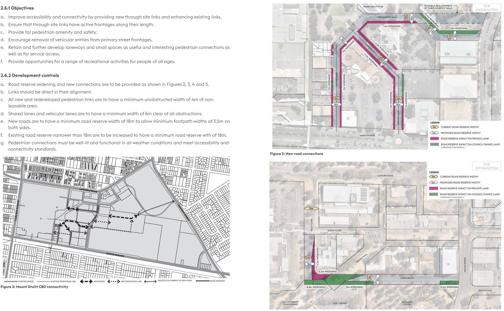
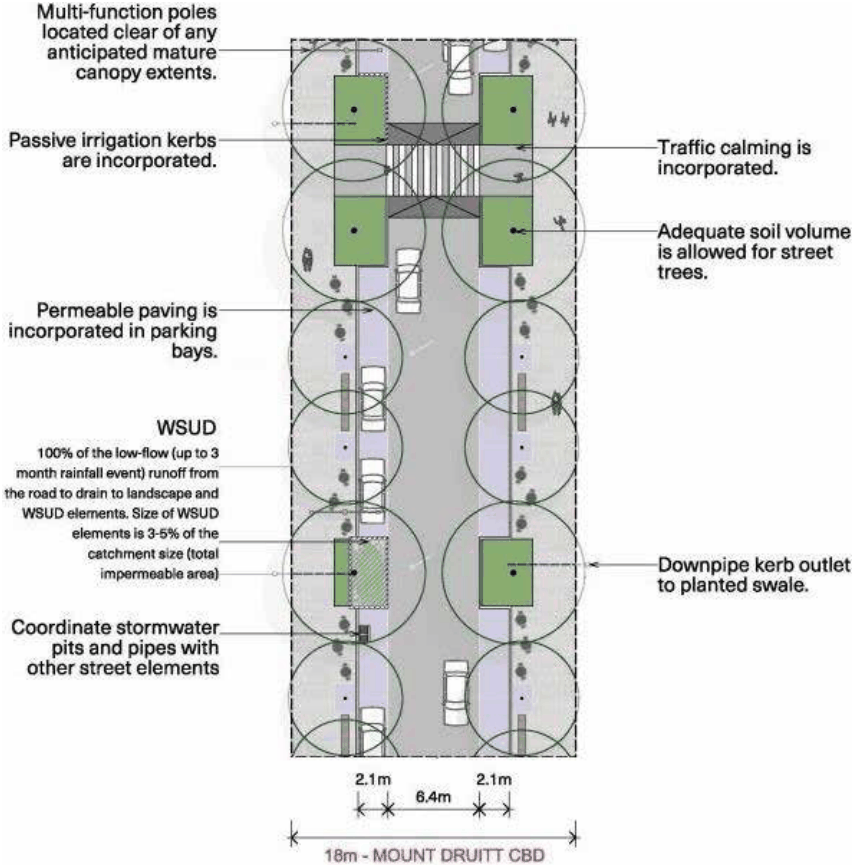
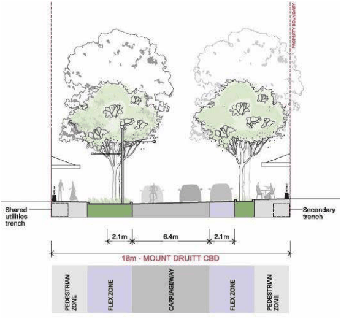
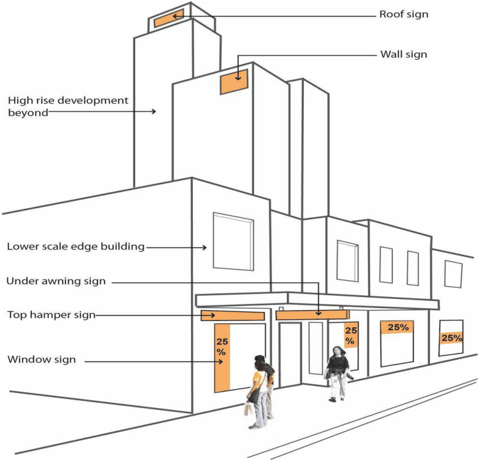

## 2. Development controls

### 2.1 Building setbacks

Street setbacks and building alignments establish the front building line and reinforce the spatial definition of streets. Consistent building lines within streets and blocks provide consistency in the streetscape that interfaces with the public domain. Setbacks enhance pedestrian amenity and activity, and provide opportunity for landscaped areas.

#### 2.1.1 Objectives

a. 	 Achieve a consistent built form alignment along streetscapes.

b. 	 Improve pedestrian amenity and safety.

c. 	 Provide solar access to the public domain.

d. 	 Provide street edges which reinforce, improve or support the character of city streets.

e. 	 Create a clear transition between the public domain and development sites.

f. 	 Provide opportunities for street landscaping

#### 2.1.2 Development control

a. 	 Development is to comply with the controls and minimum requirements outlined in Table 1.

| Controls | Maximum |
|---|---|
| Building setback from street frontage property boundary |  |
| • Kelly Close | 1m setback |
| • Mount Street • Dawson Mall (western side) • Ayres Grove • Ralph Place | 2m setback |
| • Luxford Road • Carlisle Avenue | 3m setback |
| Ground level building setback under colonnades |  |
| • Dawson Mall | 2m setback |

#### Table 1: Minimum building setbacks

### 2.2 Building separation

#### 2.2.1 Objectives

a. 	 Create a rhythm and pattern of development that positively defines the streetscape.

b. 	 Minimise the bulk and scale of the built form with appropriate massing and spaces between buildings.

c. 	 Provide separation between adjoining buildings to ensure an appropriate level of privacy, natural ventilation, outlook and solar access is achieved.

d. 	 Achieve wind mitigation and solar access to private and public open spaces.

e. 	 Minimise overshadowing of the surrounding areas, streets and other buildings.

#### 2.2.2 Development controls

a. 	 Development is to provide the minimum building separation as outlined in Table 2.

b. 	 Minor projections of up to 450mm into the building separation area are permitted for architectural features such as sun-shading devices, bay windows or balconies.

| Total building height | Total building separation (shared between adjoining buildings) for non-residential accommodation in buildings |
|---|---|
| 8m (2 storeys) to 44m (14 storeys) | 6 metres |
| 9 metres | 9 metres |

#### Table 2: Minimum building separation

### 2.3 Podium height and front setback above podium

#### 2.3.1 Objectives

a. 	 Strengthen the urban form of the CBD with consistent street wall heights.

b. 	 Achieve solar access and a scale to the public domain appropriate to its role and use.

c.	 Create a distinctive character to the streets.

d. 	 Create varied and articulated tower forms to provide visual interest and a presentation that contributes positively to the public realm.

#### 2.3.2 Development controls

Podia must be 8 metres (2 storeys) in height.

The front setback above the podium must be a minimum of 3 metres, with an average setback of 4.5m over 50% of the facade width.

c. 	 Minor projections of up to 450mm in depth are permitted into the setback area for architectural features and shading devices.

### 2.4 Building depth, bulk and length

Controlling building depth and bulk allows for good internal amenity, access to natural light and ventilation and mitigates potential adverse effects that tall, bulky buildings have on the public domain.

#### 2.4.1 Objectives

a. 	 Promote the design and development of sustainable buildings and good internal amenity that minimises the need for artificial heating, cooling and lighting.

b. 	 Provide viable and useable commercial floor space.

c. 	 Reduce the apparent bulk and scale of buildings by breaking up expanses of building walls with modulation of form and articulation of facades.

d. 	 Ensure that building footprints are compact and appropriately proportioned.

e. 	 Provide appropriate dimensions for the design of car parking levels.

#### 2.4.2 Development controls

a. 	 Development is to comply with the controls and maximum requirements outlined in Table 3.

| Controls Depth of towers above podiums | Maximum 25m |
|---|---|
| Footprint of towers on podiums |  |
| Residential towers | 1,000 sqm of gross floor area |
| Commercial towers | 1,500 sqm of gross floor area For sites greater than 1,500 sqm, consideration may be given to a larger gross floor area footprint, for commercial towers if it exhibits. |
| Facade length |  |
| Residential towers | 40m |
| Commercial towers | 60m |
| Maximum distance before change in building articulation | 30m |

#### Table 3: Building depth, bulk and length

### 2.5 Floor to floor height

#### 2.5.1 Objectives

a. 	 Maximise the depth of daylight penetration into buildings.

b. 	 Increase the sense of space in apartments and provide well-proportioned rooms.

c. 	 Provide flexibility of uses and adaptive reuse of buildings.

#### 2.5.2 Development controls

a. 	 Development is to comply with the controls and minimum requirements outlined in Table 4.

| Controls | Minimum requirements |
|---|---|
| Ground level floor to floor | 4.2m |
| First floor level floor to floor | 3.8m |
| Residential floor levels floor to floor (above first floor) | 3.1m |

#### Table 4: Floor to floor heights

### 2.6 Connectivity

Through site links provide access connections between the long sides of street blocks for pedestrian and vehicular access at street level. These links provide an important function in the form of lanes, shared zones, arcades and pedestrian ways.

High quality public amenity and generous verge space is crucial to the environment and community uses of streets in the CBD. Streets must be designed as low speed environments to foster life and activity. Pedestrian amenity must be maximised and prioritised. Footpaths must be designed to accommodate high pedestrian traffic alongside other footpath uses such as outdoor seating.

The priorities for existing and new street are:

• 	 footpaths are generous and wide. Continuous footpaths provided when possible

• 	 very slow speed vehicular environment to allow pedestrians and cyclists to safely use the vehicle travel zone

• 	 street components, like kerb extensions, are incorporated mid-block and at intersections

• 	 street tree planting provides a continuous tree canopy at maturity and minimises conflict between mature tree canopy and building awnings

• 	 Water Sensitive Urban Design elements are incorporated to ensure neighbourhood-scale performance outcomes

• 	 on-street parking is effectively integrated into the streetscape

• 	 permeability of parking bays is maximised with street trees and raingardens interspersed.

#### 2.6.1 Objectives

a. 	 Improve accessibility and connectivity by providing new through site links and enhancing existing links.

b. 	 Ensure that through site links have active frontages along their length.

c. 	 Provide for pedestrian amenity and safety.

d. 	 Encourage removal of vehicular entries from primary street frontages.

e. 	 Retain and further develop laneways and small spaces as useful and interesting pedestrian connections as well as for service access.

f. 	 Provide opportunities for a range of recreational activities for people of all ages.

#### 2.6.2 Development controls

a. 	 Road reserve widening and new connections are to be provided as shown in Figures 2, 3, 4 and 5.

b. 	 Links should be direct in their alignment.

c. 	 All new and redeveloped pedestrian links are to have a minimum unobstructed width of 4m of non-leasable area.

d. 	 Shared lanes and vehicular lanes are to have a minimum width of 6m clear of all obstructions.

e. 	 New roads are to have a minimum road reserve width of 18m to allow minimum footpath widths of 3.5m on both sides.

f. 	 Existing road reserve narrower than 18m are to be increased to have a minimum road reserve with of 18m.

g. 	 Pedestrian connections must be well-lit and functional in all weather conditions and meet accessibility and connectivity standards.

> [Picture on page 6: a picture, saved as a picture (images/part-o-mount-druitt-cbd-page-6-20.gif, 150 dpi).]

#### Figure 3: New road connections

#### Figure 2: Mount Druitt CBD connectivity

#### Figure 4: New road connections

### 2.7 Active street frontages

Active street frontages promote an interesting and safe pedestrian environment. The most active street fronts are where there are busy pedestrian areas and non-residential uses such as ground level entrances to shops, offices, studios, cafes and recreation areas.

#### 2.7.1 Objectives

a. 	 Promote pedestrian activity and safety in the public domain.

b. 	 Promote vibrant and active centres.

c. 	 Maximise active street frontages.

#### 2.7.2 Development controls

a. 	 Opportunities for active frontages to parks and public squares are to be maximised.

b. 	 The minimum width of an active street frontage must be in accordance with Table 5.

| Active frontage | Minimum building width |
|---|---|
| Primary street frontage | 50% |
| Secondary street frontage | 40% |

#### Table 5: Width of active street frontage

### 2.8 Facade designs

v. 	 changes in materials

#### 2.8.1 Objectives

vi. 	 varied proportions.

a. 	 Create buildings that respond to their use and

b. 	 A variety of materials and proportions must be

function in the design of their facades.

b. 	 Achieve interesting and articulated facades that

provided to create visual interest and urban cooling.

enhance the visual character of the CBD.

c. 	 Facades must be designed to respond to

c. 	 Reduce the apparent bulk and scale of development.

their orientation, existing alignments and proportions.

d. 	 Achieve high quality, innovative and

d. 	 Blank and inactive walls must be minimised.

contemporary architecture.

e.	 The facade of ground floor commercial premises

e. 	 Integrate sustainable design into the facades of

must be predominantly glass.

buildings.

f. 	 External roller shutters are prohibited on windows at street level.

#### 2.8.2 Development controls

g. 	 Mitigate urban heat through façade materials,

a. 	 Provide articulation to building facades through

composition and orientation.

the use of:

i. changes in alignment (vertical or horizontal)

ii. 	 balconies

iii. 	 insets

iv. 	 projecting elements

> [Picture on page 7: a picture, saved as a picture (images/part-o-mount-druitt-cbd-page-7-48.gif, 150 dpi).]

#### Figure 5: Typical street configuration

> [Picture on page 7: a picture, saved as a picture (images/part-o-mount-druitt-cbd-page-7-50.gif, 150 dpi).]

### 2.9 Awnings

Awnings increase the useability and amenity of public footpaths by protecting pedestrians from sun and rain. They encourage pedestrian activity along streets, and support and enhance the vitality of the local area. Awnings provide a public presence and interface within the public domain and contribute to the identity of a development.

#### 2.9.1 Objectives

a. 	 Increase pedestrian amenity by providing protection from wet weather and sunlight with awnings and colonnades.

b. 	 Create a protected transition area between internal and external spaces for public and commercial buildings.

c. 	 Improve pedestrian amenity by extending the footpath at ground floor level.

d. 	 Provide opportunities for outdoor dining.

#### 2.9.2 Development controls

a. 	 Development must comply with the controls and minimum requirements outlined in Table 6.

b. 	 All building entries must have an awning.

c. 	 Awnings must align with adjoining awnings in height and depth.

d. 	 Awnings must be provided on buildings with active street frontages and to the full extent of the podium.

e. 	 Awnings at the building entries must clearly define the entry through combinations of any or all of the following:

i. change in height

ii. 	 materiality

iii. 	 lighting and expression.

f. 	 Awnings must include lighting to the underside.

g. 	 All downpipes required for the awning must be fully integrated and concealed within the facade of the building.

h. 	 Awnings must not obstruct the growth of street trees.

| Control | Minimum requirements |
|---|---|
| Awning depth | 3.0m (subject to verge width) |
| Awning height | 3.2m |

#### Table 6: Awning requirements

### 2.10 Material and colours

Materials and colours are an integral part of the character of buildings and contribute to the quality of the streetscape when seen from the public domain.

#### 2.10.1 Objectives

a. 	 Enhance the contemporary character through the use of materials and colours.

b. 	 Create visual interest.

c. 	 Provide a high quality architectural outcome.

d. 	 Achieve design excellence.

e.	 Avoid monotony and repetition throughout the CBD.

#### 2.10.2 Development controls

a. 	 Buildings are to avoid high reflectivity glass.

b. 	 The use of materials from sustainable resources and with low embodied energy should be maximised.

c. 	 Materials are to provide visual interest to all facades.

d. 	 A mix of robust high quality materials should be used.

e. 	 Renovations and fit outs must use high quality and durable materials that complement the rest of the streetscape.

f. 	 Minimise the use of painted render finishes to facades.

g. 	 Buildings are to use materials and colours that maximise urban cooling.

### 2.11 Roof form

The design, form and shape of a roof are important elements in the overall expression of a building and in the creation of a city profile and silhouette.

#### 2.11.1 Objectives

a. 	 Achieve an interesting silhouette and recognisable skyline for the CBD.

b. 	 Integrate the building top and plant with the overall architectural concept.

c. 	 Maximise opportunities for the roof to be used for energy generation.

d. 	 Achieve architectural innovation and excellence.

#### 2.11.2 Development controls

a. 	 Buildings on corners require a distinctive architectural roof treatment or expression to help reinforce the intersection.

b. 	 Lift overruns, plant equipment, communication devices, solar collectors and the like are to be screened and integrated into the architectural design of the building and the roof.

c. 	 A special lighting scheme may be prepared to highlight special features of the roof top design.

d. 	 Lower buildings and roofs to podiums must be designed to provide an attractive visual outlook.

### 2.12 Signage

Signage is an important design consideration within the public domain, as visual clutter through signage can degrade the ‘sense of place’.

#### 2.12.1 Objectives

a. 	 Achieve a coordinated retail/commercial signage strategy for the CBD.

b. 	 Minimise visual clutter.

c. 	 Prevent unsightly and inappropriately located signage.

#### 2.12.2 Development controls

a. 	 For all new development and major refurbishments or adaptive reuses, a signage strategy must be provided

b. 	 All proposed signage should be identified as part of the development application.

c. 	 The following signs are prohibited in the CBD:

i. signage painted or directly placed on the building facade above the parapet

ii. 	 protruding signs above the parapet level

iii. 	 edge of awning signs

iv. 	 above awning signage

v. 	 rooftop signage.

d. 	 All signage should be provided in accordance with Figure 4.

e. 	 Development must comply with the controls and requirements outlined in Table 7.

| Controls | Requirements |
|---|---|
| Top hamper sign |  |
| Location | Within the building alignment and above the level of the doorway or window |
| Maximum height | 600mm |
| Maximum advertising area | 5sqm |
| Under awning sign |  |
| Maximum length | 2.5m |
| Maximum height | 0.5m |
| Minimum height above ground | 5sqm |
| Location | Horizontal to the ground and right angles to the building Must not project beyond the awning Must be fixed securely by metal supports |
| Window signs |  |
| Maximum window area coverage | 25% |
| Location | Only on ground floor windows |
| Roof signs |  |
| Display | No advertising material or billboards |
| Wall signs |  |
| Location | Not on blank walls |
| Display | No advertising material or billboards |
| Business and building identification signs |  |
| Maximum number of signs | 1 sign per business |
| Display | Name and occupation of the business |
| Prohibited locations | On or above the roof, canopy or parapet Attached to the under-side of an awning Projecting more than 300mm from the wall of a building above the awning Illuminated signs near residential accommodation |
| Prohibited display |  |
|  | Flashing signs |
|  | Bill/fly posters, bunting and airborne signs, including hot air balloons etc |

#### Table 7: Signage requirements

### 2.13 Safety and security

A safe and secure environment encourages activity, vitality and viability, enabling a greater level of security. Planning and design can identify and address safety and security issues through the use of environmental and technical measures.

#### 2.13.1 Objectives

a. 	 Address safety, security and crime prevention requirements in the planning and design of development.

b. 	 Reduce opportunities for crime through environmental design and the provision of natural and technical surveillance opportunities.

c. 	 Control access through the provisions of physical or implied barriers which can be used to attract, channel or restrict the movement of people.

d. 	 Promote space management by ensuring that public open space is effectively utilised and maintained.

#### 2.13.2 Development controls

a. 	 Building lobbies and entries must:

i. be easily identifiable and highly visible

ii. 	 be well designed and spacious

iii. 	 provide visual surveillance from the lifts to the street

iv. 	 not contain long and narrow corridors from the building entry to the lobby and lifts

v. 	 separate commercial and residential entries for all new tower development.

b. 	 Blind corners and dark alcoves that provide concealment opportunities in pathways, stairwells, hallways and car parks are prohibited.

c. 	 Building entries should be in visually prominent positions which are easily identifiable, and with visible

> [Picture on page 10: a picture, saved as a picture (images/part-o-mount-druitt-cbd-page-10-22.gif, 150 dpi).]

#### Figure 6: Signage principles

numbering.

d. 	 Adequate lighting of all pedestrian access ways, parking areas and building entries is required. Such lighting should be on a timer or movement detector to reduce energy consumption and glare nuisance.

e. 	 Clear lines of sight and well-lit routes throughout the development must be provided.

f. 	 A safety by design assessment conducted in accordance with the NSW Police crime prevention through environmental design principles must be provided for development greater than 5,000 sqm of gross floor area.

### 2.14 Solar access and overshadowing

#### 2.14.1 Objectives

a. 	 Provide a reasonable level of solar access to residential dwellings, private open spaces and the public domain, within and surrounding the development.

b. 	 Protect public open spaces from overshadowing.

#### 2.14.2 Development controls

a. 	 Development must comply with the controls and minimum requirements outlined in Table 8.

b. 	 Development applications must provide shadow diagrams, taken from the view of the sun for every hour between 9am and 3pm on 21 June, to illustrate the degree of solar access and overshadowing generated by the development.

c. 	 Light wells and internal courtyards are not to be used to provide solar access to habitable rooms in residential development.

| Controls | Minimum requirements |
|---|---|
| Public spaces | 65% of public spaces must receive sunlight between 12pm and 2pm on 21 June |

#### Table 8: Solar access and overshadowing

### 2.15 Views and visual privacy

Views contribute to character and amenity, enhancing the sense of place and identity. Views are regarded as significant when they terminate at places of architectural, landscape, or cultural significance. This may include views of major parks or publicly significant objects or heritage buildings.

#### 2.15.1 Objectives

a. 	 Achieve a reasonable level of visual privacy for all dwellings.

b. 	 Maximise the outlook and vistas from habitable rooms and private open space without compromising visual privacy.

c. 	 Achieve reasonable outlooks from commercial uses and ensure commercial uses do not unreasonably compromise the privacy of private dwellings.

d. 	 Maintain and enhance views to significant natural features.

e. 	 Enhance views along CBD streets.

f. 	 Protect silhouettes of the tops of major buildings or structures as seen against the sky.

#### 2.15.2 Development controls

a. 	 Building form must address the street or public space.

b. 	 Balconies with water heaters, air conditioning units, services, drying lines and the like must not to be visible from the public domain.

c. 	 Direct overlooking of habitable rooms and private open spaces is to be minimised by:

i. locating balconies above each other, or recessed into the building facade

ii. 	 providing screens if balconies overlook adjacent habitable rooms or balconies

iii. 	 ensuring that building entry points address the public domain and street frontage

iv. 	 offsetting windows with views into habitable rooms.

### 2.16 Vehicular access points

The design and location of vehicular access to developments should minimise conflicts between pedestrians and vehicles on footpaths, particularly along pedestrian priority places, and visual intrusion and disruption of streetscape continuity.

#### 2.16.1 Objectives

a. 	 Ensure safe and convenient vehicular access.

b. 	 Maximise pedestrian safety through the elimination of pedestrian and vehicular conflicts.

c. 	 Maximise opportunities for active building frontages.

d. 	 Minimise the adverse visual impact of vehicular entry points on streets.

e. 	 Ensure service areas are screened from the public domain.

#### 2.16.2 Development controls

a. 	 Development must comply with the controls and requirements outlined in Table 9.

b. 	 Vehicular access points are to be minimised to reduce the potential for pedestrian and vehicular conflicts.

c. 	 Car park entries visible to the public are to be finished in high quality materials. Wall and sofit colours to access ramps are to match the building exterior material and colour schemes.

d. 	 Clear sight lines are to be provided at pedestrian crossings.

e. 	 Loading docks and waste collection areas must be located within the basement of the development.

f. 	 Lighting, where visible from the street, is to be of a high quality and be integrated into the sofit. No visible fluoro lighting is permitted.

| Controls | Maximum requirements |
|---|---|
| Width of vehicular access | 30% of facade width |
| Width of car park and service entries | 6m |

#### Table 9: Vehicular access

### 2.17 Parking

(To be read in conjunction with Section 5.0 Car Parking of Part A Introduction and General Guidelines) On-site parking includes underground (basement), surface (at-grade) and above ground parking, including parking stations. Underground and semi-underground parking minimises the visual impact of car parks and is an efficient use of the site. Well designed and integrated above ground parking can complement the architectural character of buildings.

#### 2.17.1 Objectives

a. 	 Ensure safe and convenient vehicular access and servicing.

b. 	 Provide car parking in an efficient and cost effective manner.

c. 	 Ensure the manner in which the car parking is provided maintains and improves the amenity, aesthetic quality and liveability of the public domain.

d. 	 Design car parking to be energy efficient, well lit, safe and attractive.

e. 	 Accommodate changing needs and technology in the design of developments.

#### 2.17.2 Development controls

a. 	 Development must comply with the minimum car parking requirements outlined in Table 10.

b. 	 Residential parking areas are to be physically segregated from non-residential parking and servicing areas.

c. 	 Exposed basement, ground floor and above ground floor car parking and open ramps are not permitted.

d. 	 Above ground parking

i. Must not adversely impact on the visual and acoustic amenity of adjoining buildings and the public domain.

ii. 	 Must be screened by retail and commercial tenancies, architectural elements, landscaping and integrated into the design of the building when fronting onto the public domain.

e. 	 Bicycle parking

i. Provision must be made for secure bicycle parking in all public car parks and every building with onsite parking.

ii. 	 Bicycle parking in public car parks must ensure safe, easy and convenient access from the building to public streets.

iii. 	 Adequate and conveniently located change and shower facilities must be provided for cyclists in non-residential development that provides employment for 20 or more people.

f. 	 Electric vehicle charging points

i. Appropriate electrical infrastructure and capacity needs to be installed in car parking spaces to allow at least 20% of lot owners to charge an electric vehicle at any one time in their own car space.

ii. 	 All electric charging points are to be suitably located and sign posted to provide for convenient access.

iii. 	 A dedicated space and charging point for electric bicycles and mobility scooters to be charged must be provided.

| Controls | Minimum requirements |
|---|---|
| For land uses not listed below, refer to the car parking rates contained in Section 5.0 Car Parking of Part A Introduction and General Guidelines. |  |
| Office Premises | 1 space per 100sq.m of GFA |
| Retail or Business Premises | 1 space per 30sq.m of GFA |
| Electric vehicle charging points: |  |
| Public and visitor parking | 1 charging point for every 10 car parking spaces and provision for wiring a charging point in at least 20% of parking spaces |

#### Table 10: Car parking rates

### 2.18 Landscaping

Deep soil zones are areas of natural ground retained within a development, uninhibited by artificial structures and with relatively natural soil profiles. Deep soil zones have important environmental benefits, including promoting healthy growth of large trees with large canopies, protecting existing mature trees, and allowing stormwater infiltration.

#### 2.18.1 Objectives

a. 	 Ensure landscaping is integrated into the design of development and the public domain.

b. 	 Encourage well designed landscaping that ameliorates the effects of urban heat, assists in reducing energy use, improves stormwater management and enhances environmental biodiversity.

c. 	 Encourage the establishment and healthy growth of landscaping in urban areas.

#### 2.18.2 Development controls

a. 	 Commercial and retail developments are to incorporate planting in accessible outdoor spaces such as courtyards, forecourts, terraces and roofs.

b. 	 A landscape concept plan must be provided for all landscaped areas. The plan must outline how landscaped areas are to be maintained for the life of the development.

c. 	 Basement car parks should be contained predominantly within building footprints to allow for deep soil beneath forecourts and courtyards for canopy tree planting.

d. 	 For sites greater than 2,000sqm, a minimum of 10% of the site must incorporate deep soil area sufficient in size and dimensions to accommodate trees and significant planting.

e. 	 The design of rooftop communal open spaces must consider the amenity, useability and functionality of the space through the use of appropriate tree species, with adequate soil volume, shade elements, materials and finishes.

#### Community Development Unit, Blacktown City Council

62 Flushcombe Road, Blacktown, NSW 2148

02 9839 6000

contactus@blacktown.nsw.gov.au blacktown.nsw.gov.au
