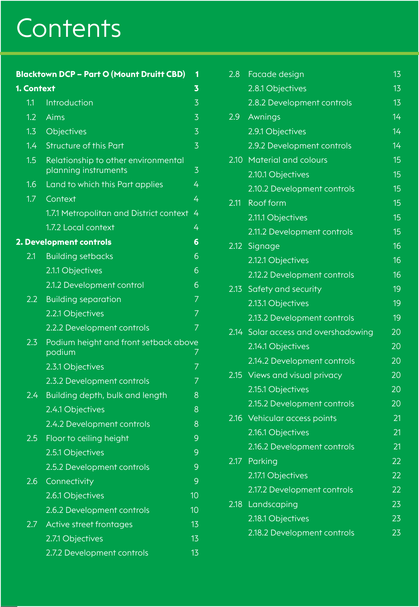

# Blacktown Development Control Plan 2015 - Part O Mount Druitt CBD

> This chapter is split into 3 section file(s), one per numbered heading, in the order they appear in the PDF.

Source PDF: [Part-O-Mount-Druitt-CBD.pdf](Part-O-Mount-Druitt-CBD.pdf)

### BLACKTOWN DCP – PART O

### Mount Druitt

### CBD

> [Picture on page 2: a map, saved as a picture (images/part-o-mount-druitt-cbd-page-2-1.gif, 150 dpi); the street names and other small labels are on the picture.]
> Labels printed on the map (copied from the PDF, in no particular order):
> 3 · 1.1 Introduction · 3 · 1.2 Aims · 3 · 1.3 Objectives · 3 · 1.4 Structure of this Part · 3 · 1.5 Relationship to other environmental · planning instruments · 3 · 1.6 Land to which this Part applies 4 · 1.7 Context · 4 · 1.7.1 Metropolitan and District context	 4 · 1.7.2 Local context · 4 · 6 · 2.1 	 Building setbacks · 6 · 2.1.1 Objectives · 6 · 2.1.2 Development control · 6 · 2.2	 Building separation · 7 · 2.2.1 Objectives · 7 · 2.2.2 Development controls · 7 · 2.3	 Podium height and front setback above · podium · 7 · 2.3.1 Objectives · 7 · 2.3.2 Development controls · 7 · 2.4	 Building depth, bulk and length 8 · 2.4.1 Objectives · 8 · 2.4.2 Development controls · 8 · 2.5 	 Floor to ceiling height · 9 · 2.5.1 Objectives · 9 · 2.5.2 Development controls · 9 · 2.6 	 Connectivity · 9 · 2.6.1 Objectives · 10 · 2.6.2 Development controls · 10 · 2.7	 Active street frontages · 13 · 2.7.1 Objectives · 13 · 2.7.2 Development controls · 13 · 2.8	 Facade design · 13 · 2.8.1 Objectives · 13 · 2.8.2 Development controls · 13 · 2.9	 Awnings · 14 · 2.9.1 Objectives · 14 · 2.9.2 Development controls · 14 · 2.10	 Material and colours · 15 · 2.10.1 Objectives · 15 · 2.10.2 Development controls · 15 · 2.11	 Roof form · 15 · 2.11.1 Objectives · 15 · 2.11.2 Development controls · 15 · 2.12 	 Signage · 16 · 2.12.1 Objectives · 16 · 2.12.2 Development controls · 16 · 2.13 	 Safety and security · 19 · 2.13.1 Objectives · 19 · 2.13.2 Development controls · 19 · 2.14	 Solar access and overshadowing 20 · 2.14.1 Objectives · 20 · 2.14.2 Development controls 20 · 2.15 	 Views and visual privacy · 20 · 2.15.1 Objectives · 20 · 2.15.2 Development controls 20 · 2.16 	 Vehicular access points · 21 · 2.16.1 Objectives · 21 · 2.16.2 Development controls 21 · 2.17 	 Parking · 22 · 2.17.1 Objectives · 22 · 2.17.2 Development controls 22 · 2.18 	 Landscaping · 23 · 2.18.1 Objectives · 23 · 2.18.2 Development controls 23

### Contents

#### Blacktown DCP – Part O (Mount Druitt CBD) 	 1

<!-- sections -->
## Sections

1. [1 Context](01-1-context.md)
2. [1 Context (cont.)](02-1-context-cont.md)
3. [2 Development controls](03-2-development-controls.md)
