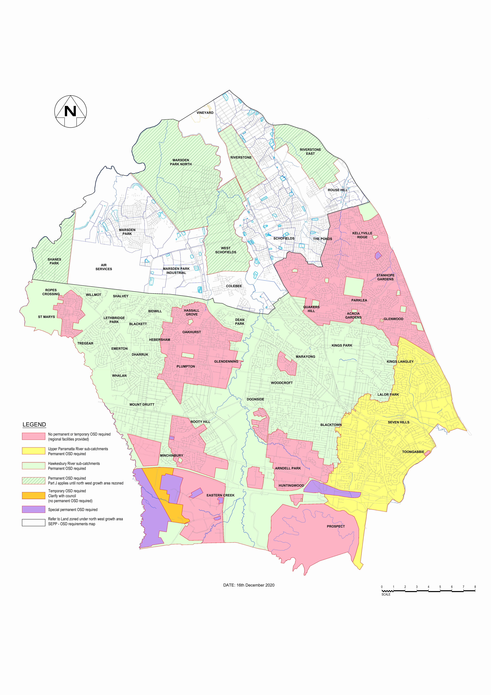

# Blacktown Development Control Plan 2015 - Figure 1 Catchment areas subject to OSD

Source PDF: [Figure 1 Catchment areas subject to OSD.pdf](Figure%201%20Catchment%20areas%20subject%20to%20OSD.pdf)

> [Picture of page 1: Figure 1 Catchment areas subject to OSD - a detailed map drawn with 29,316 lines, saved as a picture (images/figure-1-catchment-areas-subject-to-osd-page-1.gif, 150 dpi); the street names and other labels are on the picture.]

> Words printed on the picture (title and legend, copied from the PDF):
> LEGEND
