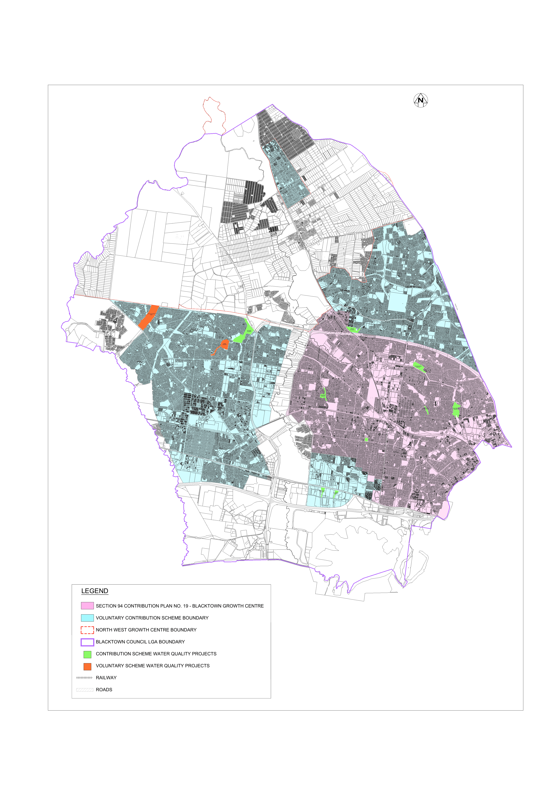

# Blacktown Development Control Plan 2015 - Figure 2 Water Quality Offset Scheme Boundary

Source PDF: [Figure 2 Water Quality Offset Scheme Boundary.pdf](Figure%202%20Water%20Quality%20Offset%20Scheme%20Boundary.pdf)

> [Picture of page 1: Figure 2 Water Quality Offset Scheme Boundary - a detailed map drawn with 164,060 lines, saved as a picture (images/figure-2-water-quality-offset-scheme-boundary-page-1.gif, 150 dpi); the street names and other labels are on the picture.]

> Words printed on the picture (title and legend, copied from the PDF):
> LEGEND
> SECTION 94 CONTRIBUTION PLAN NO. 19 - BLACKTOWN GROWTH CENTRE
> VOLUNTARY CONTRIBUTION SCHEME BOUNDARY
> NORTH WEST GROWTH CENTRE BOUNDARY
> BLACKTOWN COUNCIL LGA BOUNDARY
> CONTRIBUTION SCHEME WATER QUALITY PROJECTS
> VOLUNTARY SCHEME WATER QUALITY PROJECTS
> RAILWAY
> ROADS
