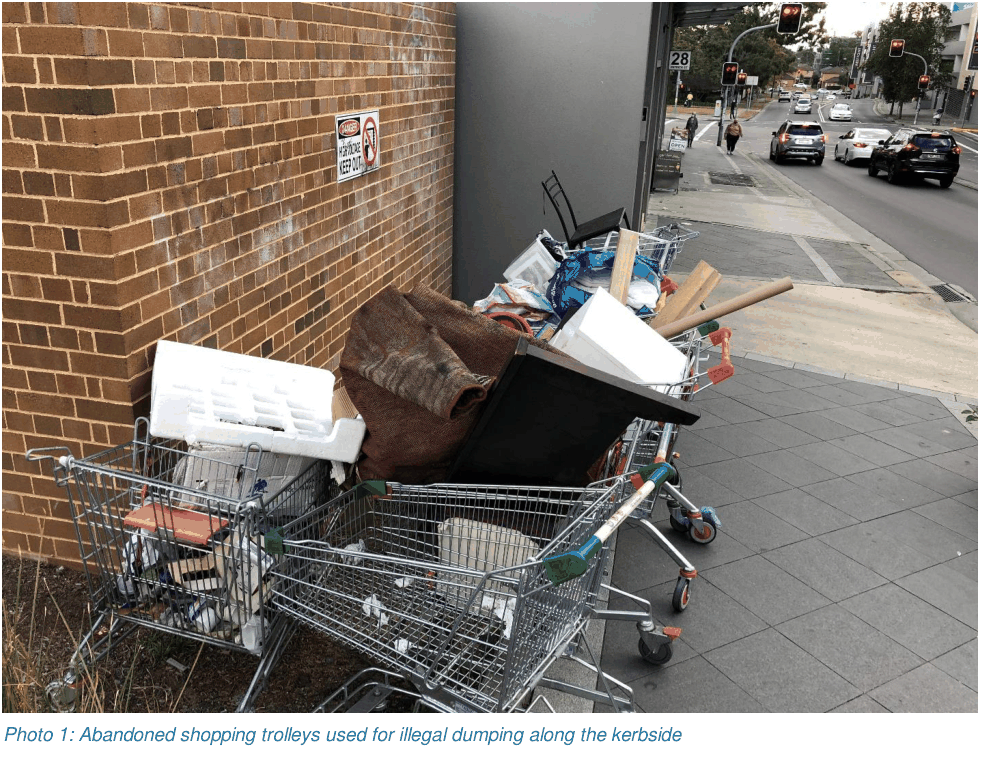
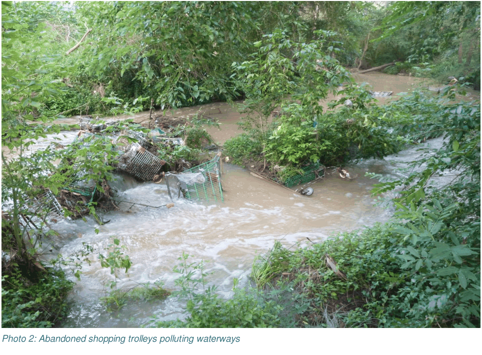

## 2. Waste management plan

A waste management plan must accompany all development applications. The waste management plan is an important planning document that will be used throughout the development application process including the demolition and construction stages, and during occupation. It is vital that applicants and their stakeholders are aware of the requirements outlined in that document for their site.

Applications must include scaled site and floor plans that clearly identify compliance with the specific requirements as identified in the matrix at Appendix 1. Additional information to assist you in completing your waste management plan can be found in Appendix 2.

### 2.1 Preparing a waste management plan

A waste management plan must be prepared by an experienced waste consultant with a minimum 5 years industry experience if the development:

• is 3 storeys or more with a lift, and/or exceeds 20 units/dwellings

• includes commercial, retail and/or industrial uses with floor areas of 2,500 square metres or more.

### 2.2 What must it include?

The details required in a waste management plan will vary across the different stages of development.

#### 2.2.1 Demolition and construction

The waste management plan must include the:

• measures to minimise waste and maximise reuse and recycling

• amount and type of waste and recyclables to be generated

• proposed storage and treatment of waste and recyclables

• proposed purchasing policies that will assist with sustainable development

• opportunities to close the loop and support a circular economy

#### 2.2.2 Occupancy

The waste management plan must include the:

• type of development

• number of units, dwellings or tenancies

• waste and recycling generation rates for the proposed use(s)

• number of bins required for the development

• bin capacities

• collection frequencies

• proposed method of bin movement around the site

• method to rotate recycling bins on each residential floor where chutes are proposed

• proposed service provider

• location of waste collection point(s)

• location of the loading bay for the site (if required)

• proposed physical treatment of the loading bay to maintain truck turning areas (eg, removable, lockable bollards)

• provision of bulky waste storage area(s), their size and location

• information on the bin tug and trolley equipment for the site (if required)

• specification sheets for all waste management equipment proposed for the site

• cleaning and maintenance schedules for all required waste equipment

• method of communication about the waste system to residents and/or tenancies

• building manager’s responsibility to coordinate the waste arrangement for the site if communal bins are required. This includes but is not limited to ensuring clear access onsite for collection vehicles, granting access to loading bays, maintaining waste related signage, moving bins for collection, managing illegal dumping, and cleaning bins and waste facilities onsite

• waste management responsibilities if the development will be strata titled. The expectations and responsibilities of residents and/or tenants in the development must also be outlined in the Community Management Statement, Total Maintenance Plan and/or Strata By-Laws (whichever applies to the site)

• proposed management of shopping trolleys for commercial and mixed use developments in accordance with Council’s Abandoned Shopping Trolley Policy P000497.1

• compliance measures with NSW Government regulations for activities generating hazardous, intractable or clinical waste.

### 2.3 Generation rates

The number of bins for your development will be dictated by the generation rates listed below.

#### 2.3.1 Residential a) individual bins

• allow for provision of the following bins: o 240 litres/week/dwelling for waste o 240 litres/week/dwelling for recycling

b) boarding houses where kerbside collection is permitted

• ‘new generation’ style with individual kitchens: o 110 litres/week/unit for waste (to be collected in 240 litre bins) o 90 litres/week/unit for recycling (to be collected in 240 litre bins)

• ‘traditional’ style with communal kitchen: o 35 litres/100 square metres floor area/day for waste (to be collected in 240 litre bins) o 15 litres/100 square metres floor area/day for recycling (to be collected in 240 litre bins)

c) boarding houses where onsite collection is required

• ‘new generation’ style with own kitchens and bathrooms: o 110 litres/week/unit for waste (to be collected in 1100 litre bins) o 90 litres/week/unit for recycling (to be collected in 240 litre bins)

• ‘traditional’ style with communal kitchen: o 35 litres/100 square metres floor area/day for waste (to be collected in 1100 litre bins) o 15 litres/100 square metres floor area/day for recycling (to be collected in 240 litre bins)

d) communal residential bins (other than boarding houses)

• allow for the following waste and recycling generation rates: o 240 litres/week/unit for waste o 80 litres/week/unit for recycling

#### 2.3.2 Commercial and retail

The waste and recycling generation rates for various retail and commercial operations, as outlined in the EPA Better Practice Guide for Resource Recovery in Residential Developments 2019.

If the retail or commercial tenancies are not known at the development application stage, the rates for the largest waste and recycling generator permitted in the zoning of the proposed development, must be applied.

#### 2.3.3 Industrial

The number of bins for your development will be dictated by the generation rates listed below. If the proposed use is not listed, your waste management plan must provide a case study to determine a suitable waste generation rate.

a) factories o 40 litres per 100 square metres per day for waste o 20 litres per 100 square metres per day for recycling

b) showrooms o 40 litres per 100 square metres per day for waste o 10 litres per 100 square metres per day for recycling

c) warehouses o 30 litres per 100 square metres per day for waste o 30 litres per 100 square metres per day for recycling

### 2.4 Collection frequencies

Collection frequencies vary between service providers and development types and sizes as outlined below.

#### 2.4.1 Residential developments (individual 240 litre bins)

• waste collected once a week

• recycling collected fortnightly

#### 2.4.2 Residential developments (communal bins)

• waste collected up to 3 times a week

• recycling collected weekly

#### 2.4.3 Retail, commercial and industrial developments

• waste collected up to 5 times a week

• recycling collected up to 5 times a week

Waste rooms in retail, commercial and/or industrial developments proposing collections 5 days a week for waste and recyclables, must be designed to accommodate 3 days’ worth of waste and recyclables to allow for public holidays and long weekends.

### 2.5 Compaction rates

Compaction of waste will assist larger developments in reducing the required number of bins. Compaction is not permitted for recycling. Compaction rates vary between residential, retail, commercial and industrial developments as outlined below.

#### 2.5.1 Residential (communal bins)

• 1:2 is the maximum compaction rate permitted for waste only

#### 2.5.2 Retail, commercial and industrial

• 1:5 is the maximum compaction rate permitted for waste only

### 2.6 Waste equipment

Any waste management equipment proposed for the site, including chutes, bin tugs, compactors, bin lifters etc., must be selected in consultation with a reputable waste equipment provider.

### 2.7 Waste systems and technologies

Where appropriate and suitably demonstrated, Council may consider alternative waste systems, processes and technologies. This may include composting, digesters, bin lifts, dedicated problem waste collection points and more. At a minimum, suitability must demonstrate that the proposal

benefits the residents and supports best practice for caretakers and operational staff. This would ensure that the proposed alternative is more practical and effective for onsite waste management.

### 2.8 Waste management platforms and tools

To support waste avoidance, diversion and recovery, commercial developments are encouraged to use recognised and accredited waste management tools. Organisations such as National Australian Built Environment Rating System (NABERS) provide online tools to record and monitor waste. This is to ensure various waste streams are accounted for and can be sustainably managed.

Suitable space for bin separation and bin weighing station(s) must be considered in the early design stage to ensure multiple waste streams generated onsite are recovered for reuse, recycling or disposal. In addition to waste and co-mingled recycling, streams may include but are not limited to, food organics, soft plastics, pallets, electronic waste, bulk cardboard, textiles, clinical waste etc.

### 2.9 Council’s Abandoned Shopping Trolley Policy

Any development which requires and/or proposes shopping trolleys, including supermarkets and shopping centers, must comply with Council’s Abandoned Shopping Trolley Policy (P000497.1). The Policy outlines the requirement for an onsite containment system to ensure trolleys are not littered and illegally dumped (see Photo 1 and 2). It is preferred that trolleys are fitted with a wheel lock system to prevent them being moved off the premises. The policy supports improved street character and community pride. Without a containment system, trolleys:

• become littered along roads and obstruct paths

• attract illegal dumping and anti-social behaviour

• increase risk of injury and damage to property

• pollute bushland and waterways.

> [Picture on page 16: a picture, saved as a picture (images/guideline-for-waste-management-in-new-developments-page-16-1.gif, 150 dpi).]
> Words printed on the picture (copied from the PDF):
> Photo 1: Abandoned shopping trolleys used for illegal dumping along the kerbside

> [Picture on page 17: a picture, saved as a picture (images/guideline-for-waste-management-in-new-developments-page-17-1.gif, 150 dpi).]
> Words printed on the picture (copied from the PDF):
> Photo 2: Abandoned shopping trolleys polluting waterways
