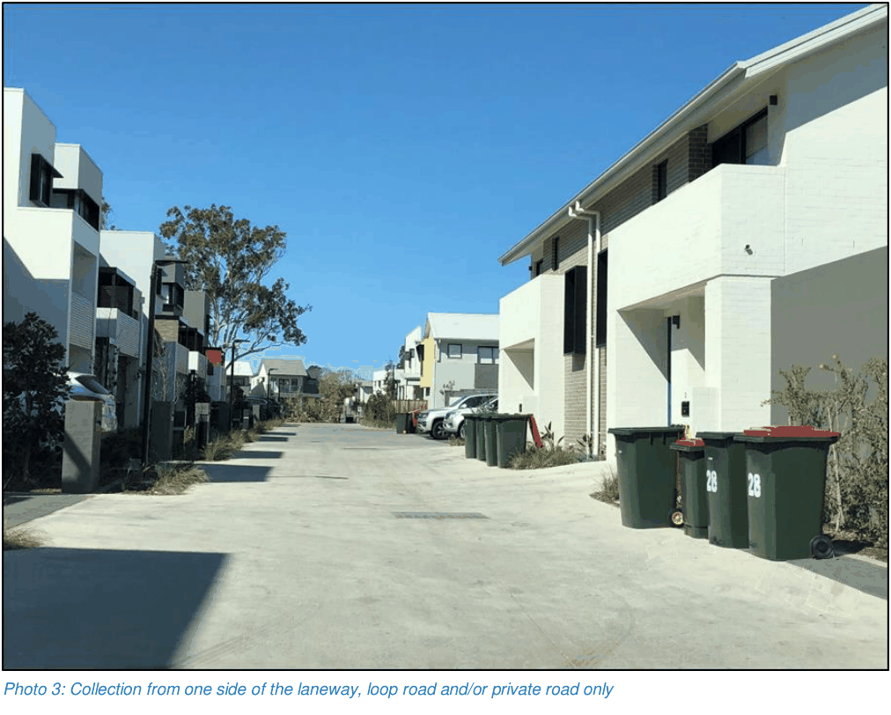
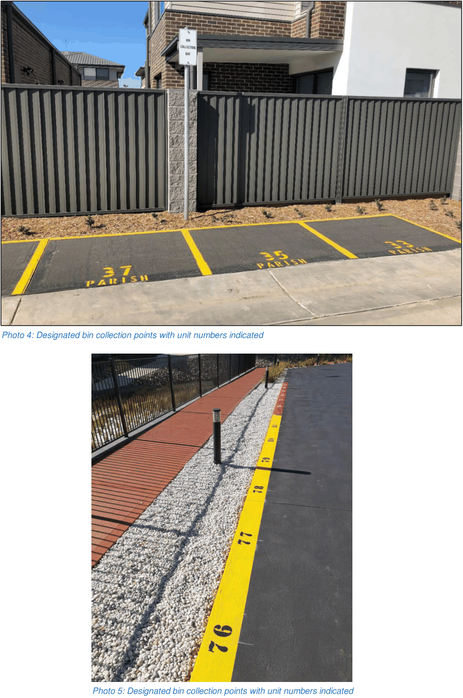
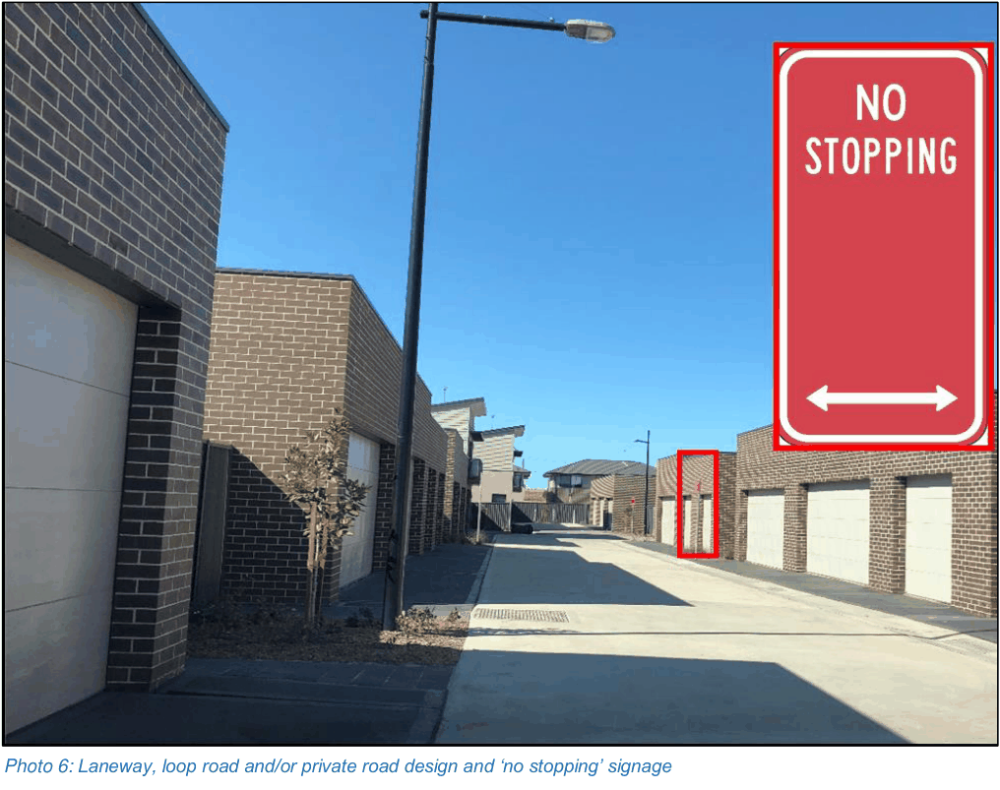

## 3. Subdivision and engineering works

This section applies to waste collection requirements for the design of new subdivisions and roads.

### 3.1 Laneways, internal loop roads and/or private roads

In addition to the controls listed in Part G Waste management and minimisation in the Blacktown DCP 2015, where developments include laneways, internal loop roads and/or private roads with waste collection, the development must demonstrate:

• bin collection from on one side of the laneway, loop road or private road only (see Photo 3)

• bin collection from identified bin collection point(s) only (see Photo 4 and 5)

• design of laneways, loop roads and/or private roads has a minimum 6 metre carriageway, a 1 metre verge on either side and garages setback a minimum 0.5 metres on each side with ‘no stopping’ signage along its entire length (see Photo 6)

> [Picture on page 18: a picture, saved as a picture (images/guideline-for-waste-management-in-new-developments-page-18-12.gif, 150 dpi).]
> Words printed on the picture (copied from the PDF):
> Photo 3: Collection from one side of the laneway, loop road and/or private road only

> [Picture on page 19: a picture, saved as a picture (images/guideline-for-waste-management-in-new-developments-page-19-1.gif, 150 dpi).]
> Words printed on the picture (copied from the PDF):
> Photo 4: Designated bin collection points with unit numbers indicated

> Words printed on the picture (copied from the PDF):
> Photo 5: Designated bin collection points with unit numbers indicated

> [Picture on page 20: a picture, saved as a picture (images/guideline-for-waste-management-in-new-developments-page-20-1.gif, 150 dpi).]
> Words printed on the picture (copied from the PDF):
> Photo 6: Laneway, loop road and/or private road design and ‘no stopping’ signage
