## 5. Daily bin storage

Refer to the matrix at Appendix 1 for the relevant development controls that apply to your development typology. This section provides information to ensure that the waste system and design are appropriate.

### 5.1 Individual bins

Daily bin storage areas for individual dwellings must:

• be located behind the front building line of the dwelling

• allow residents to easily carry bagged waste to the bin from their dwelling

• allow bins to be moved safely for collection, but not through interior living areas

• not impact the amenity of neighbouring and adjoining dwellings

• not be visible from other dwellings

• ensure that if the bin exit point in a property backs onto visitor car spaces, a minimum 1 metre of additional car park hardstand area (on the side where bins are to be moved), must be provided to allow safe exit and movement of bins on collection day.

Figure 1 shows a suitable daily bin storage area for single dwellings. The daily bin storage area is screened and located behind the building line and external to the garage. There is sufficient kerbside frontage for bin placement and servicing. The bin travel path is sealed and complies with maximum bin travel distances.

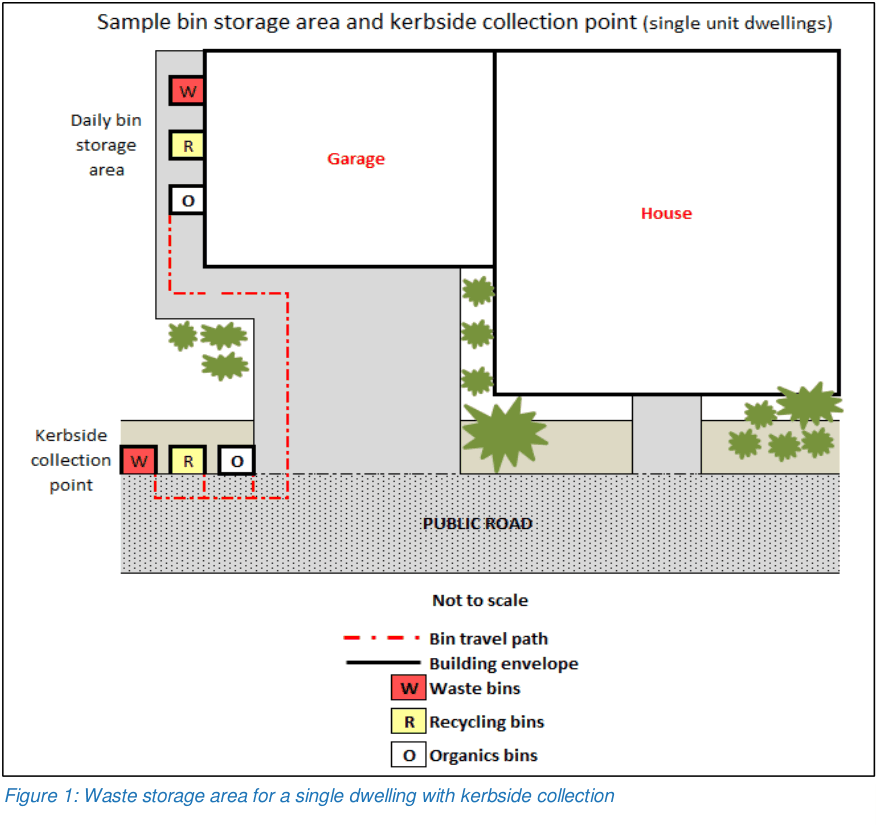

> [Picture on page 23: a picture, saved as a picture (images/guideline-for-waste-management-in-new-developments-page-23-19.gif, 150 dpi).]

Figure 1: Waste storage area for a single dwelling with kerbside collection

Figure 2 shows a sample multi-dwelling housing development with 7 units where kerbside collection is permitted. Bins are stored in each lot external to the garages.

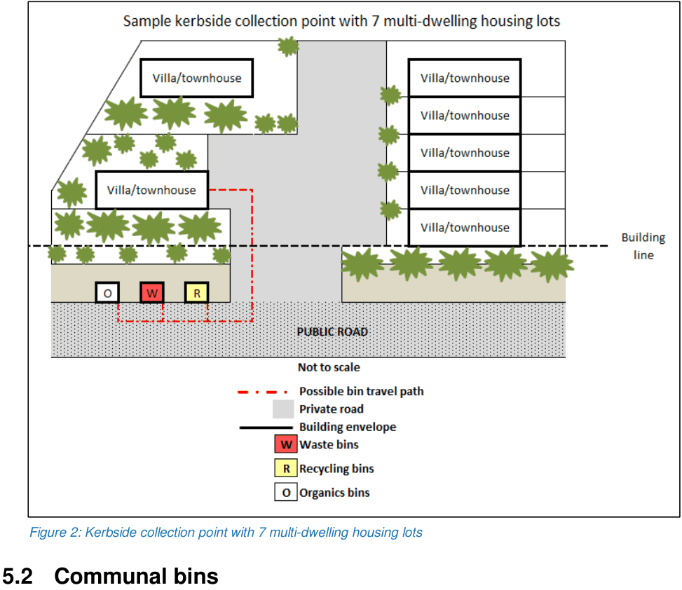

> [Picture on page 24: a picture, saved as a picture (images/guideline-for-waste-management-in-new-developments-page-24-3.gif, 150 dpi).]

Figure 2: Kerbside collection point with 7 multi-dwelling housing lots

### 5.2 Communal bins

Communal waste rooms are required for any development with shared bins. This may include some multi-dwelling housing and senior living developments. For mixed use developments, the commercial and residential waste rooms must be separated. Table 3 provides additional information on design considerations.

Clear signage must be installed in any communal waste room to indicate appropriate use of the bins and the waste room. This signage must be maintained in perpetuity by the strata management company, Body Corporate or other relevant management body.

#### 5.2.1 Communal waste room design

Photo 7 shows a waste room with adequate space for rotation and storage of bins. There is also storage space for several other waste streams generated onsite.

Communal waste rooms must be: o big enough to accommodate all required waste and recycling bins for the site o adequate in size to store any required waste equipment in addition to all the bins o completely separated for the residential component of mixed use developments o large enough to allow bins to be placed in single file with circulation space in between as bins must not be stacked

o regularly maintained for cleanliness of bins and surfaces o screened from view (if at ground level) by a visual barrier of at least 1.5 metres high or to match the fence of the surrounding properties

o screened to avoid line of sight views from living room windows and balconies within the development.

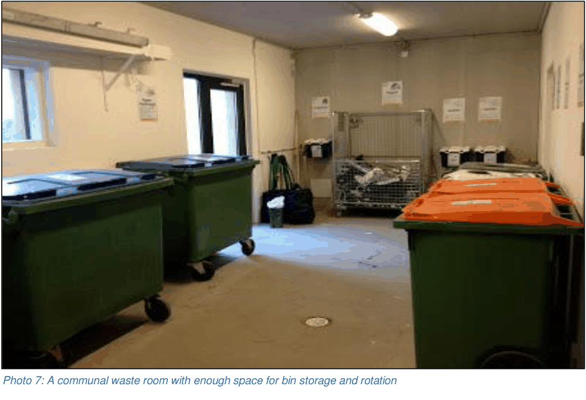

> [Picture on page 25: a picture, saved as a picture (images/guideline-for-waste-management-in-new-developments-page-25-6.gif, 150 dpi).]
> Words printed on the picture (copied from the PDF):
> Photo 7: A communal waste room with enough space for bin storage and rotation

Figure 3 shows a sample waste room layout for a multi-dwelling housing development where communal bins are required and/or proposed. A 1.5 metre wide doorway is shown as it assists with movement of bins. Different waste streams are clearly separated to promote recycling. The drain is connected to the sewer.

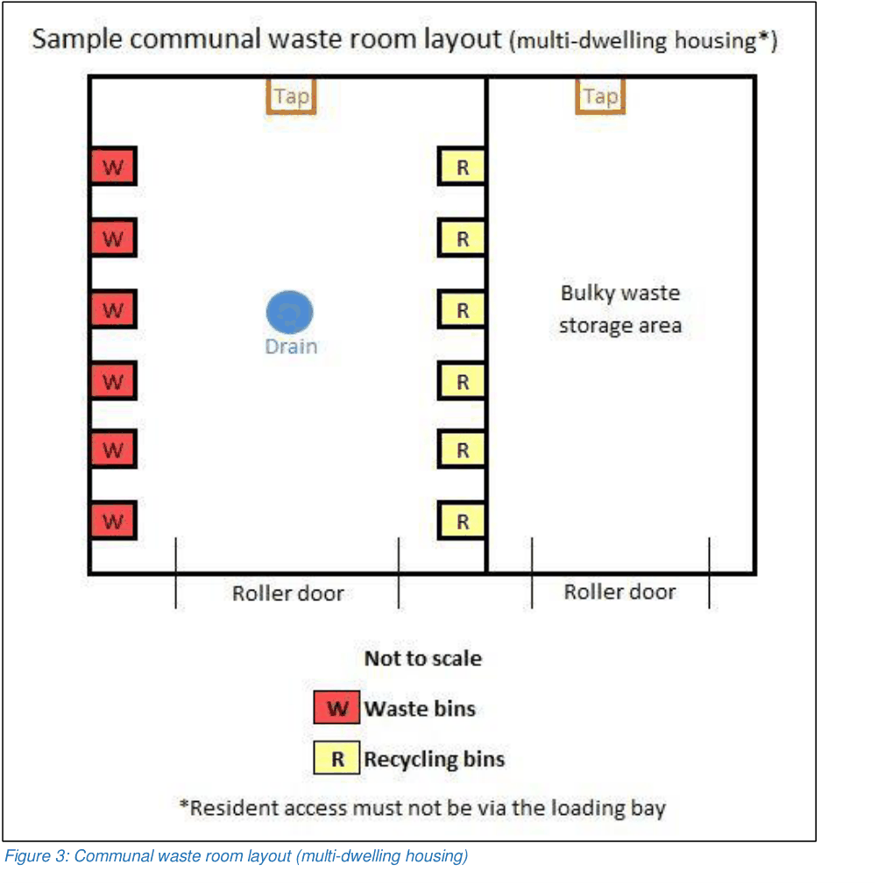

> [Picture on page 26: a picture, saved as a picture (images/guideline-for-waste-management-in-new-developments-page-26-5.gif, 150 dpi).]

Figure 3: Communal waste room layout (multi-dwelling housing)

Figure 4 shows a sample communal waste room layout for a residential flat building or residential developments with shared bins. Bulky waste storage has been provided adjacent to the communal waste room and 1.5 metre wide doorways have been installed to assist with movement of bins and bulky waste. Waste streams are separated to promote recycling. The drain is connected to the sewer.

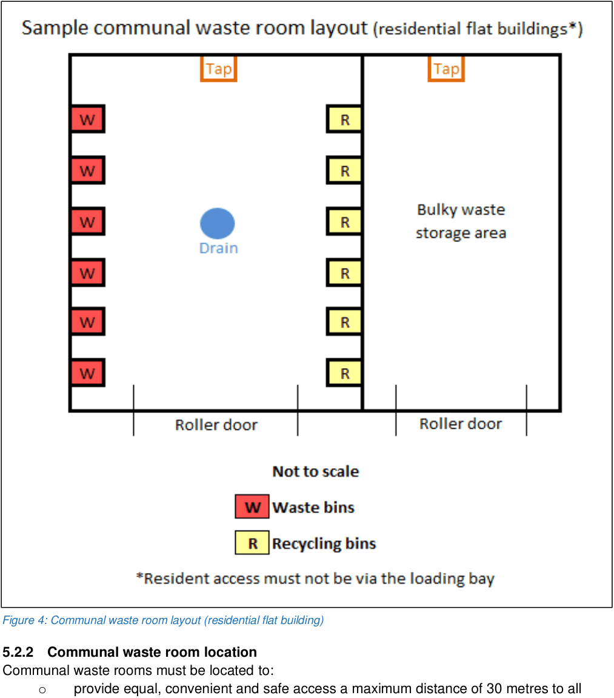

> [Picture on page 27: a picture, saved as a picture (images/guideline-for-waste-management-in-new-developments-page-27-6.gif, 150 dpi).]

Figure 4: Communal waste room layout (residential flat building)

#### 5.2.2 Communal waste room location

Communal waste rooms must be located to: o provide equal, convenient and safe access a maximum distance of 30 metres to all residents and any retail, commercial and/or industrial tenants. If this distance is exceeded, interim waste rooms will be needed where the bins are temporarily stored prior to being moved to the main waste room(s) for collection. These bins will need to be rotated by a caretaker or building manager as required.

o ensure efficient movement of bins to the collection point o not impact the amenity of neighbouring and adjoining residential lots

o be away from habitable rooms of lots within or adjoining the site o reduce noise nuisance from waste equipment, bin movement and/or bin collection o eliminate potential nuisance from odour o be ventilated, suitably lit and secure o reduce the potential for vandalism and/or illegal dumping.

Figure 5 shows a sample communal waste room for a multi-dwelling housing development with 8 lots and shared bins. The location of the communal waste storage room is behind the building line and designed to complement the rest of the development. The figure indicates an onsite collection point for the development.

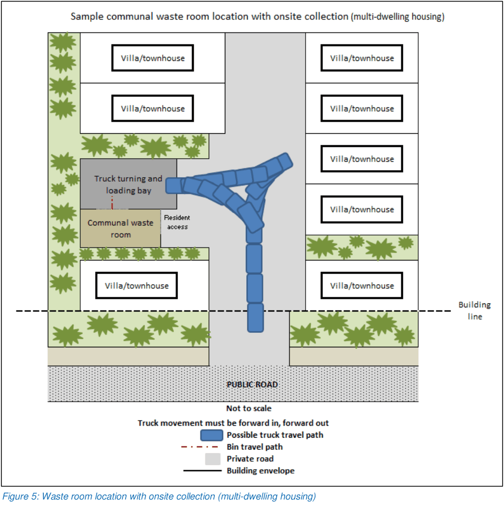

> [Picture on page 28: a picture, saved as a picture (images/guideline-for-waste-management-in-new-developments-page-28-10.gif, 150 dpi).]

Figure 5: Waste room location with onsite collection (multi-dwelling housing)

Figure 6 shows a sample communal waste room location with onsite collection at ground level for a residential flat building or residential developments with shared bins on a site under 1500 square metres. Collection is to the rear of the site and behind the building line. A 3 metre clearance to the rear of the truck is provided for bin servicing and rotation.

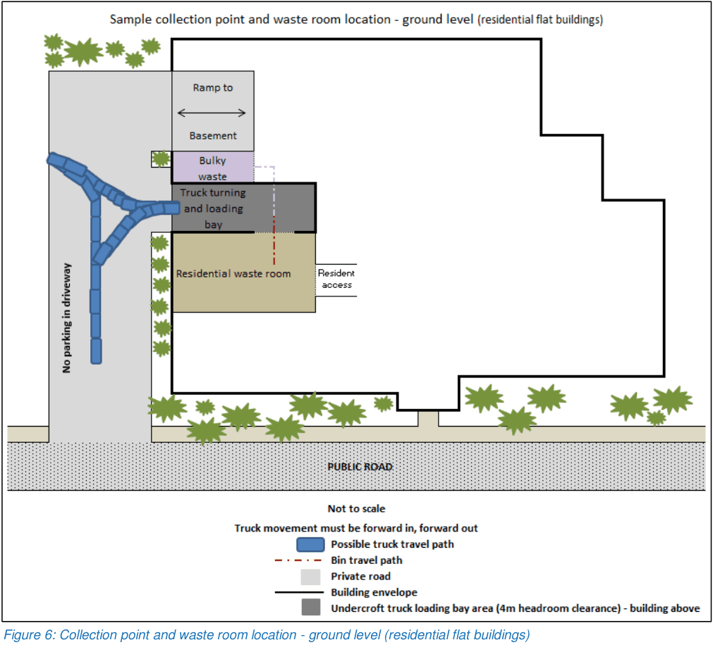

> [Picture on page 29: a picture, saved as a picture (images/guideline-for-waste-management-in-new-developments-page-29-5.gif, 150 dpi).]

Figure 6: Collection point and waste room location - ground level (residential flat buildings)

Figure 7 shows a sample communal waste room location with onsite collection from the basement for a residential flat building or residential developments with shared bins on a site measuring 1500 square metres or more. Development applications must demonstrate the route of travel for the collection vehicle and required manoeuvring.

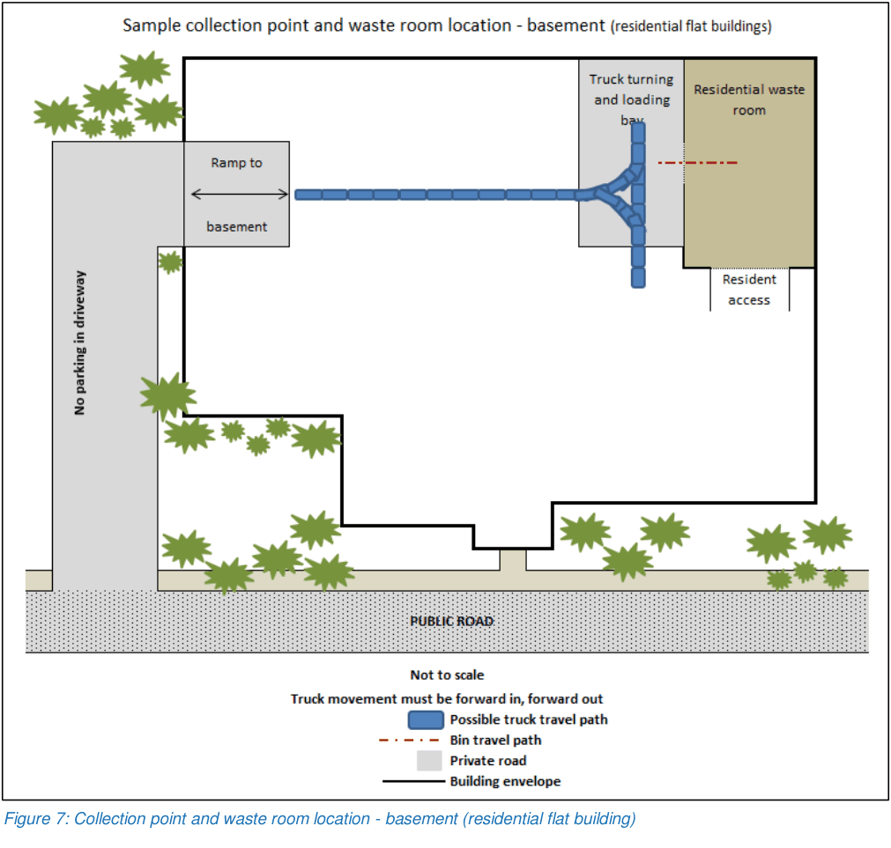

> [Picture on page 30: a picture, saved as a picture (images/guideline-for-waste-management-in-new-developments-page-30-5.gif, 150 dpi).]

Figure 7: Collection point and waste room location - basement (residential flat building)

Figure 8 shows a sample residential flat building or development where multiple communal waste rooms have been provided. It shows basement collection with the communal waste rooms coming straight off a designated loading bay.

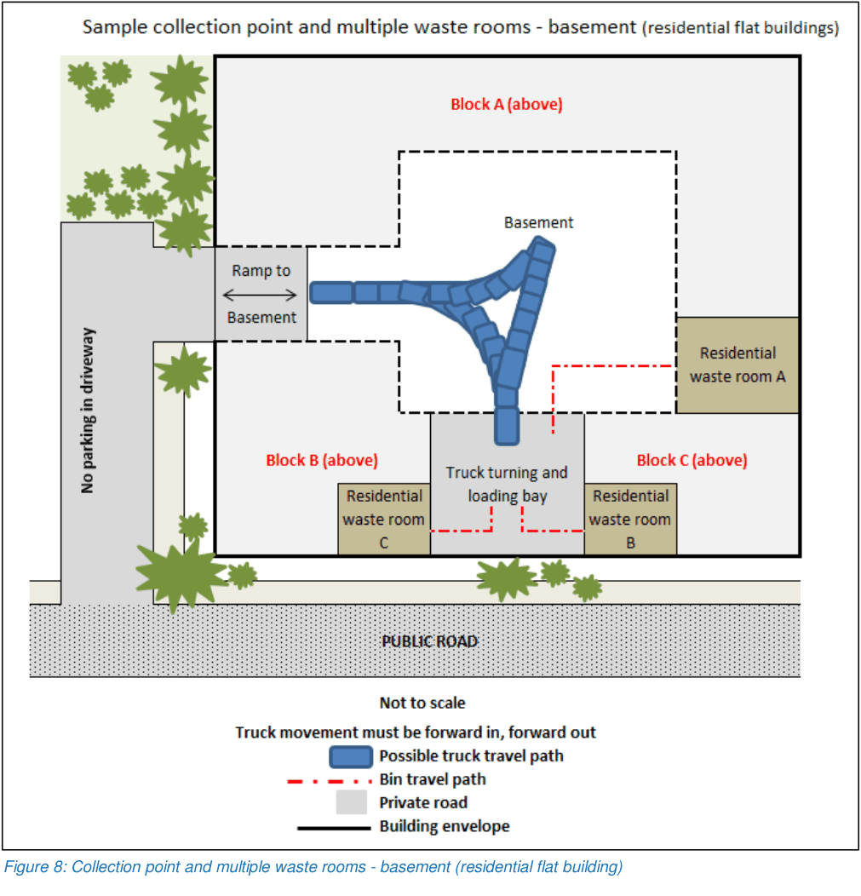

> [Picture on page 31: a picture, saved as a picture (images/guideline-for-waste-management-in-new-developments-page-31-4.gif, 150 dpi).]

Figure 8: Collection point and multiple waste rooms - basement (residential flat building)

Figure 9 shows a possible collection point at ground level for a smaller mixed use development on a site measuring under 1500 square metres. The residential and commercial/retail waste rooms are clearly separated. It indicates adequate waste vehicle access, route of travel and manoeuvring. The loading bay is to the rear of the site and behind the building line.

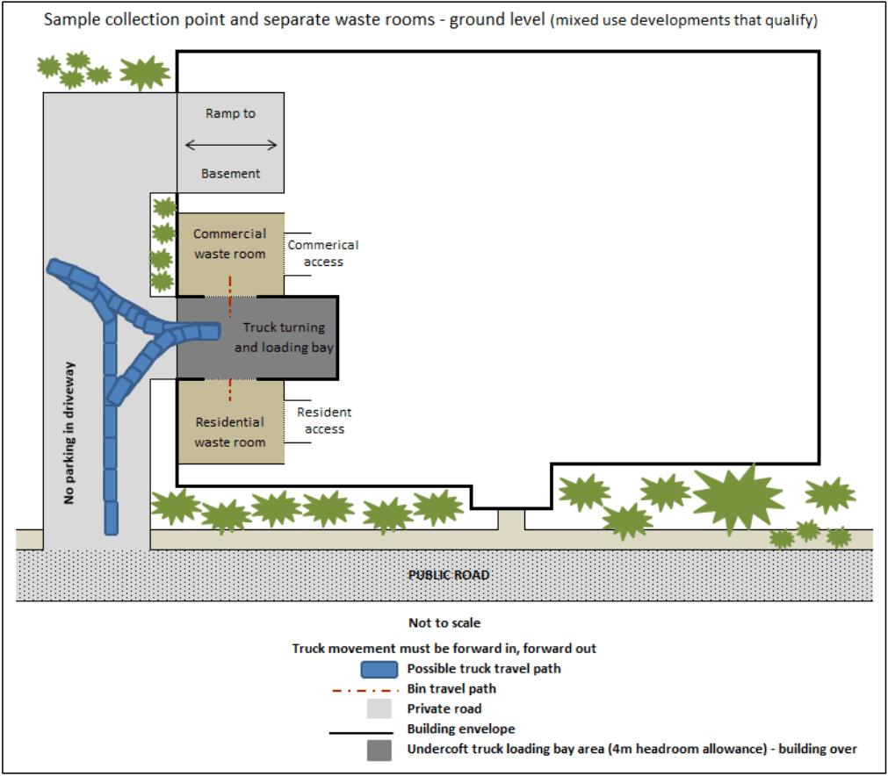

> [Picture on page 32: a picture, saved as a picture (images/guideline-for-waste-management-in-new-developments-page-32-5.gif, 150 dpi).]

Figure 9: Collection point and separate waste rooms - ground level (mixed use developments)

Figure 10 shows a possible collection point in the basement for a larger mixed use development on a site measuring over 1500 square metres. The residential and commercial/retail waste rooms are clearly separated. It indicates adequate waste vehicle access, route of travel and manoeuvring.

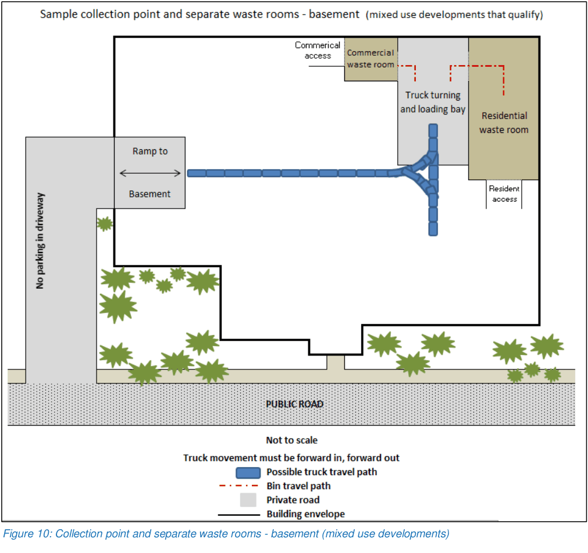

> [Picture on page 33: a picture, saved as a picture (images/guideline-for-waste-management-in-new-developments-page-33-4.gif, 150 dpi).]

Figure 10: Collection point and separate waste rooms - basement (mixed use developments)

#### 5.2.3 Communal waste room construction

Communal waste rooms must be constructed to the following specifications:

• floors are constructed of concrete at least 75 millimetres thick

• floors are graded and drained to a Sydney Water approved drainage fitting

• floors are finished in a smooth, even surface

• walls are built of solid impervious material

• ceilings are finished with a smooth faced, non-absorbent material capable of being cleaned

• walls, ceilings and floors are finished in a light colour

• the room is provided with an adequate supply of hot and cold water mixed through a centralised mixing valve with hose attachment

• doors are self-closing and able to be opened from inside the room

• the room is constructed to prevent the entry of vermin

• the room has adequate light and ventilation

• lighting is controlled using switches located both inside and outside the room

Table 3 contains more information on the specifications of waste room construction.

Table 3: Design considerations for communal waste rooms

| Factors | Considerations |
|---|---|
| Functional and suitable | • waste room size • regular and practical shape • separating waste streams • layout of waste room. |
| Safe, convenient and accessible | • travel path for residents • lighting • fire safety requirements. |
| Reduce environmental nuisances | • noise reduction measures • ventilation • clean up and wash down facilities • suitable flooring and wall finishes • floor grading and drainage. |
| Avoiding impacts on other residents and adjoining properties | • details of closest habitable doors and windows • security • lighting. |

#### 5.2.4 Communal waste rooms – industrial uses and food retail

In addition to Section 5.2.1, 5.2.2 and 5.2.3, these developments must also provide:

• a bunded and graded storage area for liquid waste so that it can be drained to a grease trap to satisfy Sydney Water requirements

• additional space in the waste rooms to accommodate reusable items like pallets and crates.

#### 5.2.5 Non-residential development

Commercial, retail and industrial spaces generate different types of waste. The waste generation rates listed in Section 2.3 will ensure that you select an appropriate waste system with a functional and effective design for future, ongoing use of the site.

You must consider all potential waste streams your development may generate and select appropriate waste equipment to store it. A variety of equipment is available for commercial developments. You must consider collection frequencies, monitoring programs and ongoing maintenance. Table 4 shows a poorly designed communal waste room where incorrect and/or inadequate waste and recycling generation rates have been applied leading to over flowing bins and obstruction when entering the waste room. This is a problem for residents and building occupants, site management and collection contractors.

Mobile garbage bins are moulded containers with two wheels and a close-fitting lid; often transported manually. They can range in size from 80 litre to 360 litre bins (see Table 5 adapted from Mastec). Other waste management equipment is available (see Table 6 adapted from Mastec) including bulk bins (front and rear lift), skips, tipper bins, balers and compactors. Consideration must be given to the size and servicing requirements for this equipment and whether they are suitable for the proposed site.

Manufacturers and waste contractors must be consulted to confirm sizes and dimensions of waste bins and access requirements. Further details are provided in the EPA Better practice guide for resource recovery in residential developments 2019.

Table 4: The result of a poorly designed and planned waste room

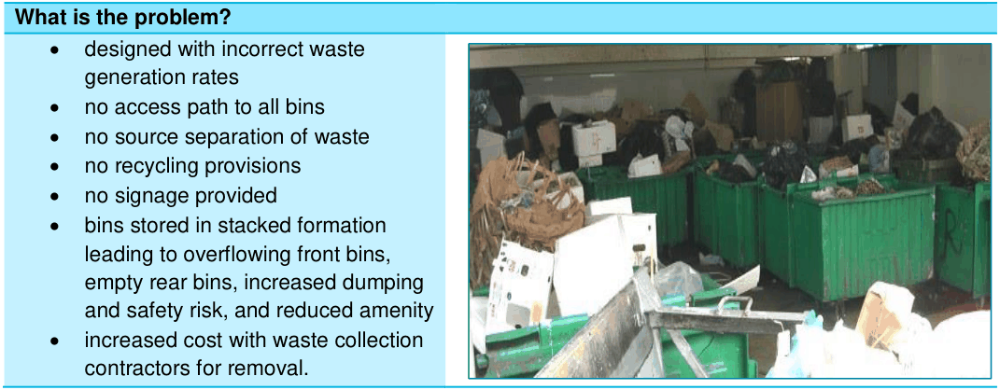

> [Picture on page 35: a picture, saved as a picture (images/guideline-for-waste-management-in-new-developments-page-35-5.gif, 150 dpi).]
> Words printed on the picture (copied from the PDF):
> • designed with incorrect waste
> generation rates
> • no access path to all bins
> • no source separation of waste
> • no recycling provisions
> • no signage provided
> • bins stored in stacked formation
> • increased cost with waste collection
> contractors for removal.

#### What is the problem?

leading to overflowing front bins, empty rear bins, increased dumping and safety risk, and reduced amenity

Table 5: Typical wheelie bin dimensions

| Bin capacity | 80 litre | 120 litre | 140 litre | 240 litre | 360 litre |
|---|---|---|---|---|---|
| Height (millimetres) | 796 940 927 1072 1116 |  |  |  |  |
| Depth (millimetres) | 561 561 616 740 904 |  |  |  |  |
| Width (millimetres) | 481 481 538 582 669 |  |  |  |  |
| Approximate footprint (square millimetres) | 0.24 0.27 0.33 0.43 0.60 |  |  |  |  |

Table 6: Typical bulk bin dimensions

| Bin capacity | 660 litre | 1100 litre |
|---|---|---|
| Height (millimetres) | 1277 1310 |  |
| Depth (millimetres) | 775 1088 |  |
| Width (millimetres) | 1216 1196 |  |
| Approximate footprint (square millimetres) | 0.94 1.30 |  |
