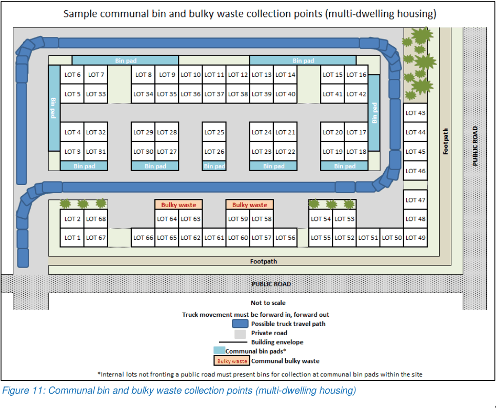
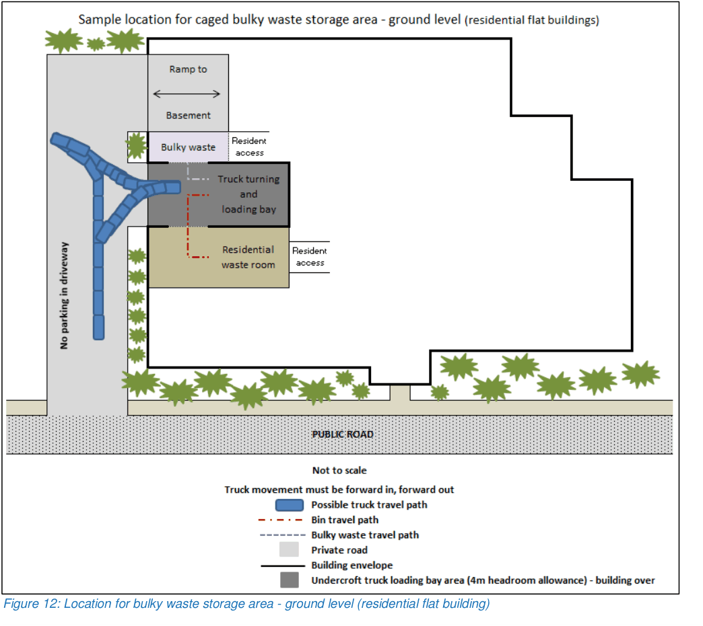
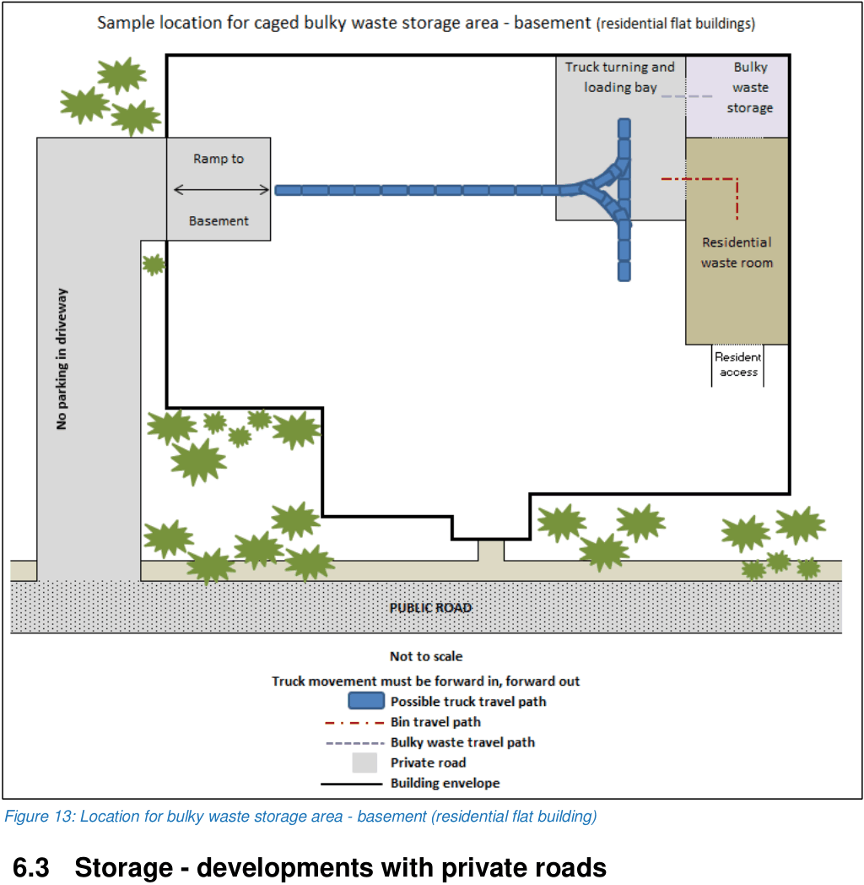
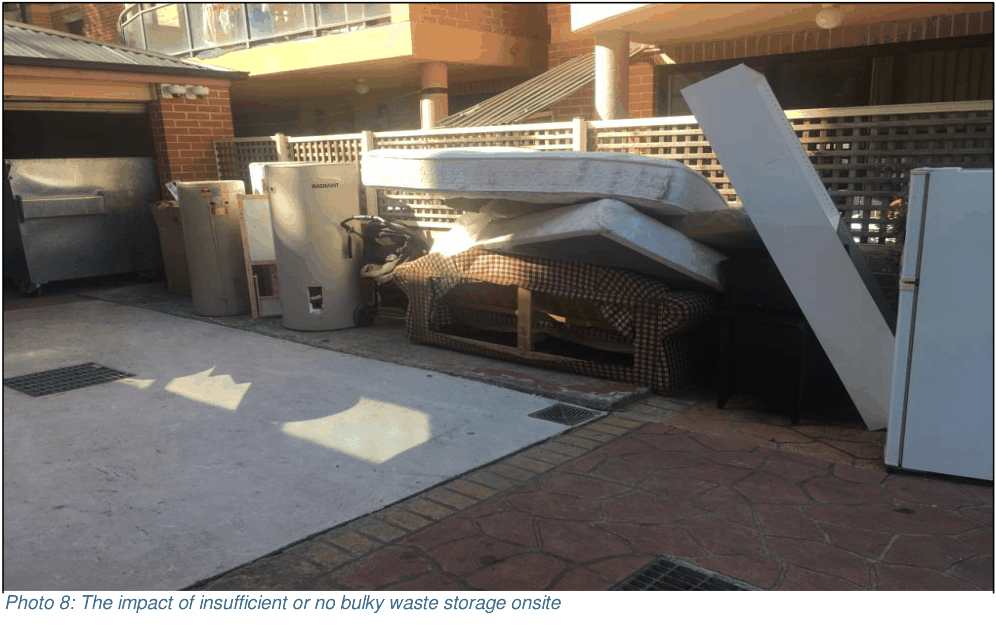

## 6. Bulky waste

### 6.1 Individual residential bins - private roads

The communal bulky waste collection point(s) must be:

• sign posted for ‘no stopping’ at any time

• located onsite and accessible to Council’s side lift vehicles

• located on a straight stretch of road

• located so the travel distance for residents to transport unwanted bulky waste items from their dwelling to the bulky waste collection point is not excessive

• managed by the elected strata management company including compliance with our requirements for collection of bulky waste and the use of this communal collection point onsite.

Figure 11 shows a sample multi-dwelling housing development with communal bin pads and communal bulky waste collection points. The bulky waste storage and collection points are property signposted and line marked and contained within the development site. Bin collections are from one side of the road with road design suitable to accommodate Council’s side lift, left hand lift waste and recycling collection vehicles. For multi-dwelling housing developments with 8 or more lots, dwellings fronting a public road will place bins on their frontage for collection. All internal lots fronting private or community title roads will present their bins for collection on private property along communal bin pads located around the site. Adequate internal loop roads have been provided through the site with access suitable for Council’s 10.5 metre long, waste collection vehicles. Design ensures that trucks do not have to reverse.

> [Picture on page 36: a picture, saved as a picture (images/guideline-for-waste-management-in-new-developments-page-36-22.gif, 150 dpi).]

Figure 11: Communal bin and bulky waste collection points (multi-dwelling housing)

### 6.2 Communal residential bins

The communal bulky waste storage area must be:

• designed to the required size, excluding the path of the door(s)

• located inside the waste room(s) or in a separate location but immediately adjacent to the loading bay

• located on the same level as the waste collection point(s)

• designed so they open straight onto the designated loading bay.

Figure 12 shows a sample residential flat building with bulky waste storage opening onto the loading bay with collection at ground level. The bulky waste storage area is located close to the residential waste room and the onsite loading bay. The bulky waste room is separated from the waste room. Waste room doors are 1.5 metres wide.

> [Picture on page 37: a picture, saved as a picture (images/guideline-for-waste-management-in-new-developments-page-37-12.gif, 150 dpi).]

Figure 12: Location for bulky waste storage area - ground level (residential flat building)

Figure 13 shows a sample residential flat building with bulky waste storage opening onto the loading bay with collection from the basement. The bulky waste storage area is located close to the residential waste room and the onsite loading bay. The bulky waste room is separated from the waste room and opens onto the loading bay. Waste room doors are 1.5 metres wide.

> [Picture on page 38: a picture, saved as a picture (images/guideline-for-waste-management-in-new-developments-page-38-5.gif, 150 dpi).]

Figure 13: Location for bulky waste storage area - basement (residential flat building)

### 6.3 Storage - developments with private roads

Multi-dwelling housing developments with 8 units or more with laneways, loop roads and/or private roads, must provide an onsite bulky waste collection point(s) at a rate of:

• 8 square metres for every 40 units and 2 square metres for every 20 units (or part thereof) after that. This can be spread over several locations across the site.

### 6.4 Storage - communal residential bins

Communal residential developments must provide a bulky waste storage area at a rate of:

• 4 square metres for every 40 units (or part thereof), and 1 square metre for every 20 units (or part thereof) afterwards.

Photo 8 shows a development that has not provided a designated bulky waste storage area onsite which has resulted in resident amenity and safety issues. There are also operational concerns as the waste bins are blocked during bin servicing.

> [Picture on page 39: a picture, saved as a picture (images/guideline-for-waste-management-in-new-developments-page-39-4.gif, 150 dpi).]
> Words printed on the picture (copied from the PDF):
> Photo 8: The impact of insufficient or no bulky waste storage onsite

### 6.5 Storage - non-residential development

Non-residential development must provide a bulky and problem waste storage area(s) of at least:

• 2 square metres for developments under 100 square metres

• 4 square metres for developments between 100 to 2000 square metres

• an additional 4 square metres is required for each retail accommodation or entertainment development over 2000 square metres and for every 20,000 square metres of office space.
