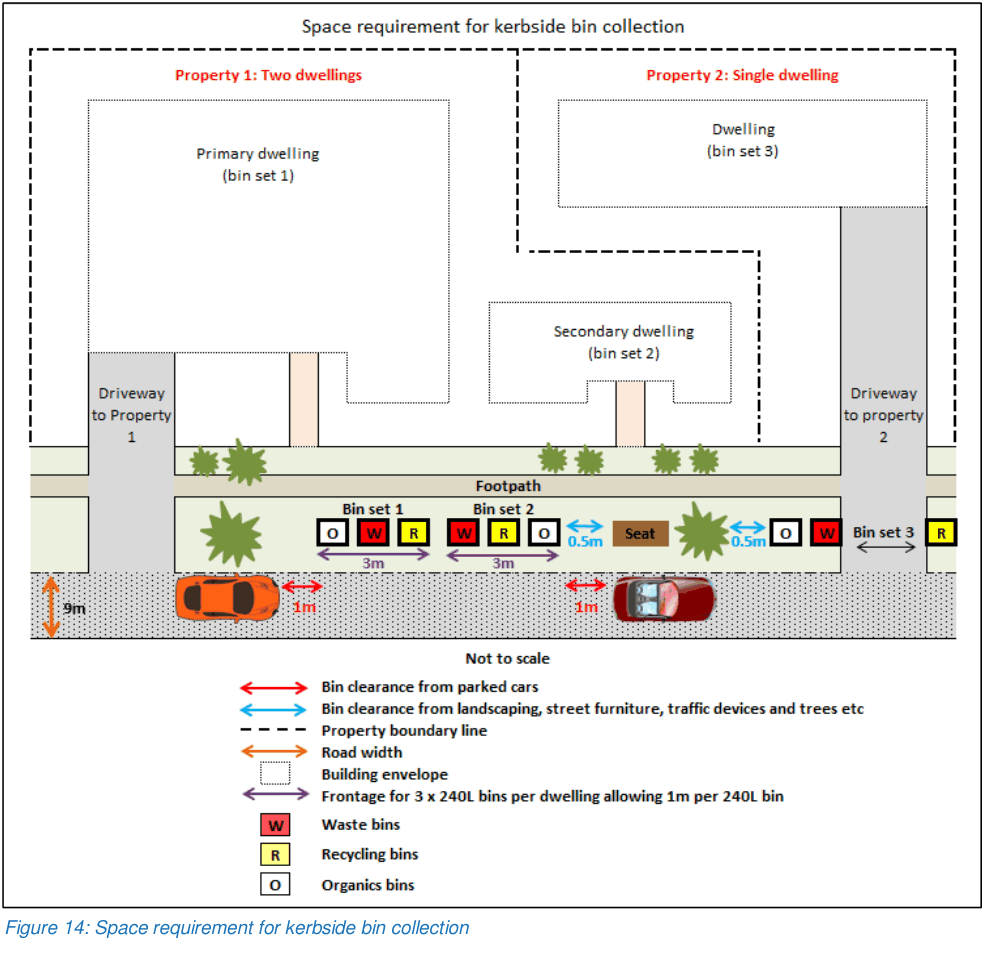
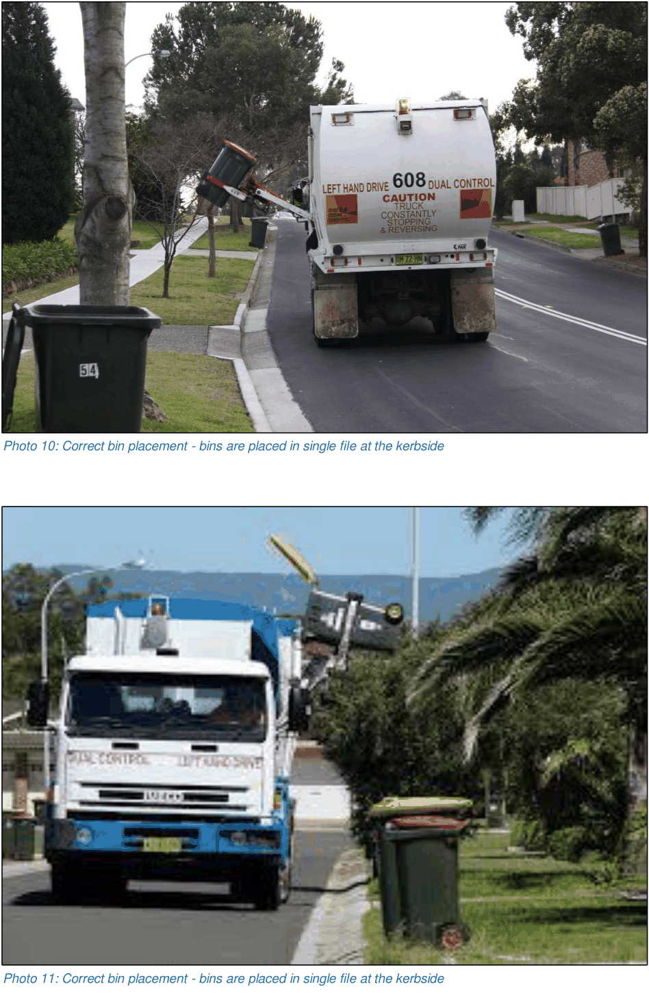
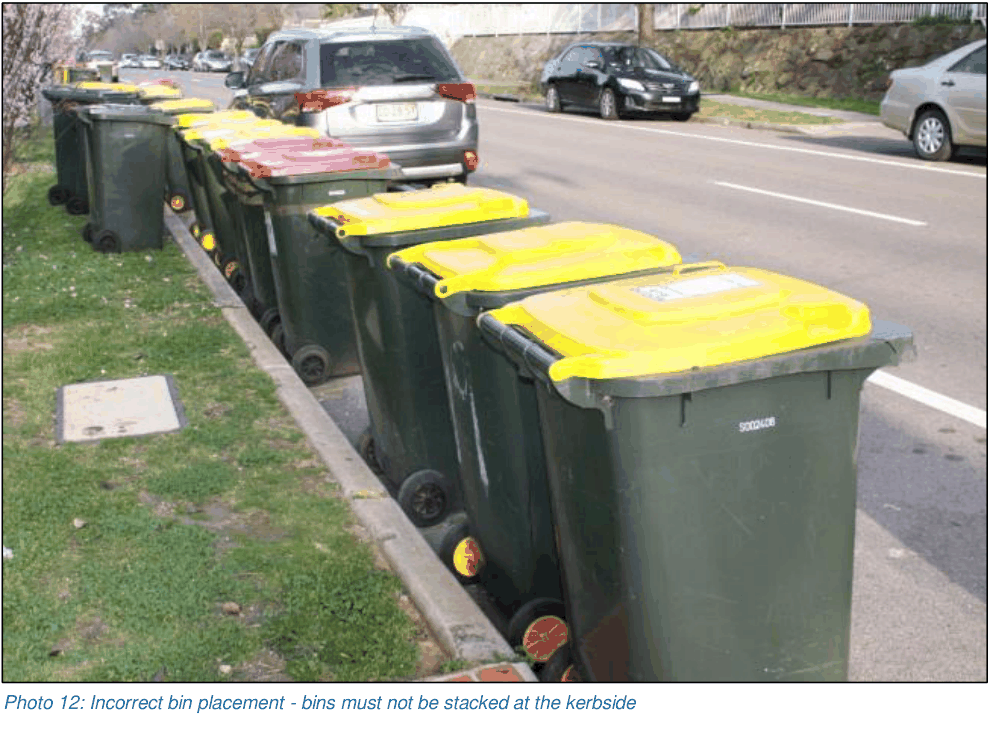
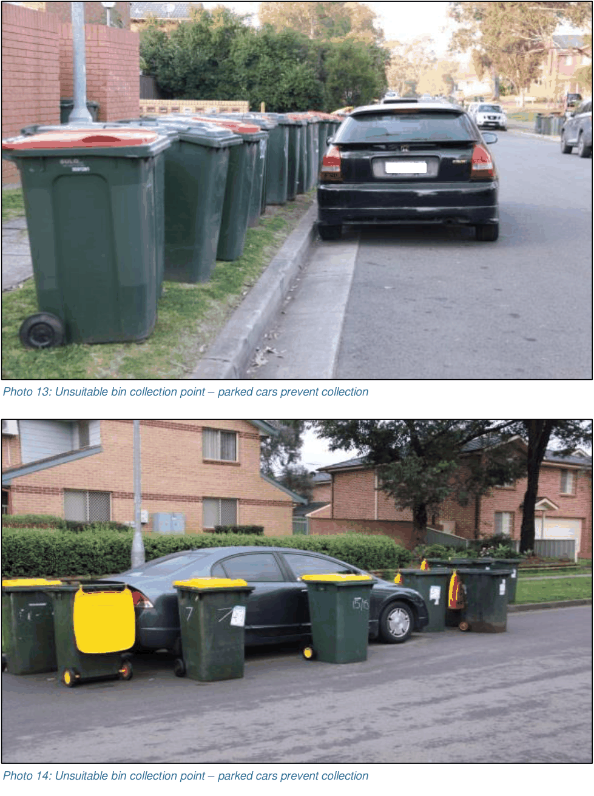
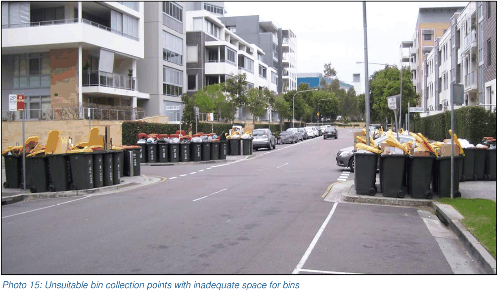
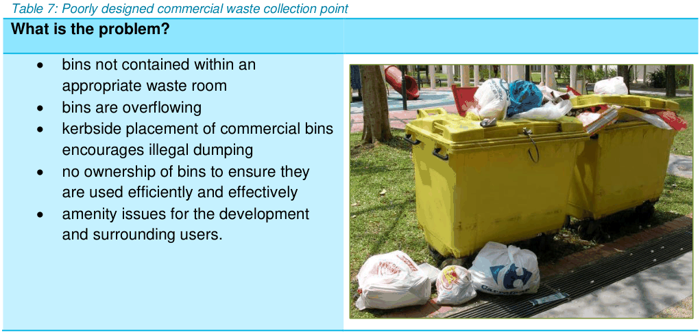

## 9. Collection

Please see the matrix in Appendix 1 as it identifies the collection point for a variety of development types.

### 9.1 Kerbside collection

Kerbside collection points must be clear of obstructions along the subject property’s frontage. Figure 14 demonstrates suitable presentation and clearance from driveways, light and power poles, street furniture, bus stops, landscaping and trees.

Bin collection must be away from intersections and not on arterial roads. It must be demonstrated that bin collection from the kerbside does not impact resident amenity or cause safety or operational issues.

Bins must only be placed in single file at the kerbside (see Photo 10 and 11). Bins stacked 2 or more deep at the kerbside cannot be collected (see Photo 12).

> [Picture on page 41: a picture, saved as a picture (images/guideline-for-waste-management-in-new-developments-page-41-13.gif, 150 dpi).]

Figure 14: Space requirement for kerbside bin collection

> [Picture on page 42: a picture, saved as a picture (images/guideline-for-waste-management-in-new-developments-page-42-1.gif, 150 dpi).]
> Words printed on the picture (copied from the PDF):
> Photo 10: Correct bin placement - bins are placed in single file at the kerbside

> Words printed on the picture (copied from the PDF):
> Photo 11: Correct bin placement - bins are placed in single file at the kerbside

> [Picture on page 43: a picture, saved as a picture (images/guideline-for-waste-management-in-new-developments-page-43-1.gif, 150 dpi).]
> Words printed on the picture (copied from the PDF):
> Photo 12: Incorrect bin placement - bins must not be stacked at the kerbside

Photos 13 and 14 are examples of unsuitable bin collection points. Site design that results in poor outcomes in relation to waste operations, resident amenity and pedestrian and vehicular safety, will not be supported. These bin collection points negatively impact the visual amenity of the surrounding area. They can also lead to traffic hazards as bins are left in the carriageway. Extensive bin pads along public roads also affect waste operations as parked cars block access to the bins placed out for collection.

Photo 15 shows collection points without suitable frontage and bins are placed in banks on street corners causing blind spots for road users and hazards for pedestrians on the footpaths.

> [Picture on page 44: a picture, saved as a picture (images/guideline-for-waste-management-in-new-developments-page-44-1.gif, 150 dpi).]
> Words printed on the picture (copied from the PDF):
> Photo 13: Unsuitable bin collection point – parked cars prevent collection

> Words printed on the picture (copied from the PDF):
> Photo 14: Unsuitable bin collection point – parked cars prevent collection

> [Picture on page 45: a picture, saved as a picture (images/guideline-for-waste-management-in-new-developments-page-45-1.gif, 150 dpi).]
> Words printed on the picture (copied from the PDF):
> Photo 15: Unsuitable bin collection points with inadequate space for bins

#### 9.1.1 Kerbside collection from private roads

For developments serviced by laneways, loop roads, punch throughs and/or private roads with access through a cul-de-sac head, bins cannot be collected from the cul-de-sac head. An alternative collection point must be identified in these instances including onsite collection.

### 9.2 Onsite collection

Onsite collections must occur for the following:

• all residential flat buildings

• multi-dwelling housing developments with 8 dwellings or more

• mixed use developments

• other developments as assessed.

#### 9.2.1 Ground level and basement

The matrix at Appendix 1 identifies where onsite collection is required and where it can be at ground level or in the basement.

Where a development application proposes onsite collection at ground level, it must demonstrate that there are no adverse impacts on residential amenity or safety, and that the at-grade collections result in an improved design outcome for the development with more efficient functionality of the waste management system. It must be located towards the rear of the site, behind the building line. Figures 4 to 10 inclusive provide more information.

Ensure onsite loading bays allow the trucks to reverse in and collect bins and bulky waste from the

rear. This eliminates contractors having to move loaded bins in a carriageway.

#### 9.2.2 Turntables

Using turntables for waste collection is not preferred due to their short 10 year lifespan and expensive minimum $100,000 replacement costs. They also require regular maintenance and servicing annually.

Turntables also require additional design considerations to ensure water doesn’t enter the mechanical parts and that items do not get stuck in the equipment both of which are likely issues in a waste storage and collection area.

In the event of turntable malfunction, failure or complete breakdown, waste collection trucks would be required to either reverse into or out of the site to service bins as the site has been designed with complete reliance on a turntable for truck manoeuvring. Revering through the public domain across public footpaths and into or out of public roads, is not acceptable. It can take time to raise enough funds to replace this equipment in a strata managed building which is of concern if the sinking funds have not been well maintained or managed for the site.

Where turntables are proposed, it must be demonstrated that the required waste collection vehicle can complete the necessary movements without the use of the turntable. This ensures service continuity in the event the turntable fails.

#### 9.2.3 Collection for commercial, retail and industrial sites

Commercial and retail waste collections must not occur at the kerbside or from other parts of the site including landscaped, parking or manoeuvring areas. Collection must be via an onsite loading bay with a waste room that opens directly onto it with access from a public laneway or public road. Table 7 shows the result of a poorly designed waste collection point for a commercial site.

Table 7: Poorly designed commercial waste collection point

> [Picture on page 46: a picture, saved as a picture (images/guideline-for-waste-management-in-new-developments-page-46-23.gif, 150 dpi).]
> Words printed on the picture (copied from the PDF):
> • bins not contained within an
> appropriate waste room
> • bins are overflowing
> • kerbside placement of commercial bins
> encourages illegal dumping
> • no ownership of bins to ensure they
> • amenity issues for the development
> and surrounding users.

#### What is the problem?

are used efficiently and effectively
