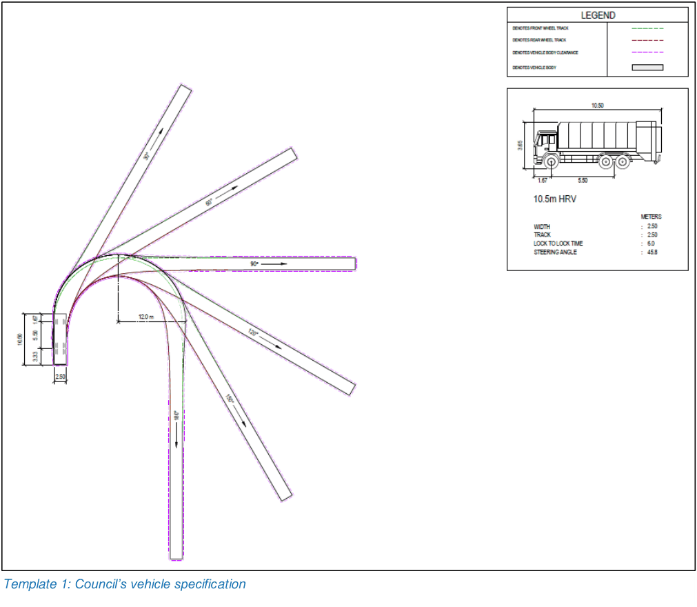

## 11.  Truck access

Entry and egress points, internal roads and access points must be designed to ensure that the specifications and dimensions of the proposed collection vehicles can be accommodated. The waste management plan must confirm that the development has been designed to accommodate the Council’s waste collection vehicle specifications and dimensions (see Template 1).

Table 8 and 9 contain specifications for Council’s side lift and rear lift collection vehicles. These will be needed when designing onsite access for waste collection vehicles.

Table 8: Council’s side lift collection vehicle dimensions

| Council automated side lift collection vehicles | Dimensions |
|---|---|
| Actual height (operational with bin loaded) | 3.8 metres |
| Minimum width | 2.6 metres |
| Minimum length | 10.5 metres |
| Maximum weight loading | 24 tonne |
| Lift side | Left |
| Travel clearance height | 4.0 metres |

Table 9: Council’s rear lift collection vehicle dimensions

| Council rear load waste collection vehicles | Dimensions |
|---|---|
| Actual height | 3.6 metres |
| Minimum width | 2.6 metres |
| Minimum length | 10.5 metres |
| Maximum weight loading | 24 tonnes |
| Travel clearance height | 4.0 metres |

### 11.1 Minimum design requirements

You must cater for the following at the design stage:

• truck access based on Council’s vehicle (see Template 1)

• that the truck travel path is rated suitable for a 24 tonne truck.

• turning circles and clearances to kerbs, existing buildings and other obstructions designed to accommodate the required collection vehicle that may service the site.

Architectural plans must demonstrate:

• that collection vehicles can easily access the collection point without the need to reverse outside of the site boundaries. Onsite 3-point turns are acceptable. This must be demonstrated without the use of a turntable

• a minimum vertical clearance of 4 metres for the vehicles entire travel path and in any turning areas for Council’s collection vehicle

• that ramp grades and changes of rate of grade on the ramp for any collection occurring in a basement, do not exceed 15.4%, in line with Australian Standard AS2890.2 Parking Facilities: Off-Street Commercial Vehicle Facilities (Tables 3.2 and 3.3)

• an additional 3 metre clearance in the loading bay either to the rear or the front of the truck for bin servicing and/or compactor/skip bin operation.

### 11.2 Demonstrating onsite truck access

You must provide the following to demonstrate suitable truck access onsite:

• swept paths for the trucks entire travel path from entry to exit and in all manoeuvring areas. Template 1 contain more information

• vertical cross section plans demonstrating a 4 metre vertical clearance for the trucks entire travel path

• AutoCAD files in DWG format and 1:1 scale for both the vertical and horizontal clearances for the trucks entire travel path.

> [Picture on page 49: a picture, saved as a picture (images/guideline-for-waste-management-in-new-developments-page-49-14.gif, 150 dpi).]
> Words printed on the picture (copied from the PDF):
> Template 1: Council’s vehicle specification

### 11.3 Rear lift collection vehicles

The information submitted with the development application must be supported by scaled site and floor plans that clearly identify:

• swept paths suitable for a 10.5 metre long, rear lift collection vehicle for the trucks entire travel path including forward entry and exit and around the collection point.

• a minimum vertical clearance of 4 metres in the collection area.

### 11.4 Side lift collection vehicles

The information submitted with the development application must be supported by scaled site and floor plans that clearly identify:

• swept paths suitable for a 10.5 metre long, side lift waste collection vehicle for the trucks entire travel path including forward entry and exit and around the collection point.

• a minimum vertical clearance of 4 metres in the collection area.

### 11.5 Front lift collection vehicles

The information submitted with the development application must be supported by scaled site and floor plans that clearly identify:

• swept paths suitable for an 11.8 metre long, heavy rigid, front lift waste collection vehicle servicing 1 to 4.5 cubic metres bulk bins in line with the EPA Better Practice Guide for Resource Recovery in Residential Developments 2019. This is required for the vehicles entire travel path including forward entry and exit and around the collection point.

• a minimum vertical clearance of 6.5 metres in the collection area in line with the EPA Better Practice Guide for Resource Recovery in Residential Developments 2019.

### 11.6 Hook lift collection vehicles

The information submitted with the development application must be supported by scaled site and floor plans that clearly identify:

• swept paths suitable for a 10 metre long, heavy rigid, hook lift waste collection vehicle servicing 1 to 36 cubic metre skip bins in line with the EPA Better Practice Guide for Resource Recovery in Residential Developments 2019. This is required for the trucks entire travel path including forward entry and exit and around the collection point.

• a minimum vertical clearance of 7.1 metres in the collection area in line with the EPA Better Practice Guide for Resource Recovery in Residential Developments 2019.

### 11.7 Constrained sites

Smaller and isolated sites may be problematic for waste collection, particularly for when they are unable to consolidate with surrounding lots. These sites may require an alternative onsite service arrangement with a small rigid waste collection vehicle (as defined by Australian Standard 2890.2). Council may use the below criteria to determine if an alternative arrangement is permitted. This may include, but is not limited to, sites that:

• cannot accommodate a safe and/or efficient kerbside collection

• have insufficient and/or unsuitable frontage for kerbside collection

• have access off cul-de-sac heads with limited frontage within in the lot boundary

• are located within a 1 kilometre radius of Transport for New South Wales designated train stations. Here commuter car parking prevents kerbside collection and ‘no parking’ signage is permitted only with approval from Transport for New South Wales. Train stations include Blacktown, Mount Druitt, Seven Hills, Quakers Hill and Schofields.
