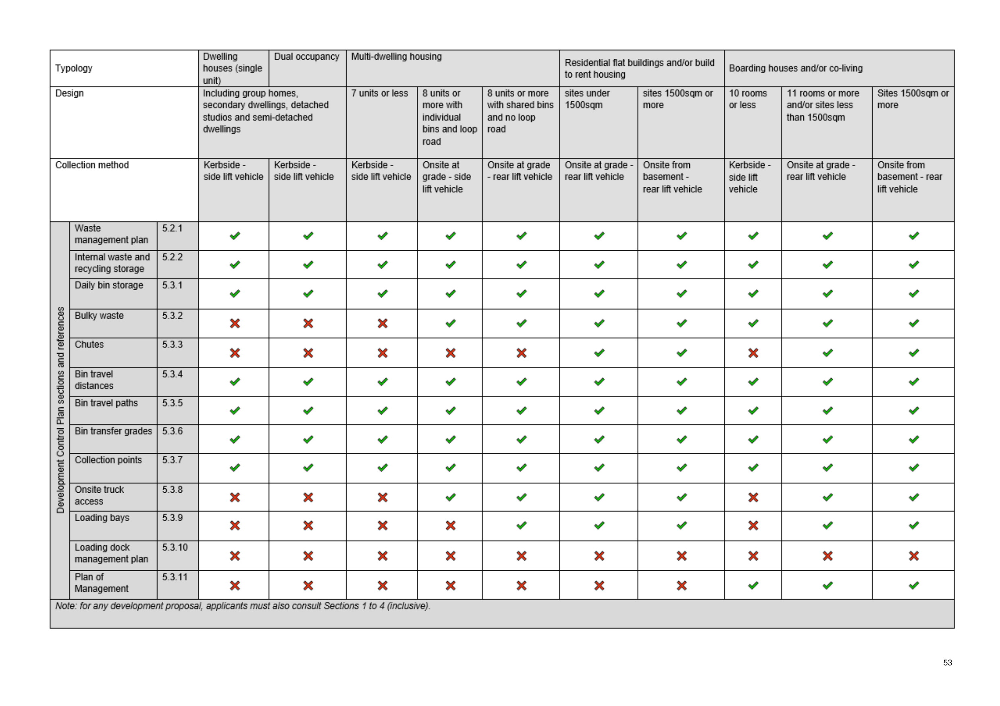
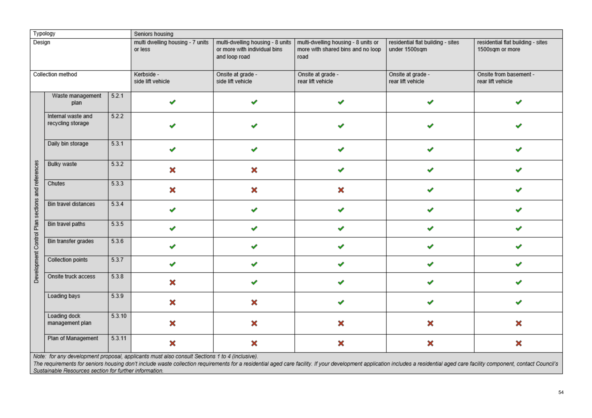
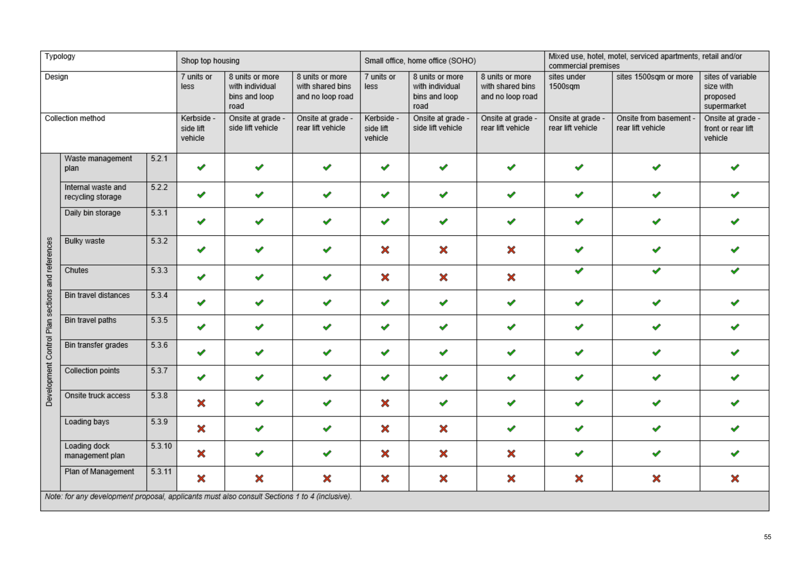
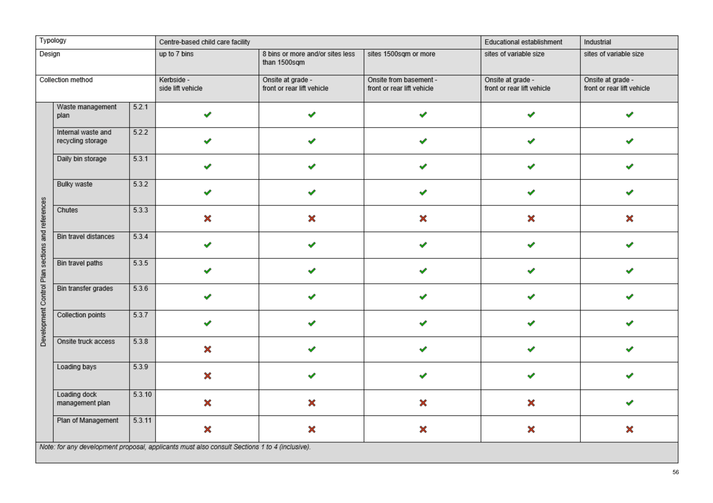

## 12. Appendix 1 - matrix

> [Page 52 (printed page 53) is a scanned table. It was typed in by hand from the picture on 26 Oct 2026 and checked against it. Yes = a tick (this DCP section applies), No = a cross (it does not apply).]

| Development Control Plan section | Ref | Dwelling houses (single unit): Including group homes, secondary dwellings, detached studios and semi-detached dwellings (Kerbside - side lift vehicle) | Dual occupancy: Including group homes, secondary dwellings, detached studios and semi-detached dwellings (Kerbside - side lift vehicle) | Multi-dwelling housing: 7 units or less (Kerbside - side lift vehicle) | Multi-dwelling housing: 8 units or more with individual bins and loop road (Onsite at grade - side lift vehicle) | Multi-dwelling housing: 8 units or more with shared bins and no loop road (Onsite at grade - rear lift vehicle) | Residential flat buildings and/or build to rent housing: sites under 1500sqm (Onsite at grade - rear lift vehicle) | Residential flat buildings and/or build to rent housing: sites 1500sqm or more (Onsite from basement - rear lift vehicle) | Boarding houses and/or co-living: 10 rooms or less (Kerbside - side lift vehicle) | Boarding houses and/or co-living: 11 rooms or more and/or sites less than 1500sqm (Onsite at grade - rear lift vehicle) | Boarding houses and/or co-living: Sites 1500sqm or more (Onsite from basement - rear lift vehicle) |
|---|---|---|---|---|---|---|---|---|---|---|---|
| Waste management plan | 5.2.1 | Yes | Yes | Yes | Yes | Yes | Yes | Yes | Yes | Yes | Yes |
| Internal waste and recycling storage | 5.2.2 | Yes | Yes | Yes | Yes | Yes | Yes | Yes | Yes | Yes | Yes |
| Daily bin storage | 5.3.1 | Yes | Yes | Yes | Yes | Yes | Yes | Yes | Yes | Yes | Yes |
| Bulky waste | 5.3.2 | No | No | No | Yes | Yes | Yes | Yes | Yes | Yes | Yes |
| Chutes | 5.3.3 | No | No | No | No | No | Yes | Yes | No | Yes | Yes |
| Bin travel distances | 5.3.4 | Yes | Yes | Yes | Yes | Yes | Yes | Yes | Yes | Yes | Yes |
| Bin travel paths | 5.3.5 | Yes | Yes | Yes | Yes | Yes | Yes | Yes | Yes | Yes | Yes |
| Bin transfer grades | 5.3.6 | Yes | Yes | Yes | Yes | Yes | Yes | Yes | Yes | Yes | Yes |
| Collection points | 5.3.7 | Yes | Yes | Yes | Yes | Yes | Yes | Yes | Yes | Yes | Yes |
| Onsite truck access | 5.3.8 | No | No | No | Yes | Yes | Yes | Yes | No | Yes | Yes |
| Loading bays | 5.3.9 | No | No | No | No | Yes | Yes | Yes | No | Yes | Yes |
| Loading dock management plan | 5.3.10 | No | No | No | No | No | No | No | No | No | No |
| Plan of Management | 5.3.11 | No | No | No | No | No | No | No | Yes | Yes | Yes |

Note: for any development proposal, applicants must also consult Sections 1 to 4 (inclusive).

> [Page 53 (printed page 54) is a scanned table. It was typed in by hand from the picture on 26 Oct 2026 and checked against it. Yes = a tick (this DCP section applies), No = a cross (it does not apply).]

| Development Control Plan section | Ref | Seniors housing: multi dwelling housing - 7 units or less (Kerbside - side lift vehicle) | Seniors housing: multi-dwelling housing - 8 units or more with individual bins and loop road (Onsite at grade - side lift vehicle) | Seniors housing: multi-dwelling housing - 8 units or more with shared bins and no loop road (Onsite at grade - rear lift vehicle) | Seniors housing: residential flat building - sites under 1500sqm (Onsite at grade - rear lift vehicle) | Seniors housing: residential flat building - sites 1500sqm or more (Onsite from basement - rear lift vehicle) |
|---|---|---|---|---|---|---|
| Waste management plan | 5.2.1 | Yes | Yes | Yes | Yes | Yes |
| Internal waste and recycling storage | 5.2.2 | Yes | Yes | Yes | Yes | Yes |
| Daily bin storage | 5.3.1 | Yes | Yes | Yes | Yes | Yes |
| Bulky waste | 5.3.2 | No | No | Yes | Yes | Yes |
| Chutes | 5.3.3 | No | No | No | Yes | Yes |
| Bin travel distances | 5.3.4 | Yes | Yes | Yes | Yes | Yes |
| Bin travel paths | 5.3.5 | Yes | Yes | Yes | Yes | Yes |
| Bin transfer grades | 5.3.6 | Yes | Yes | Yes | Yes | Yes |
| Collection points | 5.3.7 | Yes | Yes | Yes | Yes | Yes |
| Onsite truck access | 5.3.8 | No | Yes | Yes | Yes | Yes |
| Loading bays | 5.3.9 | No | No | Yes | Yes | Yes |
| Loading dock management plan | 5.3.10 | No | No | No | No | No |
| Plan of Management | 5.3.11 | No | No | No | No | No |

Note: for any development proposal, applicants must also consult Sections 1 to 4 (inclusive).

The requirements for seniors housing don't include waste collection requirements for a residential aged care facility. If your development application includes a residential aged care facility component, contact Council's Sustainable Resources section for further information.

> [Page 54 (printed page 55) is a scanned table. It was typed in by hand from the picture on 26 Oct 2026 and checked against it. Yes = a tick (this DCP section applies), No = a cross (it does not apply).]

| Development Control Plan section | Ref | Shop top housing: 7 units or less (Kerbside - side lift vehicle) | Shop top housing: 8 units or more with individual bins and loop road (Onsite at grade - side lift vehicle) | Shop top housing: 8 units or more with shared bins and no loop road (Onsite at grade - rear lift vehicle) | Small office, home office (SOHO): 7 units or less (Kerbside - side lift vehicle) | Small office, home office (SOHO): 8 units or more with individual bins and loop road (Onsite at grade - side lift vehicle) | Small office, home office (SOHO): 8 units or more with shared bins and no loop road (Onsite at grade - rear lift vehicle) | Mixed use, hotel, motel, serviced apartments, retail and/or commercial premises: sites under 1500sqm (Onsite at grade - rear lift vehicle) | Mixed use, hotel, motel, serviced apartments, retail and/or commercial premises: sites 1500sqm or more (Onsite from basement - rear lift vehicle) | Mixed use, hotel, motel, serviced apartments, retail and/or commercial premises: sites of variable size with proposed supermarket (Onsite at grade - front or rear lift vehicle) |
|---|---|---|---|---|---|---|---|---|---|---|
| Waste management plan | 5.2.1 | Yes | Yes | Yes | Yes | Yes | Yes | Yes | Yes | Yes |
| Internal waste and recycling storage | 5.2.2 | Yes | Yes | Yes | Yes | Yes | Yes | Yes | Yes | Yes |
| Daily bin storage | 5.3.1 | Yes | Yes | Yes | Yes | Yes | Yes | Yes | Yes | Yes |
| Bulky waste | 5.3.2 | Yes | Yes | Yes | No | No | No | Yes | Yes | Yes |
| Chutes | 5.3.3 | Yes | Yes | Yes | No | No | No | Yes | Yes | Yes |
| Bin travel distances | 5.3.4 | Yes | Yes | Yes | Yes | Yes | Yes | Yes | Yes | Yes |
| Bin travel paths | 5.3.5 | Yes | Yes | Yes | Yes | Yes | Yes | Yes | Yes | Yes |
| Bin transfer grades | 5.3.6 | Yes | Yes | Yes | Yes | Yes | Yes | Yes | Yes | Yes |
| Collection points | 5.3.7 | Yes | Yes | Yes | Yes | Yes | Yes | Yes | Yes | Yes |
| Onsite truck access | 5.3.8 | No | Yes | Yes | No | Yes | Yes | Yes | Yes | Yes |
| Loading bays | 5.3.9 | No | Yes | Yes | No | No | Yes | Yes | Yes | Yes |
| Loading dock management plan | 5.3.10 | No | Yes | Yes | No | No | No | Yes | Yes | Yes |
| Plan of Management | 5.3.11 | No | No | No | No | No | No | No | No | No |

Note: for any development proposal, applicants must also consult Sections 1 to 4 (inclusive).

> [Page 55 (printed page 56) is a scanned table. It was typed in by hand from the picture on 26 Oct 2026 and checked against it. Yes = a tick (this DCP section applies), No = a cross (it does not apply).]

| Development Control Plan section | Ref | Centre-based child care facility: up to 7 bins (Kerbside - side lift vehicle) | Centre-based child care facility: 8 bins or more and/or sites less than 1500sqm (Onsite at grade - front or rear lift vehicle) | Centre-based child care facility: sites 1500sqm or more (Onsite from basement - front or rear lift vehicle) | Educational establishment: sites of variable size (Onsite at grade - front or rear lift vehicle) | Industrial: sites of variable size (Onsite at grade - front or rear lift vehicle) |
|---|---|---|---|---|---|---|
| Waste management plan | 5.2.1 | Yes | Yes | Yes | Yes | Yes |
| Internal waste and recycling storage | 5.2.2 | Yes | Yes | Yes | Yes | Yes |
| Daily bin storage | 5.3.1 | Yes | Yes | Yes | Yes | Yes |
| Bulky waste | 5.3.2 | Yes | Yes | Yes | Yes | Yes |
| Chutes | 5.3.3 | No | No | No | No | No |
| Bin travel distances | 5.3.4 | Yes | Yes | Yes | Yes | Yes |
| Bin travel paths | 5.3.5 | Yes | Yes | Yes | Yes | Yes |
| Bin transfer grades | 5.3.6 | Yes | Yes | Yes | Yes | Yes |
| Collection points | 5.3.7 | Yes | Yes | Yes | Yes | Yes |
| Onsite truck access | 5.3.8 | No | Yes | Yes | Yes | Yes |
| Loading bays | 5.3.9 | No | Yes | Yes | Yes | Yes |
| Loading dock management plan | 5.3.10 | No | No | No | No | Yes |
| Plan of Management | 5.3.11 | No | No | No | No | No |

Note: for any development proposal, applicants must also consult Sections 1 to 4 (inclusive).

