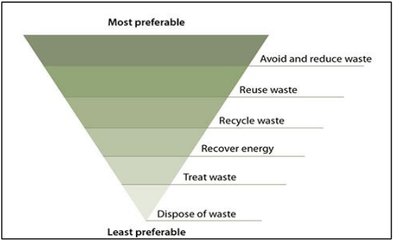

## 13. Appendix 2 - additional information

4.1

The NSW Waste and Resource Recovery Strategy 2014-21 developed a waste hierarchy to identify preferred approaches in managing waste. These principles must underpin the activity across all stages of your development and must be used to prepare and implement your waste management plan.

> [Picture on page 56: a picture, saved as a picture (images/guideline-for-waste-management-in-new-developments-page-56-8.gif, 150 dpi).]

How your development can reduce waste

| 4.3 | It is important to understand and be fully aware of your statutory |  |
|---|---|---|
| Obligations under the | obligations under the Protection of the Environment Operations Act 1997 concerning waste management and minimisation. This |  |
| Protection of | includes illegal dumping. |  |
| the | The NSW Illegal Dumping Strategy 2017-21 identified in a 2004 |  |
| Environment | survey, that demolition and construction waste was one of the |  |
| Operations | major problems for metropolitan and regional councils equating |  |
| Act 1997 | to 12% of materials dumped illegally. In 2013, the NSW Government introduced new laws concerning illegal dumping including increased penalty notices and prison sentences for repeat offenders. |  |
| 4.4 | Asbestos containing material was widely used in buildings until |  |
| Asbestos | the late 1980’s. However, it is important to note that it was only completely prohibited on 31 December 2003. If you are undertaking demolition, refurbishment or renovation work on an existing dwelling built before 2013, you need to be aware of your |  |
|  | statutory obligations under the | Work Health and Safety Act and |
|  | Regulations. |  |
|  | If asbestos is identified on your site, to satisfy your legal |  |
|  | obligation to transport and dispose of it lawfully, you must obtain |  |
|  | a WasteLocate consignment number from the asbestos |  |
|  | transporter to track the location of this waste to ensure it has |  |
|  | reached its intended destination. More information can be found |  |
|  | on the NSW EPA website at: |  |
|  | http://www.epa.nsw.gov.au/wasteregulation/transport-asbestos- |  |
|  | tyres.htm |  |
| 4.5 | Resource | Website |

| Useful | Protection of the | www.legilsation.nsw.gov.au |
|---|---|---|
| websites and | Environment Operations Act |  |
| resources | and Regulations |  |
|  | Inside Waste | www.wmaa.asn.au |
|  | Recycling near you | www.recylicngnearyou.com.au |
|  | Environmental Protection | www.epa.nsw.gov.au |
|  | Authority |  |
|  | Your home | www.yourhome.gov.au/materials/ |
|  |  | waste-minimisation |
|  | Planet Ark Business | www.businessrecycling.com.au |
|  | Recycling |  |
|  | Better practice guide for | www.epa.nsw.gov.au |
|  | resource recovery in |  |
|  | residential developments |  |
|  | 2019 (NSW Environment |  |
|  | Protection Authority) |  |
