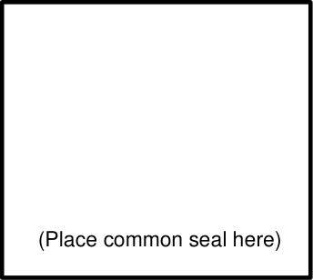

## 14. Appendix 3 - onsite collection agreement

BY THIS AGREEMENT made between the applicant and the Council, the Council agrees at the request of the applicant, to collect waste from the collection point within the property on the following terms and conditions:

1\. Waste will be collected at the same times and on the same conditions as apply to other properties in the area of the property or as otherwise agreed.

2\. The applicant authorises the Council and its contractors to enter upon the property with collection vehicles for the collection of waste from the collection point and warrants to the Council that the applicant has the power to do so.

3\. Council will not collect waste from the collection point if vehicular access to that point from the public road adjacent to the property is not available or impeded at the time of collection for any reason.

4\. The applicant releases the Council and any contractor engaged by it from any claim in respect of damage to the applicant, to the property or to any improvements on the property caused or contributed to by the collection of waste, or by the use of the property by collection vehicles.

5\. The applicant indemnifies the Council and any contractor against any claim by a third party arising from:

a. Any trespass by the Council or its contractor upon the land of that party in the course of carrying out the collection of waste from the collection point;

b. Any damage to the personal property of that third party, except to the extent that such damage is caused by the negligence of the Council or its contractor.

6\. In this agreement:

a. “Applicant” means the party named in the first schedule

b. “Collection point” means the place or each of the places within the property described in the second schedule.

c. “The Council” means Blacktown City Council

d. “The property” means the property described in the third schedule

e. “Waste” means any waste or recyclables, the collection of which is included within the Council’s domestic waste management charge.

#### First schedule

The Applicant

#### Second schedule

The collection point

#### Third schedule

The property

Lot number - DP Number _______________________ Dated:

Signed on behalf of landlords by:

Strata manager:

_____________________________ (Print name)

Strata company:

_____________________________

Strata manager contact number:

Strata manager’s signature: _____________________________

> [Picture on page 59: a picture, saved as a picture (images/guideline-for-waste-management-in-new-developments-page-59-19.gif, 150 dpi).]
> Words printed on the picture (copied from the PDF):
> (Place common seal here)

Owners Strata Plan No. ##

| In the presence of |  |  |
|---|---|---|
| (witness): | Witness name Witness position | _____________________________ (Print name) _____________________________ |
| Signed on behalf of | Witness signature | _____________________________ |
| Council by: | Council representative: Representative’s position: Representative’s signature: | ________________________________ (Print name) _______________________________ _______________________________ |
| In the presence of | Witness name: |  |
| (witness): |  | _______________________________ (Print name) |
|  | Witness position: | _______________________________ |
|  | Witness signature: | _______________________________ |
