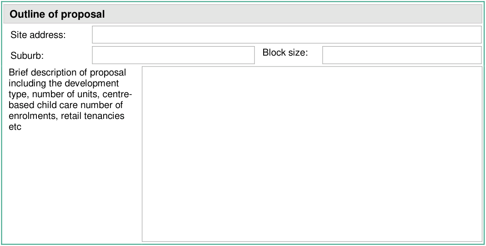
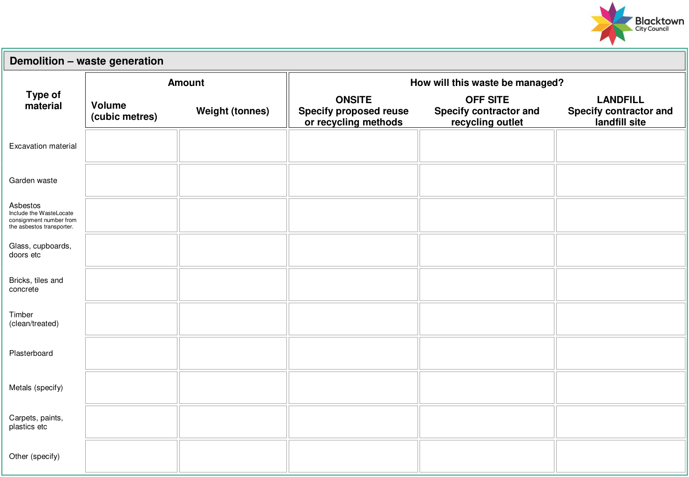
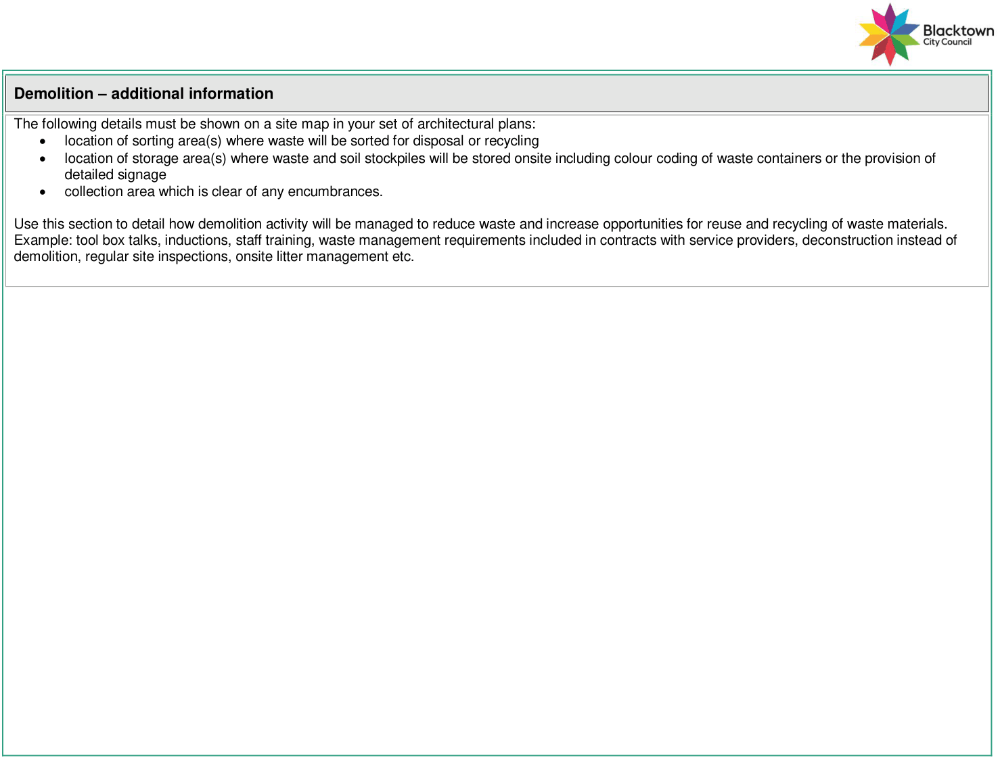
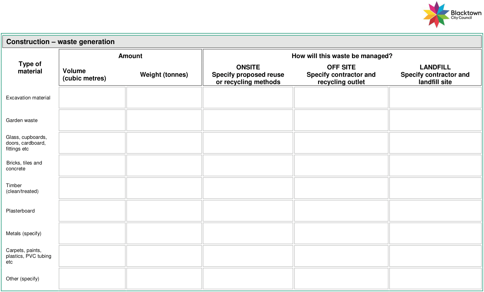
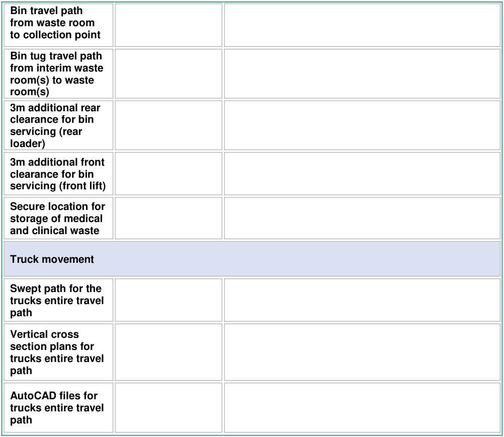

## 15. Appendix 4 - waste management plan template

#### Waste management plan requirements

The relevant sections of this waste management plan template must be completed and submitted with your development application as required in the Blacktown Development Control Plan 2015.

This form will help you:

• comply with the planning controls

• avoid delays in the assessment process as you have provided all necessary information

• facilitate access to our waste service in new residential developments

• provide suitable waste management systems for new developments

• provide opportunities for recycling in all stages of your development

• help meet NSW Waste and Sustainable Materials Strategy 2041 recycling targets.

The information provided in this waste management plan and on submitted architectural drawings will be assessed against the objectives of the Development Control Plan. There are checklists at the end of this waste management plan that must be completed as part of your waste submission to Council.

Note: If the space is insufficient in the tables, please provide attachments.

| Applicant details |  |
|---|---|
| Surname: | First name: |
| Company name: |  |
| Address: |  |
| Suburb | Postcode: |
| Phone (h): | Phone (w): |
| Phone (m): | Fax: |
| Email: |  |

#### Lawful disposal of waste

You should be aware that under the NSW Protection of the Environment Operations Act 1997, both the owner and transporter of waste are legally responsible for ensuring that waste is taken to a place that can lawfully accept it.

I understand that it is my responsibility to manage waste on site to prevent the creation of litter.

I am aware of my responsibilities under the NSW Protection of the Environment Operations Act 1997 in relation to waste.

Where I am not the person responsible for waste management on the site, I will ensure that the person responsible is also aware of the above.

> [Picture on page 62: a picture, saved as a picture (images/guideline-for-waste-management-in-new-developments-page-62-1.gif, 150 dpi).]
> Words printed on the picture (copied from the PDF):
> Site address:
> Suburb:
> Block size:
> Brief description of proposal
> including the development
> type, number of units, centre-
> based child care number of
> enrolments, retail tenancies
> etc

#### Outline of proposal

#### Buildings and other structures onsite:

| Declaration |  |
|---|---|
| I declare that | the information provided in this waste management plan is to the best of my knowledge true. |
| Applicant signature: | Date: |
| Print name: |  |
| Owner's signature: | Date: |
| Print name: |  |

> [Picture on page 63: a map, saved as a picture (images/guideline-for-waste-management-in-new-developments-page-63-1.gif, 150 dpi); the street names and other small labels are on the picture.]
> Labels printed on the map (copied from the PDF, in no particular order):
> Amount · How will this waste be managed? · Type of · material · ONSITE · Specify proposed reuse · OFF SITE · Specify contractor and · LANDFILL · Specify contractor and · Volume · (cubic metres) · Weight (tonnes) · or recycling methods · recycling outlet · landfill site · Excavation material · Garden waste · Asbestos · Include the WasteLocate · consignment number from · the asbestos transporter. · Glass, cupboards, · doors etc · Bricks, tiles and · concrete · Timber · (clean/treated) · Plasterboard · Metals (specify) · Carpets, paints, · plastics etc · Other (specify)

#### Demolition – waste generation

Page

64 of 82

> [Picture on page 64: a picture, saved as a picture (images/guideline-for-waste-management-in-new-developments-page-64-1.gif, 150 dpi).]
> Words printed on the picture (copied from the PDF):
> The following details must be shown on a site map in your set of architectural plans:
> • location of sorting area(s) where waste will be sorted for disposal or recycling
> • location of storage area(s) where waste and soil stockpiles will be stored onsite including colour coding of waste containers or the provision of
> detailed signage
> • collection area which is clear of any encumbrances.
> Use this section to detail how demolition activity will be managed to reduce waste and increase opportunities for reuse and recycling of waste materials.
> Example: tool box talks, inductions, staff training, waste management requirements included in contracts with service providers, deconstruction instead of
> demolition, regular site inspections, onsite litter management etc.

#### Demolition – additional information

Page

65 of 82

> [Picture on page 65: a map, saved as a picture (images/guideline-for-waste-management-in-new-developments-page-65-1.gif, 150 dpi); the street names and other small labels are on the picture.]
> Labels printed on the map (copied from the PDF, in no particular order):
> Amount · How will this waste be managed? · Type of · material · ONSITE · Specify proposed reuse · OFF SITE · Specify contractor and · LANDFILL · Specify contractor and · Volume · (cubic metres) · Weight (tonnes) · or recycling methods · recycling outlet · landfill site · Excavation material · Garden waste · Glass, cupboards, · doors, cardboard, · fittings etc · Bricks, tiles and · concrete · Timber · (clean/treated) · Plasterboard · Metals (specify) · Carpets, paints, · plastics, PVC tubing · etc · Other (specify)

#### Construction – waste generation

#### Construction – additional information

The following details must be shown on a site map in your set of architectural plans:

• location of sorting area(s) where waste will be sorted for disposal or recycling

• location of storage area(s) where waste and soil stockpiles will be stored onsite including colour coding of waste containers or the provision of detailed signage

• collection area which is clear of any encumbrances. Use the section below to detail how site activity will be managed to reduce construction waste and increase opportunities for reuse and recycling of waste materials. Example: tool box talks, inductions, staff training, waste management requirements included in contracts with service providers, site inspections, materials reused onsite

#### Residential – waste generation

#### Type of waste generated

#### Expected volume per week (litres)

#### Number and size of bins required Collections per week Service provider

Garbage – building A

Garbage – building B

Garbage – building C

Recycling – building A

Recycling – building B

Recycling – building C

#### Residential - ongoing management of waste

The following details must be shown on scaled plans:

• details of bin storage and holding areas including dimensions, floor area (square metres) and location

• details of dedicated waste collection point(s) including dimensions, floor area (square metres) and location

• bin travel path from interim waste rooms to waste rooms

• details of any waste management equipment required for the development including suitable storage areas.

Use this section below to add any additional information.

| Commercial / industrial – waste generation |  |  |  |
|---|---|---|---|
| Number of tenancies: |  |  |  |
| Type of waste generated | Expected volume per week (litres/cubic metres) | Number and size of bins required | Collections per week |
|  |  | ________ L |  |
|  |  | ________ L |  |
|  |  | ________ L |  |
|  |  | ________ L |  |
|  |  | ________ L |  |
|  |  | ________ L |  |
|  |  | ________ L |  |
|  |  | ________ L |  |
|  |  | ________ L |  |
|  |  | ________ L |  |
|  |  | ________ L |  |
|  |  | ________ L |  |

#### Commercial / industrial - ongoing management of waste

The following details must be shown on scaled plans:

• storage area(s) inside all tenancies

• storage area(s) for nominated waste bins

• number of each type of bin (garbage, recycling, bulk cardboard, clinical waste, other relevant waste streams) required for the development;

• details of interim waste rooms and waste rooms including dimensions, floor area (square metres) and location

• details of dedicated waste collection point(s) including dimensions, floor area (square metres) and location

• details of any waste management equipment required for the development including suitable storage areas

• bin travel path from interim waste rooms to waste rooms and collection points

Use the section below to add any additional information

#### Swept paths – collection on private property

Swept paths and the associated AutoCAD files must be included in your submission to detail how waste collection vehicles will move around the site. You must demonstrate:

• the trucks entire travel path

• forward entry and exit with all maneuvering onsite

• the use of designated loading bays or collection from communal bin pads

• that collections can be carried out in a safe manner

• compliance with AS2890.2 for headroom allowances and horizontal clearances for small rigid vehicles (where permitted) or 4 metres for Council’s vehicle

• compliance with AS2890.2 (Tables 3.2 and 3,3) for ramp grades and changes of rate of grade on the ramp where applicable

Note: Swept path analysis must be prepared by a traffic engineer in accordance with

#### AS2890.2.

#### Bulky waste - all development types

#### Residential storage area provided (m²)

#### Location of storage area(s)

#### Commercial storage area provided (m²)

#### Location of storage area(s)

#### Mixed use storage area provided (m²)

#### Location of storage area(s)

#### Retail storage area provided (m²)

#### Location of storage area(s)

#### Industrial storage area provided (m²)

#### Location of storage area(s)

| Supporting documentation - attachment list |  |  |
|---|---|---|
| Component | Drawing reference number (eg A105) | Format where the component is demonstrated (eg, waste management plan, traffic report, architectural drawings) |
| Waste rooms |  |  |
| Interim waste room(s) |  |  |
| Waste room(s) |  |  |
| Separated commercial and residential waste room(s) - mixed |  |  |
| use Communal bulky waste storage area(s) |  |  |
| Secure bin tug and trolley storage |  |  |
| Waste chute room with 240L recycling bin on each residential floor |  |  |
| Caged chute discharge point(s) |  |  |
| Bin lifter location and storage area |  |  |
| Compactor location and storage area |  |  |
| Baler location and storage area |  |  |
| Bin storage, movement and collection |  |  |
| Internal waste and recycling storage |  |  |
| Daily bin storage area |  |  |
| Bin collection point(s) |  |  |
| Loading bay(s) |  |  |
| Bin travel path from interim waste room to waste room |  |  |

> [Picture on page 73: a map, saved as a picture (images/guideline-for-waste-management-in-new-developments-page-73-1.gif, 150 dpi); the street names and other small labels are on the picture.]
> Labels printed on the map (copied from the PDF, in no particular order):
> Bin travel path · from waste room · to collection point · Bin tug travel path · from interim waste · room(s) to waste · room(s) · 3m additional rear · clearance for bin · servicing (rear · loader) · 3m additional front · clearance for bin · servicing (front lift) · Secure location for · storage of medical · and clinical waste · Truck movement · Swept path for the · trucks entire travel · path · Vertical cross · section plans for · trucks entire travel · path · AutoCAD files for · trucks entire travel · path

#### Demolition checklist

This checklist must be completed as part of your waste management plan for demolition activity.

| Checklist |  |
|---|---|
| Must be used for: | any demolition activity. |
| Does your waste management plan answer these questions? | • will the development reduce waste requiring disposal? • do adaptive reuse opportunities exist for building structures etc? • have you determined the types and quantities of materials that can be reused or recycled? • will you have storage containers for recyclables, e.g. glass, metal? • is there a provision for collection of daily rubbish and litter? • will the waste receptacles be covered when not in use? • will you separate materials for reuse, recycling and disposal? • have you reviewed steps for safe and lawful removal of waste? • have you engaged a suitably qualified and licenced professional for removal and disposal of asbestos containing material? • does truck access comply with Australian Standard 2890.2? • have you requested the WasteLocate consignment number from the asbestos transporter to track the location of this waste if identified onsite? This is your legal obligation as the generator and owner of that waste - more information can be found at: https://www.epa.nsw.gov.au/your-environment/waste/transporting- asbestos-waste-tyres/tracking-asbestos-waste-locate • have you reviewed Asbestos Management in Blacktown City, for specific information on dealing with asbestos? • can waste materials generated from demolition activity be recycled or reused? • have you made arrangements with contractors to ensure materials that can’t be reused or recycled are safely separated and disposed of at licenced landfills? • will asbestos, hazardous and/or intractable wastes be disposed of in accordance with WorkSafe NSW and EPA requirements? • will you increase waste avoidance? • will you limit site disturbance and unnecessary excavation? • will data be collected and records kept (including dockets) to ensure the lawful disposal of waste? • will contractors and other relevant parties be aware of their legal requirements for waste disposal and their responsibilities under the waste management plan? • have you planned for onsite communication strategies, such as signage, toolbox talks and inductions? • will storage areas for reusable and recyclable materials be clearly identified with their intended contents and purpose? • have you identified the waste storage area(s) including the bins? • can trucks access the waste storage area? • have you completed a waste management plan? |
| Additional Information | table 1 |

#### Construction checklist

This checklist must be completed as part of your waste management plan for construction activity.

| Checklist |  |
|---|---|
| Must be used for: | any construction activity. |
| Does your waste management plan answer these questions? | • will the development reduce waste requiring disposal? • do adaptive reuse opportunities exist for the building structures? • have you determined the types and quantities of materials that can be reused or recycled? • have you determined the types and quantities of materials used for construction? • is there a provision for collection of daily rubbish and litter? • will the waste receptacles be covered when not in use? • have you provided separate bins for residual waste? • will you separate materials for reuse, recycling and disposal? • have you developed an estimating and purchasing policy? • will you use prefabricated and recyclable materials? • have you reviewed steps for safe and lawful removal of waste? • does truck access comply with Australian Standard 2890.2? • will you increase waste avoidance? • will data be collected and records kept (including dockets) to ensure the lawful disposal of waste? • will contractors and other relevant parties be aware of their legal requirements for waste disposal and their responsibilities under the waste management plan? • have you planned for onsite communication strategies, such as signage, toolbox talks and inductions? • will storage areas for reusable and recyclable materials be clearly identified with their intended contents and purpose? • have you identified the waste storage area (s) including the bins? • can trucks access the waste storage area? • do you have storage for recyclables eg, glass and metal? • have you completed a waste management plan? |
| Additional Information | • table 2. |

#### Residential checklist – individual bins

This checklist must be completed as part of your waste management plan for residential developments with individual bins.

| Checklist |  |
|---|---|
| Must be used for: | single dwellings secondary dwellings some multi-dwelling housing developments semi-detached dwellings. |
| Does your waste management plan answer these questions? | • does the bin storage area accommodate Council’s standard bins? • is the bin storage area located conveniently for residents? • is the bin storage area behind the building line and screened? • is access to the collection point easy, direct and convenient? • is the frontage suitable for all required bins? • does each dwelling have 3 metres by 1 metre of frontage? • is the frontage compliant with clearances outlined in Figure 1? • is the bin travel distance a maximum 30 metres? • do you comply with a maximum bin transfer grade of 1:14? • are you aware purchasers will be informed if they are affected by onsite waste facilities, bin and bulky waste storage areas and/or bin and bulky waste collection points via a Section 88E instrument? • have you indicated the daily bin storage area for the dwellings? • have you detailed the storage area size for all bins? • have you indicated the nominated kerbside collection point? • is there a 1 metre wide paved surface from the storage area to the collection point? • does truck access comply with our requirements if bins are collected from private roads? • have you provided a communal bulky waste collection point if a communal bin pad along a private road is proposed/required? • have you demonstrated bin collection from the perimeter streets in developments with laneways? This is Council’s preference. • where bins must be collected within a laneway, does laneway design comply with our requirements? • where bins must be collected within a laneway, have you catered for collection from one side of the laneway only? • have you completed a waste management plan? |
| Additional Information | figure 1, 2 and 14 photo 3, 4, 5, 6, 9, 10,11, 12 and 13 table 5 and 8 template 2 |

#### Residential checklist – communal bins

This checklist must be completed as part of your waste management plan for residential developments with communal bins.

| Checklist |  |
|---|---|
| Must be used for: | some multi-dwelling housing developments attached dwellings (3 or more dwellings) residential flat buildings seniors housing build to rent housing student housing serviced apartments manor houses affordable rental housing developments boarding houses other applications as assessed. |
| Does your waste management plan answer these questions? | • does each unit have internal storage for one days’ worth of waste and recyclables? • are ground level waste rooms (if permitted), incorporated into the building footprint? • does the walk distance with bagged rubbish exceed 30 metres? • do you comply with maximum bin travel distances? • do you comply with bin transfer grades? • has a bulky waste storage area been provided at the correct rate? • has the bulky waste storage area been caged and signposted? • is hot and cold water provided in the waste room? • do waste room drains connect to Sydney Water approved sewers? • is waste room access direct, safe and convenient for all users? • can the waste room(s) accommodate all the necessary bins? • is the waste room(s) a regular shape and free from obstruction? • are waste storage areas on the same level as the collection point? • are doorways used to move bins and bulky waste 1.5 metres wide? • is resident access to the waste room not via the loading bay? • are interim waste rooms needed? • does design ensure bins are not manually moved across high traffic areas? • is the storage area for bin movement aids secure and enclosed? • if your site is under 1500 square metres, have you provided onsite collection either at ground level or from the basement? • if your site is over 1500 square metres, have you provided basement collection? • have waste chutes been provided if 3 storeys or more? • is there space for recycling bins in each waste chute room? • are chutes and recycling bins inside a waste chute room? • have you identified the location of the chute discharge point(s)? |

|  | • are you aware a Council indemnity agreement form is required for onsite collection? |
|---|---|
|  | • are you aware purchasers will be informed if they are affected by onsite waste facilities, bin and bulky waste storage areas and/or bin and bulky waste collection points via a Section 88E instrument? |
|  | • have you provided information on all waste equipment for the site? |
|  | • have you identified any compaction equipment for the site? |
|  | • can waste vehicles reverse into the loading bay for collection? |
|  | • have you provided physical treatment to the loading bay? |
|  | • will you provide no stopping signs for truck turning and collection? |
|  | • will you provide line marking for truck turning and collection? |
|  | • can trucks turn around onsite without relying on a turntable? |
|  | • does the loading bay hold the truck plus a 3 metre rear clearance? |
|  | • do the waste rooms open straight onto the loading bay? |
|  | • do bulky waste storage areas open straight onto the loading bay? |
|  | • does truck access comply with our requirements? |
|  | • can collection vehicles enter, move, service bins and exit safely? |
|  | • has onsite collection allowed for forward entry and exit? |
|  | • have you provided temporary turning heads in the form of a cul de sac where the road network results in a dead end? |
|  | • do ramp grades and changes of rate of grade comply with Tables 3.2 and 3.3 in Australian Standard AS2890.2? |
|  | • have you provided vertical cross section plans for truck access? |
|  | • have you provided swept paths for the trucks entire travel path? |
|  | • have you provided swept paths where half roads are proposed? |
|  | • have you provided AutoCAD files in DWG format for truck access? |
|  | • is the truck travel path sealed and suitable for 24 tonne trucks? |
|  | • have you provided a plan of management if a boarding house is proposed? |
|  | • have you competed a waste management plan? |
| Additional Information | photo 7, 8, 14 figure 3, 4, 5, 6, 7, 8, 9, 10, 11, 12 and 13 table 3, 4, 5, 6, 9, and 10 template 1 and 2 |

#### Mixed use checklist

This checklist must be completed as part of your waste management plan for mixed use developments.

| Checklist |  |
|---|---|
| Must be used for: | shop top housing mixed use developments. |
| Does your waste management plan answer these questions? | • does each unit have internal storage for one days’ worth of waste and recyclables? • are ground level waste rooms (if permitted), incorporated into the building footprint? • does the walk distance with bagged rubbish exceed 30 metres? • do you comply with maximum bin travel distances? • do you comply with bin transfer grades? • are residential and commercial waste rooms separated? • are commercial tenants restricted to residential waste room(s)? • has a bulky waste storage area been provided at the correct rate? • has the bulky waste storage area been caged and signposted? • is hot and cold water provided in the waste room? • do waste room drains connect to Sydney Water approved sewers? • is waste room access direct, safe and convenient for all users? • can the waste room(s) accommodate all the necessary bins? • can commercial waste rooms hold 3 days waste and recyclables? • is the waste room(s) a regular shape and free from obstruction? • are waste storage areas on the same level as the collection point? • are doorways used to move bins and bulky waste 1.5 metres wide? • is access to the waste rooms not via the loading bay? • are interim waste rooms needed? • does design ensure bins are not manually moved across high traffic areas? • is the storage area for bin movement aids secure and enclosed? • if your site is under 1500 square metres, have you provided onsite collection either at ground level or from the basement? • if your site is over 1500 square metres, have you provided basement collection? • have waste chutes been provided if 3 storeys or more? • is there space for recycling bins in each waste chute room? • are chutes and recycling bins inside a waste chute room? • have you identified the location of the chute discharge point(s)? • are you aware a Council indemnity agreement form is required for onsite collection of residential bins? • is a private contractor needed for this site? |

|  | • are you aware purchasers will be informed if they are affected by onsite waste facilities, bin and bulky waste storage areas and/or bin and bulky waste collection points via a Section 88E instrument? |
|---|---|
|  | • have you provided an onsite trolley management system in accordance with Council’s Abandoned Shopping Trolley Policy P000497.1? |
|  | • have you provided information on all waste equipment for the site? |
|  | • have you identified any compaction equipment for the site? |
|  | • can waste vehicles reverse into the loading bay for collection? |
|  | • have you provided physical treatment to the loading bay? |
|  | • will you provide no stopping signs for truck turning and collection? |
|  | • will you provide line marking for truck turning and collection? |
|  | • can trucks turn around onsite without relying on a turntable? |
|  | • does the loading bay hold the truck plus a 3 metre rear clearance? |
|  | • do the waste rooms open straight onto the loading bay? |
|  | • do bulky waste storage areas open straight onto the loading bay? |
|  | • does truck access comply with our requirements? |
|  | • can collection vehicles enter, move, service bins and exit safely? |
|  | • has onsite collection allowed for forward entry and exit? |
|  | • have you provided temporary turning heads in the form of a cul de sac where the road network results in a dead end? |
|  | • do ramp grades and changes of rate of grade comply with Tables 3.2 and 3.3 in Australian Standard AS2890.2? |
|  | • have you provided vertical cross section plans for truck access? |
|  | • have you provided swept paths for the trucks entire travel path? |
|  | • have you provided swept paths where half roads are proposed? |
|  | • have you provided AutoCAD files in DWG format for truck access? |
|  | • is the truck travel path sealed and suitable for 24 tonne trucks? |
|  | • have you provided a loading dock management plan to outline how waste services will use this space when there are competing uses? |
|  | • have you completed a waste management plan? |
|  | photo 1 and 2 |
| Additional Information | figure 9, 10, 12 and 13 table 3, 4, 5, 6, 7 and 10 template 1 and 2 |

#### Commercial and industrial checklist

This checklist must be completed as part of your waste management plan for commercial and industrial developments.

| Checklist |  |
|---|---|
| Must be used for: | commercial and industrial developments. |
| Does your waste management plan answer these questions? | • does each unit have internal storage for one days’ worth of waste and recyclables? • does the walk distance with bagged rubbish to your tenancy waste room exceed 30 metres? • do you comply with maximum bin travel distances? • do you comply with bin transfer grades? • has a bulky waste storage area been provided at the correct rate? • has the bulky waste storage area been caged and signposted? • can the waste room be easily cleaned and maintained? • is hot and cold water provided in the waste room? • do waste room drains connect to Sydney Water approved sewers? • where liquid waste is generated, can it be stored in a separate bunded area and drained to a Sydney Water approved grease trap? • do you comply with NSW State Government regulations if your activity generates hazardous or clinical waste? • is the waste room located within the site boundary? • is the waste room screened from public view? • is the waste room covered and weatherproof? • does each tenancy have an individual waste room? • is waste room access direct, safe and convenient for all users? • have you used correct generation rates for waste and recyclables? • can the waste room(s) accommodate all the necessary bins? • can waste rooms hold 3 days waste and recyclables? • is refrigerated storage provided for tenancies generating more than 50 kilograms of seafood, poultry or meat waste a day? • have separate containers for industrial waste been provided? • is the waste room(s) a regular shape and free from obstruction? • are doorways used to move bins and bulky waste 1.5 metres wide? • is access to the waste rooms not via the loading bay? • are interim waste rooms needed? • does design ensure bins are not manually moved across high traffic areas? • is the storage area for bin movement aids secure and enclosed? • have you considered basement collection if your site is over 1500 square metres? • have you indicated a private contractor is needed for this site? |

|  | • have you provided an onsite trolley management system in accordance with Council’s Abandoned Sopping Trolley Policy P000497.1? |
|---|---|
|  | • have you provided information on all waste equipment for the site? |
|  | • have you identified any compaction equipment for the site? |
|  | • can waste vehicles reverse into the loading bay for collection? |
|  | • have you provided physical treatment to the loading bay? |
|  | • will you provide no stopping signs for truck turning and collection? |
|  | • will you provide line marking for truck turning and collection? |
|  | • can trucks turn around onsite without relying on a turntable? |
|  | • does the loading bay hold the truck plus a 3 metre rear and/or front clearance? |
|  | • do the waste rooms open straight onto the loading bay? |
|  | • do bulky waste storage areas open straight onto the loading bay? |
|  | • have you designed for heavy rigid vehicle access onsite? |
|  | • does truck access comply with our requirements? |
|  | • can collection vehicles enter, move, service bins and exit safely? |
|  | • has onsite collection allowed for forward entry and exit? |
|  | • do you have private contractor requirements for servicing, access, manoeuvring and clearance heights for onsite collection? |
|  | • have you provided temporary turning heads in the form of a cul de sac where the road network results in a dead end? |
|  | • do ramp grades and changes of rate of grade comply with Tables 3.2 and 3.3 in Australian Standard AS2890.2 (if applicable)? |
|  | • have you provided vertical cross section plans for truck access? |
|  | • have you provided swept paths for the trucks entire travel path? |
|  | • have you provided swept paths where half roads are proposed? |
|  | • have you provided AutoCAD files in DWG format for truck access? |
|  | • is the truck travel path sealed and suitable for 24 tonne trucks? |
|  | • have you provided a loading dock management plan to outline how waste services will use this space when there are competing uses? |
|  | • have you completed a waste management plan? |
|  | photo 1 and 2 |
| Additional Information | table 3, 4, 5, 6, 7 and 10 template 1 and 2 |
