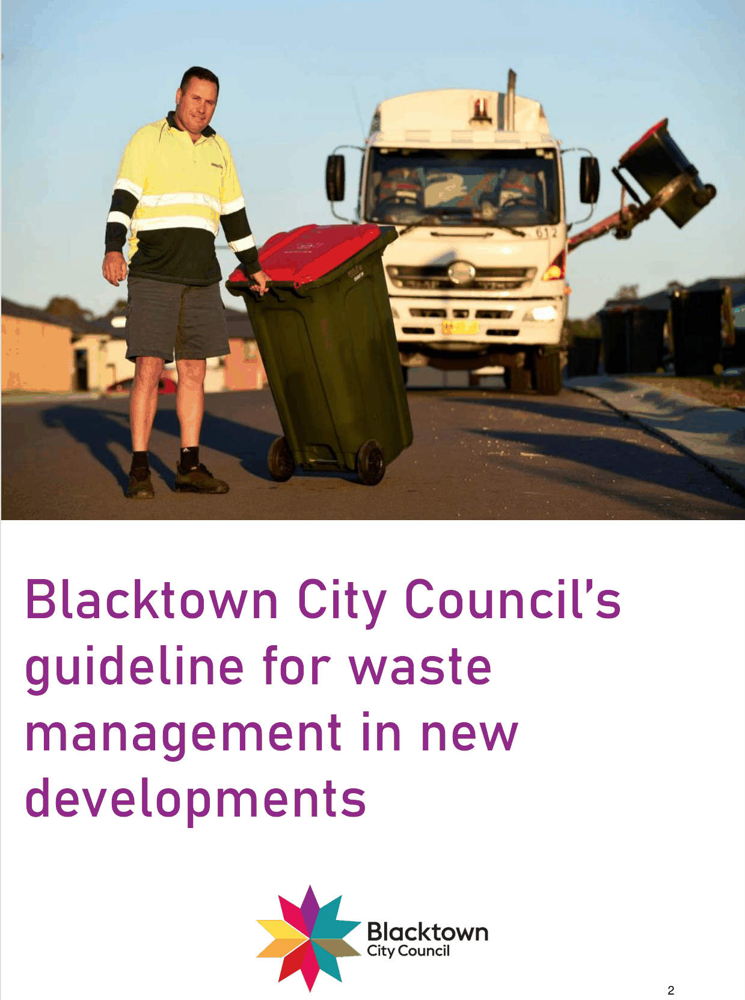

# Blacktown Development Control Plan 2015 - Guideline for waste management in new developments

> This chapter is split into 17 section file(s), one per numbered heading, in the order they appear in the PDF.

Source PDF: [0Guideline-for-waste-management-in-new-developments.pdf](0Guideline-for-waste-management-in-new-developments.pdf)

> [Picture on page 1: a picture, saved as a picture (images/guideline-for-waste-management-in-new-developments-page-1-1.gif, 150 dpi).]

### Blacktown City Council’s guideline for waste management in new developments

| 1. | Introduction _______________________________________________________ 6 |
|---|---|
| 1.1 | Definitions _________________________________________________________ 6 |
| 2. | Waste management plan ___________________________________________ 12 |
| 2.1 | Preparing a waste management plan ___________________________________ 12 |
| 2.2 | What must it include? _______________________________________________ 12 |
| 2.3 | Generation rates ___________________________________________________ 13 |
| 2.4 | Collection frequencies _______________________________________________ 15 |
| 2.5 | Compaction rates __________________________________________________ 15 |
| 2.6 | Waste equipment __________________________________________________ 15 |
| 2.7 | Waste systems and technologies ______________________________________ 15 |
| 2.8 | Waste management platforms and tools _________________________________ 16 |
| 2.9 | Council’s Abandoned Shopping Trolley Policy ____________________________ 16 |
| 3. | Subdivision and engineering works __________________________________ 19 |
| 3.1 | Laneways, internal loop roads and/or private roads ________________________ 19 |
| 4. | Checklists _______________________________________________________ 22 |
| 4.1 | Demolition ________________________________________________________ 22 |
| 4.2 | Construction ______________________________________________________ 23 |
| 5. | Daily bin storage __________________________________________________ 24 |
| 5.1 | Individual bins _____________________________________________________ 24 |
| 5.2 | Communal bins ____________________________________________________ 25 |
| 6. | Bulky waste ______________________________________________________ 37 |
| 6.1 | Individual residential bins - private roads ________________________________ 37 |
| 6.2 | Communal residential bins ___________________________________________ 38 |
| 6.3 | Storage - developments with private roads _______________________________ 39 |
| 6.4 | Storage - communal residential bins ____________________________________ 39 |
| 6.5 | Storage - non-residential development __________________________________ 40 |
| 7. | Chutes __________________________________________________________ 41 |
| 7.1 | Design ___________________________________________________________ 41 |
| 7.2 | Chute contingency _________________________________________________ 41 |
| 8. | Bin movement ____________________________________________________ 41 |
| 8.1 | Bin movement aids _________________________________________________ 41 |
| 9. | Collection________________________________________________________ 42 |
| 9.1 | Kerbside collection _________________________________________________ 42 |
| 9.2 | Onsite collection ___________________________________________________ 46 |
| 10. | Private contractors ________________________________________________ 48 |
| 10.1 | Selecting private contractors __________________________________________ 48 |
| 10.2 | Section 88E for private contractors _____________________________________ 48 |

<!-- sections -->
## Sections

1. [11 Truck access  49](01-11-truck-access-49.md)
2. [15 Appendix 4 - waste management plan template  62](02-15-appendix-4-waste-management-plan.md)
3. [1 Introduction](03-1-introduction.md)
4. [2 Waste management plan](04-2-waste-management-plan.md)
5. [3 Subdivision and engineering works](05-3-subdivision-and-engineering-works.md)
6. [4 Checklists](06-4-checklists.md)
7. [5 Daily bin storage](07-5-daily-bin-storage.md)
8. [6 Bulky waste](08-6-bulky-waste.md)
9. [7 Chutes](09-7-chutes.md)
10. [8 Bin movement](10-8-bin-movement.md)
11. [9 Collection](11-9-collection.md)
12. [10 Private contractors](12-10-private-contractors.md)
13. [11 Truck access](13-11-truck-access.md)
14. [12 Appendix 1 - matrix](14-12-appendix-1-matrix.md)
15. [13 Appendix 2 - additional information](15-13-appendix-2-additional-information.md)
16. [14 Appendix 3 - onsite collection agreement](16-14-appendix-3-onsite-collection-agreement.md)
17. [15 Appendix 4 - waste management plan template](17-15-appendix-4-waste-management-plan.md)
