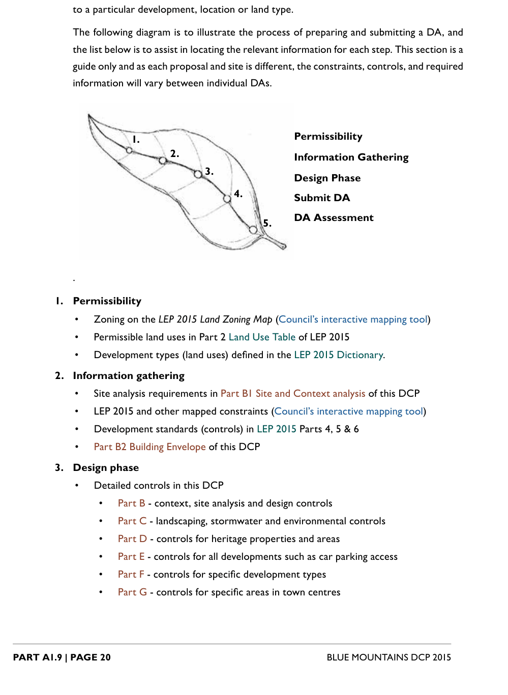

# Blue Mountains Development Control Plan 2015 - Part A Introduction

> This chapter is split into 2 section file(s), one per numbered heading, in the order they appear in the PDF.

Source PDF: [DCP 2015_Amendment 8_Part A.pdf](DCP%202015_Amendment%208_Part%20A.pdf)

### PART A

### INTRODUCTION

### About this DCP and a guide to its use

#### Revision: Amendment 8 (November 2025)

> [Picture on page 1: a picture, saved as a picture (images/part-a-introduction-page-1-5.gif, 150 dpi).]

#### PART A | PAGE 8

### Contents

| A1.1. | Name of the Plan | 12 |
|---|---|---|
| A1.2. | Where this Plan applies | 12 |
| A1.3. | Status of the Plan | 12 |
| A1.4. | Role of the Plan | 12 |
| A1.5. | Relationship to LEP 2015 | 12 |
| A1.6. | Repeal of other DCPs | 12 |
| A1.7. | Notes, Schedules and Conventions A1.7.1. Notes and Schedules A1.7.2. Australian Standards | 13 13 13 |
| A1.8. | Blue Mountains context and character A1.8.1. Natural settings and World Heritage Status A1.8.2. Historic context A1.8.3. Planning context | 14 14 15 17 |
| A1.9. | Key steps in preparing a DA | 20 |

#### PART A | PAGE 9

#### PART A | PAGE 10

### Introduction

Development shapes the character of our towns and villages. The Blue Mountains Local Government Area (LGA) is defined by a string of villages and towns, many with a unique character, located along the Great Western Highway and within the World Heritage Blue Mountains National Park.

It is this combination of elements which distinguishes the Blue Mountains LGA and in many ways defines the way it needs to be planned and managed.

The unique and internationally recognised natural environment of the Blue Mountains LGA attracts residents and visitors alike. The natural bushland setting, topography and rare flora and fauna are all fundamental components of the Blue Mountains and require consistent and careful management, such that both residents and visitors can continue to appreciate this environment in the coming generations.

Part A: Introduction

The Blue Mountains LGA is also rich in cultural heritage. The region includes some of the traditional lands of the Gundungurra and Darug peoples, and it is important that development considers Indigenous cultural heritage to avoid any potential harm to places and objects of Aboriginal cultural significance.

The Blue Mountains local government area (LGA) has also retained significant heritage associated with early European settlement. There are buildings and places within the LGA which have both state and local heritage significance, and contribute greatly to the character and setting of the villages and towns.

These significant environmental and cultural features attract a high level of tourism annually, which is central to the local economy. Commercial development for tourist and visitor accommodation, and other businesses which support the tourism industry – including restaurants and cafés, retail outlets and other commercial enterprises, are an integral part of the Blue Mountains as a City and as a tourist destination.

In this context, achieving a balance between development and conservation is vital to create vibrant places for people to live in, work and visit, while appreciating and preserving the unique environmental context of this local government area.

#### PART A | PAGE 11

### A1.1. Name of the Plan

This plan is cited as Blue Mountains Development Control Plan 2015 (DCP 2015) and will be referred to throughout this document as ‘the DCP’.

### A1.2. Where this Plan applies

This DCP applies to all land in the Blue Mountains Local Government Area to which Blue Mountains Local Environmental Plan 2015 (LEP 2015) applies.

Note: Land deferred from LEP 2015 is addressed under the current relevant LEP and DCP.

### A1.3. Status of the Plan

This plan has been prepared in accordance with Clause 3.43 of the Environmental Planning and Assessment Act (EP&A Act) and Part 2 of the Environmental Planning and Assessment Regulation 2021 (the Regulation). This plan may be amended only in the manner prescribed in the Regulation. This plan came into effect on 15th February 2016 in accordance with Clause 14(4) of the Regulation.

Part A: Introduction

### A1.4. Role of the Plan

The role of the DCP is as a ‘guideline’ document, as set out in the Environmental Planning and Assessment Act 1979. Each application will need to adequately demonstrate that the development either complies with the DCP objectives, numerical standards and qualitative standards, or that the application adequately provides justification for departure from those standards.

### A1.5. Relationship to LEP 2015

In order to have effect, Clause 3.43 of the EP&A Act requires this DCP to be consistent and compatible with LEP 2015.

### A1.6. Repeal of other DCPs

The following DCPs are repealed:

• Better Living Development Control Plan 2005;

• DCP No.5 Echo Point

• DCP No.9 Significant Trees

• DCP No.14 Sorensens Nursery Site, Herbert Street Leura

• DCP No.15 Parklands, Govetts Leap Road Blackheath

• DCP No.21 Advertising and Information Signage;

• DCP No.31 Public Infrastructure Works in Subdivision and Developments

• DCP No.33 Exempt and Complying Development

The above DCPs continue to apply, as relevant, to land deferred from LEP 2015

### A1.7. Notes, Schedules and Conventions

### A1.7.1.	 Notes and Schedules

Notes in this DCP are provided for guidance and do not form part of this Plan. Submission requirements contained in Part I and guideline documents contained in Part J are provided for guidance and do not form part of this DCP. They are intended to reflect current best practice and knowledge. Guideline documents will be updated and changed to reflect legislation and policy changes as required.

### A1.7.2.	 Australian Standards

Part A: Introduction

Any reference to an Australian Standard within this plan is to be the most recent version of that standard.

### A1.8. Blue Mountains context and character

Following is a summary of the significant natural features and the historical development of the Blue Mountains. Both of the elements provide the context for planning controls within the Blue Mountains Local Government Area (LGA). These planning objectives and controls are intended to explain why particular characteristics are identified for protection, and to guide future development of the Blue Mountains such that its unique attributes can be preserved and enhanced.

### A1.8.1.	 Natural settings and World Heritage Status

The Blue Mountains has an environmental complexity due to the combinations of landform, hydrology, climate, soils, vegetation, wildlife and scenery. Much of the Blue Mountains is ecologically sensitive; therefore careful analysis, management and environmental controls are necessary.

#### World Heritage status

Part A: Introduction

The Greater Blue Mountains Area consists of 1.03 million ha of sandstone plateaux, escarpments and gorges dominated by temperate eucalypt forest. The setting of the Blue Mountains is of local, state, national and international significance, as recognised by the United Nations Educational, Scientific and Cultural Organisation (UNESCO) listing of the Blue Mountains in 2000 as a World Heritage Site. UNESCO identifies the Greater Blue Mountains Area for its exceptional expression of the structural and ecological diversity of the ninety-one eucalypt taxa associated with its wide range of habitat, and for the significant representation of Australia’s biodiversity including a significant number of rare or threatened species. It is this environmental rarity and resultant significance which requires consistent and careful management, such that both residents of and visitors to the Blue Mountains, can continue to appreciate and enjoy this environment for generations to come.

#### Environmentally sensitive land

The term environmentally sensitive land is defined in the dictionary to LEP 2015. It refers to land that is environmentally sensitive, such as areas with significant slope, significant vegetation communities, ecological buffer zones around watercourses, areas of rare flora or significant geological features. Development potential within these areas is usually limited due to the sensitivity of the natural features and the potential for adverse impacts on these features by development. Reference should be made to clause 6.1 (Impact on environmentally sensitive land) of LEP 2015 and Part C1 of this DCP.

#### Bushfire prone land

The Blue Mountains is highly bush fire prone due to a combination of climatic, vegetation and geographic factors. Bushfire hazard mitigation is a critical issue to land use and building construction in the Blue Mountains. Land mapped as bush fire prone is identified on the Bush Fire Prone Land Map. For development on land identified as bush fire prone, there are particular approval pathways required, including referral of applications to the NSW Rural Fire Service. These processes are identified within Part C4 of this DCP.

### A1.8.2.	 Historic context

#### Historic overview

The Blue Mountains and surrounding region incorporates significant parts of the traditional lands of the Gundungurra and Darug people. Evidence suggests that the Blue Mountains region has been inhabited by Aboriginal people for at least 20,000 years and probably longer. The recognition and preservation of Indigenous heritage and culture is central to ensuring that important spiritual and cultural links to land are maintained. Development pressures have resulted in the destruction of many Aboriginal sites, and those that remain need to be protected.

Part A: Introduction

The Europeans who settled in Sydney considered the Blue Mountains an impassable barrier until 1813, when Gregory Blaxland, William Charles Wentworth, and Lieutenant Lawson officially crossed the mountains and established a route for a ridge-top road to Bathurst. This road was designed as a 12-foot wide carriageway by surveyor William Cox and built within a year by convict labour. Subsequent development in the Blue Mountains has followed a linear pattern established by the first tracks and roads. A string of villages has developed around favourable stopping points along this route. This track has developed over time into a significant road and rail transport corridor between Sydney and the agricultural hinterland of the Megalong Valley and beyond.

#### Village development and land between towns

Each town and village has its own characteristics and features. Towns and villages are separated by ‘land between towns’ which has retained a natural bushland character, and is protected under the LEP 2015 clause 6.13 (Protected area – land between towns). Most villages have developed from a commercial core, with most based on a main street style traditional layout and a surrounding grid layout of streets and lanes. These urban centres contain dense patterns of development, with many buildings having zero setbacks to the front and side, and heights of multiple storeys. The predominant building types are shops, guesthouses, hotels and public buildings. There are also churches, schools, and recreational facilities.

Many of these urban centres are identified as precincts, with specific character controls in Part G of this DCP and objectives in LEP 2015 Part 7 (Additional local clauses-development in villages). There are also significant concentrations of heritage items and heritage conservation areas within these urban centres. Surrounding each village are the early residential subdivision patterns and dwellings developed during the historical growth of the villages following the consolidation of the town centres. Many of these areas, particularly notable in the upper mountains towns, were laid down over 100 years ago, and retain highly intact and consistent dwelling house patterns with high cultural significance. The periphery of the villages has a strong interface with the pre-eminent natural environment of bushland, escarpments, extraordinary views and native fauna. The Megalong Valley is a rural landscape with its own identified character and values.

#### Heritage planning

Indigenous heritage protection

Part A: Introduction

Indigenous or Aboriginal heritage consists of objects and places that are of significance to Aboriginal people. These may include physical or non-physical elements; for example, objects including stone tools, art sites or ceremonial grounds, as well as places of spiritual and cultural importance. There are state requirements, as well as the requirements under LEP 2015 clause 5.10 (Heritage conservation), for the protection of these objects and places. These required processes are included in Part D of this DCP.

European heritage planning The towns and villages of the Blue Mountains have many exceptional heritage properties with high cultural significance.  The significance of these properties can relate to historic events, activities or people and to the fine quality of the architecture or layout of gardens. Some heritage listings relate to the prominence of the railway, religious buildings, even natural rock formations or valleys. There are also nineteen heritage conservation areas. These conservation areas have an intact character, quality and consistency of streetscape. They consist of historic town centres and residential neighbourhoods. The buildings within the conservation areas often have high representative value as excellent examples of their type. These heritage items and heritage conservation areas are listed in Schedule 5 of LEP 2015 and are identified on the accompanying Heritage maps. The objectives and controls for heritage are identified in LEP 2015 clause 5.10 (Heritage conservation). This DCP provides further supporting controls and objectives in Part D.

### A1.8.3.	 Planning context

Development in the Blue Mountains requires careful analysis of the constraints that may apply to land. Due to the sensitive natural and cultural environment of the Blue Mountains, there are planning controls in LEP 2015 which specifically address these characteristics, through the identification of zones, precincts and protected areas. Each of these is described in the following section.

#### Zones

Zoning is one of a number of tools used to guide the desired future character of a LGA through specifying land uses for certain areas. This helps define town centres and industrial areas, and seeks to limit adverse amenity impacts of development. The zoning of a land parcel will identify the type of uses permissible on that land. The zoning of land can be found on the LEP Land Zoning Map. Following is a list of main zones where development can occur within the Blue Mountains:

•	 RU2 – Rural Landscape

•	 E4 – General Industrial

•	 RU4 – Primary Production Small Lots •	 RE1 – Public Recreation

•	 R1 – General Residential

•	 RE2 – Private Recreation

Part A: Introduction

•	 R2 – Low Density Residential

•	 C2 – Environmental Conservation

•	 R3 – Medium Density Residential

•	 C3 – Environmental Management

•	 E1 – Local Centre

•	 C4 – Environmental Living

•	 E2 – Commercial Centre

•	 SP3 – Tourist

•	 E3 – Productivity Support

LEP 2015 Part 2 (Permitted or prohibited development) and the Land Use Table in that part, identifies the zones relevant to the Blue Mountains, the zone objectives, those types of development that are permitted in each zone, and also those that are prohibited. The specific objectives for each zone seek to guide development towards the desired future character outcomes for that zone. These objectives are found in the Land Use Table of LEP 2015 and all development is required to comply with the zone objectives that are relevant to that development.

#### Precincts

Specific parts of the Blue Mountains villages are identified as individual precincts and fall under the precinct provisions of Part G of this DCP.  The following information should be used as a starting point:

(a) Identify the land on the LEP 2015 Built Character Map.

(b) Precincts are identified by a reference number and each precinct outlined in a heavy blue edge line;

(c) Using the reference number, locate the precinct objectives in LEP 2015 Part 7 (Additional local clauses-development in villages). These objectives apply to all development within the specific precinct;

(d) Part G – Specific Precincts of this DCP contains the specific provisions for each precinct.

#### Protected areas

Part A: Introduction

Protected areas are described in Part 6 of LEP 2015 and identified in the supporting maps to LEP 2015. The function of Protected areas is to enable environmental attributes and constraints or character elements to be identified and their values protected from adverse impacts. These areas are identified as having a particular environmental or cultural sensitivity. The Protected areas provide the basis for managing development at the site level to account for these characteristics. Protected area – slope constraint area

• Land within this protected area is identified as ‘Protected area – slope

constraint area’ on the LEP 2015 Natural Resources – Land Map.

• Development on land within this protected area is required to comply with

the objectives identified in clause 6.4 (Protected area-slope constraint area)

of LEP 2015. Protected area – landslide risk

• Land within this protected area is identified as ‘Protected area - landslide risk

area’’ on the LEP 2015 Natural Resources – Land Map.

• Development on land within this protected area is required to comply with

the objectives identified in clause 6.5 (Protected area-landslide risk) of LEP

2015\. Protected area – vegetation constraint area

• Land within this protected area is identified as ‘Protected area – vegetation

constraint area’ on the LEP 2015 Natural Resources – Biodiversity Map.

• Development on land within this protected area is required to comply with

the objectives identified in clause 6.6 (Protected area-vegetation constraint

area) of LEP 2015. Protected area – ecological buffer area

• Land within this protected area is identified as ‘Protected area – ecological

buffer area’ on the LEP 2015 Natural Resources – Biodiversity Map.

• Development on land within this protected area is required to comply with

the objectives identified in clause 6.7 (Protected area-ecological buffer area)

of LEP 2015.

Protected area – riparian lands and watercourses

• Land within this protected area is identified as ‘Protected area – watercourses’

and ‘Protected Area – riparian land’ on the LEP 2015 Riparian Lands and

Watercourses Map.

• Development on land within this protected area is required to comply with

the objectives identified in clause 6.8 (Protected area-riparian lands and

watercourses) of LEP 2015. Protected area – escarpment

• Land within this protected area is identified as ‘Protected area – escarpment’

on the LEP 2015 Scenic and Landscape Values Map.

• Development on land within this protected area is required to comply with

the objectives identified in clause 6.12 (Protected area-escarpment) of LEP

2015\. Protected area – land between towns

• Land within this protected area is identified as ‘Protected area – land between

towns’ on the LEP 2015 Scenic and Landscape Values Map.

• Development on land within this protected area is required to comply with

the objectives identified in clause 6.13 (Protected area-land between towns)

of LEP 2015. Note: In addition to Protected areas identified in LEP 2015, State Government Policy that identifies areas of value to be protected from adverse impacts may also apply to development. The State Environmental Planning Policy (Biodiversity and Conservation) 2021 is a State Government plan specific to areas including parts of the Blue Mountains LGA, and must be considered for development where relevant.

Part A: Introduction

### A1.9. Key steps in preparing a DA

This Plan has been divided into 11 parts, providing a layered approach to development objectives and controls. This approach means that while some parts will apply to all developments, others may only be necessary in certain circumstances. The explanation included at the beginning of each part should be consulted to determine if the part applies

> [Picture on page 14: a picture, saved as a picture (images/part-a-introduction-page-14-6.gif, 150 dpi).]
> Words printed on the picture (copied from the PDF):
> to a particular development, location or land type.
> The following diagram is to illustrate the process of preparing and submitting a DA, and
> the list below is to assist in locating the relevant information for each step. This section is a
> guide only and as each proposal and site is different, the constraints, controls, and required
> information will vary between individual DAs.
> 1.
> Permissibility
> 2.
> Information Gathering
> 3.
> Design Phase
> 4.
> Submit DA
> 5.
> DA Assessment
> .
> 1\.	 Permissibility
> • Zoning on the LEP 2015 Land Zoning Map (Council’s interactive mapping tool)
> • Permissible land uses in Part 2 Land Use Table of LEP 2015
> • Development types (land uses) defined in the LEP 2015 Dictionary.
> 2\.	 Information gathering
> • Site analysis requirements in Part B1 Site and Context analysis of this DCP
> • LEP 2015 and other mapped constraints (Council’s interactive mapping tool)
> • Development standards (controls) in LEP 2015 Parts 4, 5 & 6
> • Part B2 Building Envelope of this DCP
> 3\.	 Design phase
> • Detailed controls in this DCP
> • Part B - context, site analysis and design controls
> • Part C - landscaping, stormwater and environmental controls
> • Part D - controls for heritage properties and areas
> • Part E - controls for all developments such as car parking access
> • Part F - controls for specific development types
> • Part G - controls for specific areas in town centres

Part A: Introduction

<!-- sections -->
## Sections

1. [4 Submit DA](01-4-submit-da.md)
2. [5 DA assessment](02-5-da-assessment.md)
