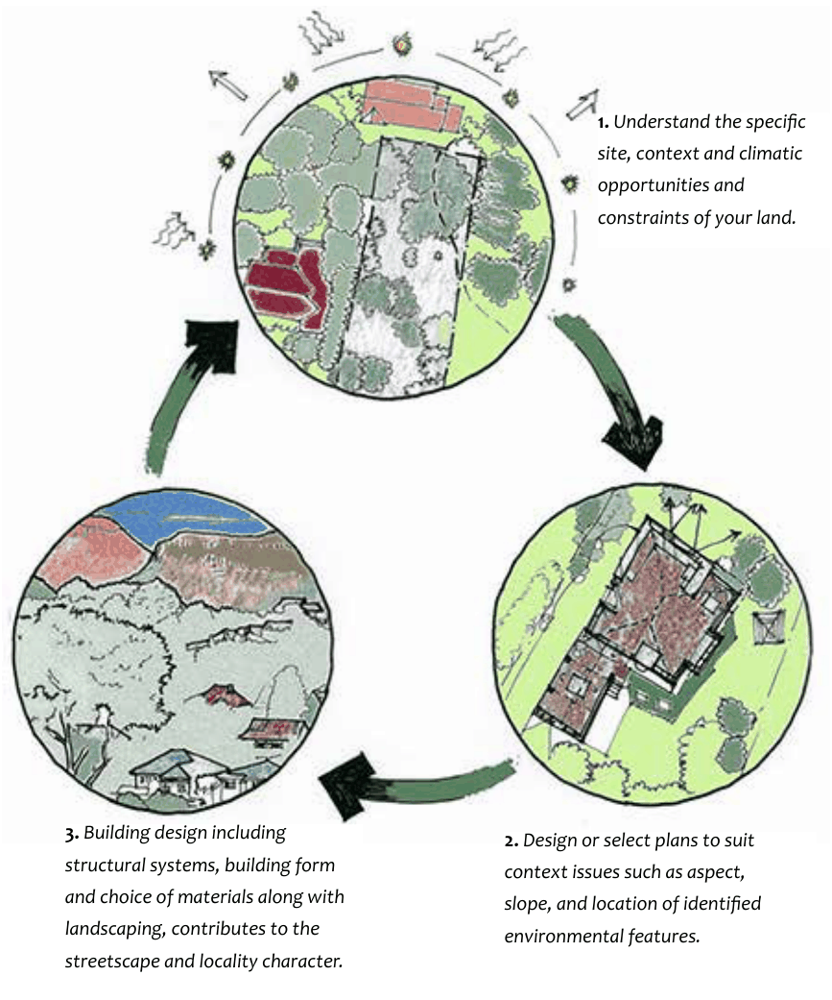
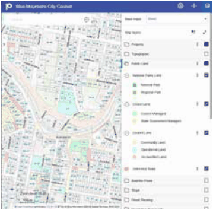
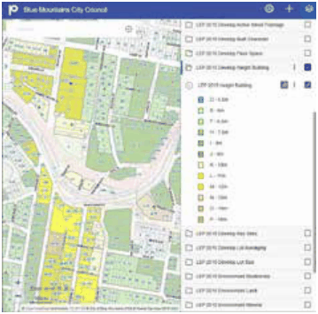
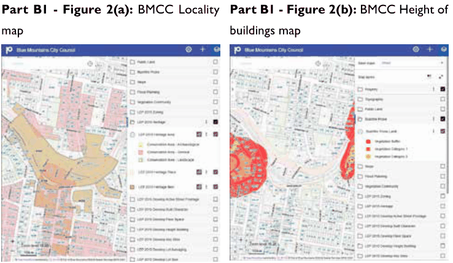
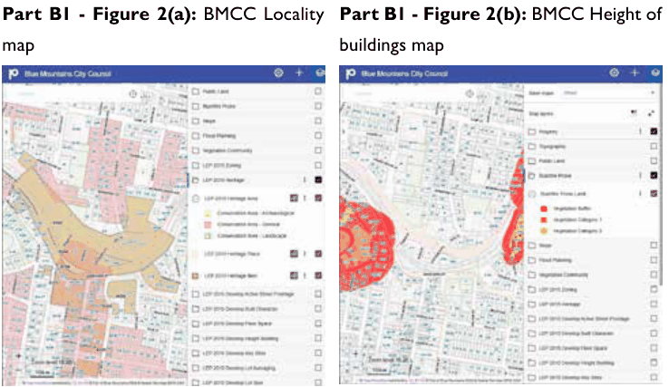
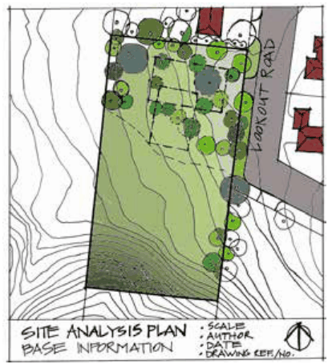
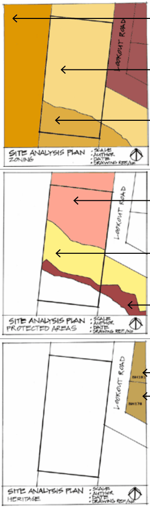

### B1.1. Site Analysis of Opportunities and Constraints

#### Explanation

As a first step in preparing for a development, a site analysis is to be undertaken. An integrated site analysis understands the relationship of a particular site within a given context. It looks at opportunities and constraints to ensure this information is used to inform a design outcome. Buildings designed to specifically address topographic and climatic considerations are generally more comfortable to live in. Appropriate site planning and building design can also minimise issues relating to environmental impact, overshadowing and solar access, thermal comfort, heating and cooling costs, privacy and amenity, vehicular access, waste generation and community safety. The Environmental Planning and Assessment Regulation 2021, under clause 24, requires certain information to be included in any development application. The requirements include but are not limited to a site plan of the land, a sketch of the development and a statement of environmental effects. Refer to the regulations for further information.

Part B1: Site and Context Analysis

The site analysis plan should identify the key opportunities and constraints of the site, taking into account the planning controls within Blue Mountains Local Environmental Plan 2015 (LEP 2015) and this DCP, with particular reference to:

• Zoning (identified on LEP 2015 Land Zoning Map)

• Protected areas (identified on LEP 2015 maps)

• Bush fire prone land (identified on Council’s bush fire prone land map).

• Heritage listing (identified on the LEP 2015 Heritage Map).

• Specific town centre precincts (identified on LEP 2015 Built Character Map)

Council’s pre-lodgement service provides the opportunity for applicants to discuss concept designs with Council once a context and/or site analysis has been carried out.

Part B1: Site and Context Analysis

> [Picture on page 9: a picture, saved as a picture (images/part-b-context-site-analysis-and-design-page-9-2.gif, 150 dpi).]
> Words printed on the picture (copied from the PDF):
> 1\. Understand the specific
> site, context and climatic
> opportunities and
> constraints of your land.
> 3\. Building design including
> 2\. Design or select plans to suit

structural systems, building form

context issues such as aspect,

and choice of materials along with

slope, and location of identified

landscaping, contributes to the

environmental features.

streetscape and locality character.

Part B1 - Figure 1: An integrated site analysis understands the relationship of a particular site within a given context. It looks at opportunities and constraints to ensure this information is used to inform a design outcome. Buildings designed to specifically address topographic, climatic and environmental conditions are generally more comfortable to live in.

#### Objectives

The objectives of undertaking a site analysis are to:

O1. identify the opportunities and constraints of a development site to create a site responsive application, and

O2. enable the most appropriate siting of a development through the identification of protected areas and environmentally sensitive land, and

O3. reduce adverse amenity impacts such as overshadowing, loss of privacy, views or solar access, and improve sustainability outcomes of development, during its construction and operation, and

O4. determine the most appropriate form in terms of bulk and scale that a site can accommodate, and

O5. Identify the opportunities and constraints of a development site to create a site responsive application which works with the local climate to maintain a comfortable temperature in the home, reduce the reliance on additional heating and cooling and lower greenhouse gas emissions.

#### Controls

Part B1: Site and Context Analysis

C1. A site analysis plan is generally required with any development application that includes a new building or external alterations to existing buildings. For minor applications where the land has minimal constraints or the proposal is for minimal external changes, a separate drawing or plan may not be necessary, and the site analysis information can be incorporated onto the site plan. It may also be necessary to incorporate relevant written discussion into the statement of environmental effects.

C2. Site analysis information shall generally take the form of a scaled plan drawing. The site analysis plan is to map basic site features and information, and any additional mapped features. Refer to Part I1.1.1 in Part I Submission Requirements for details of site analysis features.

Note: An indicative building envelope or potential development space can be dotted onto the site analysis plan once all constraints have been identified.

The following image, Part B1 - Figure 3(a), is a base guide to the presentation of site analysis information.

> [Picture on page 11: a picture, saved as a picture (images/part-b-context-site-analysis-and-design-page-11-1.gif, 150 dpi).]

> [Picture on page 11: a picture, saved as a picture (images/part-b-context-site-analysis-and-design-page-11-2.gif, 150 dpi).]

Part B1 - Figure 2(a): BMCC Locality Part B1 - Figure 2(b): BMCC Height of map

> [Picture on page 11: a picture, saved as a picture (images/part-b-context-site-analysis-and-design-page-11-5.gif, 150 dpi).]

buildings map

> [Picture on page 11: a picture, saved as a picture (images/part-b-context-site-analysis-and-design-page-11-7.gif, 150 dpi).]

Part B1: Site and Context Analysis

Part B1 - Figure 2(c): BMCC Heritage Part B1 - figure 2(d): BMCC Bushfire map

prone land map

Figures 2a-2d: Council’s website has an interactive mapping tool which is capable of providing detailed mapping information which can be used in the preparation of a site analysis plan. References to LEP 2015 or other Council maps throughout this DCP provide a hyperlink to this interactive mapping tool. Instructions regarding the use of the interactive mapping is also available on Council’s website.

The site analysis plan should contain relevant site characteristics, including:

• Title block information (see above)

• Lot boundaries, including adjacent lots or part thereof

• Site area and dimensions

• Adjacent road reserves, and site access points nearby (subject and surrounding driveways)

• Contours (preferably at 1 or 2 metre intervals)

• All trees on and adjacent to the site, establishing which trees originate from which site, and size and species where possible.

• Identification of trees proposed to be removed or trees which are likely to be impacted by the proposed development; and trees to be retained. A tree is likely to be impacted if development encroaches more than 10% into the Tree Protection Zone (TPZ).

• Mapped, known or observed environmental features including native vegetation, watercourses, swamps and rock outcrops

• Any existing buildings, sheds, tanks, parking and the like on the site and near site boundaries

• Neighbouring buildings

Part B1: Site and Context Analysis

• Indication of important views to and from the site – for example, protected escarpment areas indicate the importance of uninterrupted views of the tree canopy

• Prevailing sun angles and wind directions

• Potential Asset Protection Zones (APZs) can be shown if relevant

• Required setbacks from front, side and rear boundaries can be shown

• The remaining development space after all site constraints have been identified and considered Refer to Part I1.1.1 of Part I – Submission Requirements for full details.

C3. To determine the most appropriate location and scale of the proposed development, it is strongly recommended that relevant technical studies are undertaken at an early stage in order to inform the design process.

> [Picture on page 13: a picture, saved as a picture (images/part-b-context-site-analysis-and-design-page-13-1.gif, 150 dpi).]

Part B1 - Figure 3(a) - Site analysis basic information

> [Picture on page 13: a picture, saved as a picture (images/part-b-context-site-analysis-and-design-page-13-3.gif, 150 dpi).]

Zone E1 National Parks and Reserves from the LEP 2015 Zoning Map

Zone E4 Environmental Living from the LEP 2015 Zoning Map

Part B1: Site and Context Analysis

Zone E2 Environmental Protection from the LEP 2015 Zoning Map

Part B1 - Figure 3(b) - Site analysis zoning information

Protected area - escarpment area from the LEP 2015 Scenic Landscape Values Map

Protected area - ecological buffer area from the LEP 2015 Biodiversity Natural Resources  Map (note: extends into slope constraint area) Protected area - slope constraint area area from the LEP 2015 Land Natural Resources Map

Part B1 - Figure 3(c) - Site analysis protected areas

Heritage listed properties in the vicinity of the site from the LEP 2015 Heritage Map

Part B1 - Figure 3(d) - Site analysis heritage information
