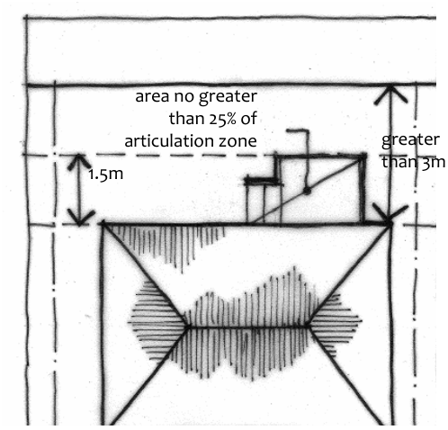

### B2.3.2.	 Building articulation – residential development

C1. Residential development, other than residential development that has a setback from a primary road of less than 3m, may incorporate an articulation zone that extends from the building line to a distance of 1.5m into the required setback from the primary road.

C2. The following building elements are permitted in an articulation zone in the setback from a primary road:

(a) an entry feature or portico, and

(b) a balcony, deck, patio, pergola, terrace or verandah, and

(c) a window box treatment, and

(d) a bay window or similar feature, and

(e) an awning or other feature over a window, and

(f) a sun shading feature.

C3. A building element on a dwelling house (other than a pitched roof to an entry feature or portico that has the same pitch as the roof on the dwelling house) must not extend more than:

Part B2: Building Envelope

(a) 1m above the gutter line of the eaves of a single storey dwelling house, or

(b) above the gutter line of the eaves of a two storey dwelling house.

C4. The maximum total area of all building elements within the articulation zone, other than a building element listed in C2 (e) or (f), must not be more than 25% of the area of the articulation zone.

> [Picture on page 24: a picture, saved as a picture (images/part-b-context-site-analysis-and-design-page-24-24.gif, 150 dpi).]
> Words printed on the picture (copied from the PDF):
> area no greater
> than 25% of
> articulation zone
> greater
> than 3m
> 1.5m

Part B2 - Figure 1: Articulation zone for residential development.
