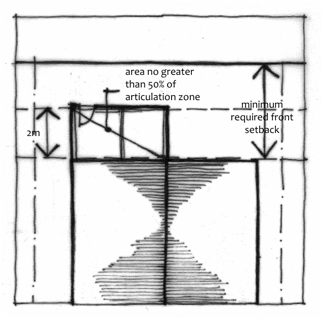

### B2.3.3.	 Building articulation – industrial development

C1. The following building elements are permitted within an articulation zone for an industrial building:

(a) an entry feature or portico, and

(b) an awning or canopy over a door or window.

C2. A building element within the articulation zone of an industrial building:

(a) is not to reduce the required landscape area, car parking spaces or driveway, and

(b) may extend 2m into the minimum required front setback, but must not be more than 50%  of the width of the front facade of the building, and

(c) is not to be more than the maximum height of the building.

> [Picture on page 25: a picture, saved as a picture (images/part-b-context-site-analysis-and-design-page-25-13.gif, 150 dpi).]
> Words printed on the picture (copied from the PDF):
> area no greater
> than 50% of
> articulation zone
> minimum
> required front
> setback
> 2m

Part B2: Building Envelope

Part B2 - Figure 2: Articulation zone for industrial development.
