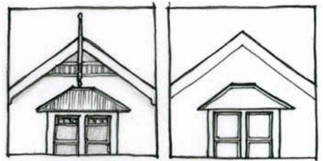
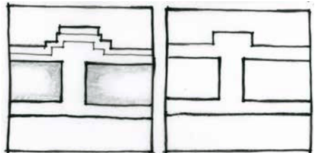
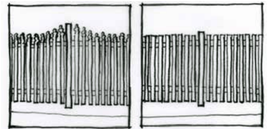
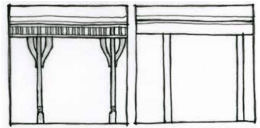

### B3.1.2.	 Infill development

#### Explanation

The use of land within existing urban areas, whether vacant land or land containing older buildings or uses, is termed infill development. Opportunities for infill development provide the chance for the continuing enrichment of urban areas and the creation of additional housing through urban consolidation. The addition of new built forms is an expression of contemporary life and has the potential to create dialogue with older buildings and styles in the vicinity. Council does not necessarily advocate the replication of historical architectural styles for infill development. A contemporary design approach which respects the historic context and achieves a cohesive relationship between the existing and new fabric is required. This section applies to infill development on land within the specific precincts in Part G Precincts of this DCP, that falls within zones E1, E2, R1 and R3, where character considerations apply to a village setting. The primary controls for these areas are within Part G Precincts of this DCP.

Part B3: Character and Design

In heritage conservation areas and for heritage items, the criteria and controls for infill development are more stringent than for other areas. Refer to Part D9.8 Infill development. Landscaping required to accompany development is discussed in detail in Part

C3 Landscaping.

#### Objectives

O1. To ensure infill development achieves a cohesive relationship between new and existing urban fabric and where relevant, retains and enhances cultural significance.

O2. To ensure the design of infill development responds respectfully and sensitively to significant contextual indicators and incorporates innovative design responses.

O3. To ensure the façade of buildings are articulated to address the streetscape and reinforce the architectural character of the village centre streets.

O4. To encourage infill development that demonstrates a high quality contemporary design response where respect for and sympathy with surrounding development can be demonstrated.

#### Controls

C1. Designers of infill development are required to provide a detailed site and context analysis. Refer to Part B1 Site Analysis and Part I for submission requirements. For single dwellings this information can be included in the statement of environmental effects.

C2. Infill development is to reference established aspects of the character of the area, including, floor levels, solid to void ratios of elevations, fenestration patterns, coursing lines and any other significant details of neighbouring buildings. Historic detailing is not to be imitated. Refer to Part B3 - Figure 1.

> [Picture on page 39: a picture, saved as a picture (images/part-b-context-site-analysis-and-design-page-39-11.gif, 150 dpi).]

(a) Original historic gable treatment and simplified gable treatment

> [Picture on page 39: a picture, saved as a picture (images/part-b-context-site-analysis-and-design-page-39-13.gif, 150 dpi).]

Part B3: Character and Design

(b) Original historic fence treatment and simplified rendered brick fence

> [Picture on page 39: a picture, saved as a picture (images/part-b-context-site-analysis-and-design-page-39-16.gif, 150 dpi).]

(c) Original historic picket fencing and simplified timber picket fence

> [Picture on page 40: a picture, saved as a picture (images/part-b-context-site-analysis-and-design-page-40-1.gif, 150 dpi).]

(d) Original historic verandah treatment and simplified timber verandah details

Part B3 - Figure 1: Simplified detailing for infill development.

C3. The established orientation pattern of the streetscape and neighbouring buildings is generally to be adopted by new development.

C4. Buildings are to formally address the street with entrances and windows. Verandahs and balconies can also be appropriate elements.
