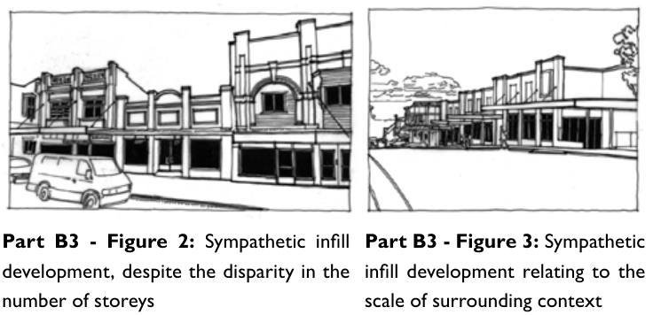
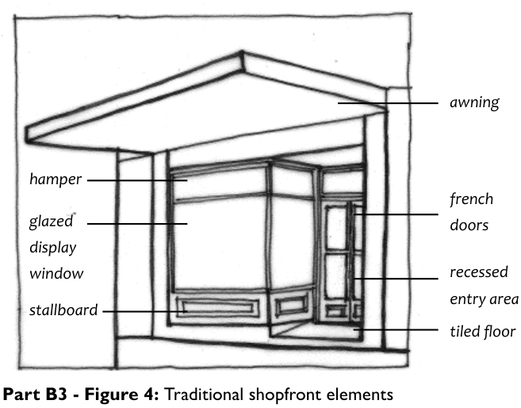
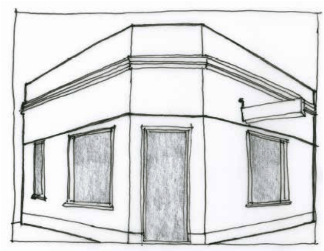
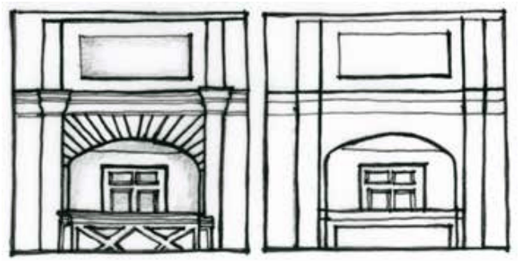

### B3.1.3.	 Infill shopfront buildings

#### Explanation

Part B3: Character and Design

The town centres of the Blue Mountains contain a variety of shopfront buildings, with most based on a traditional pattern of continuous shopfronts in a main street form. In the upper Mountains, most shopfront precincts have high heritage and character value. Due to the historic pattern of town development along the transport corridor, many town centres are small and compact and focus on proximity to road and rail. The existing patterns of small narrow shopfronts with some laneways to provide filtered access to rear parking and secondary areas is a valued aspect of the Mountains character. Where renewal of individual shops, groups of shops or larger areas is proposed, consideration is to be given to traditional shopfront forms, designs and detailing. This section provides guidelines for acceptable types of shopfront design to retain town centre character. These controls apply to zones E1, E2, R1 and R3, where character considerations apply to a village setting. Reference should also be made to Part G Precincts of this DCP. Shopfront buildings that are listed as heritage items or within heritage conservation areas, or those properties in the vicinity of items or conservation areas, are dealt with under the heritage provisions in Part D Heritage.

> [Picture on page 41: a picture, saved as a picture (images/part-b-context-site-analysis-and-design-page-41-1.gif, 150 dpi).]

Part B3 - Figure 2: Sympathetic infill development, despite the disparity in the number of storeys

Part B3 - Figure 3: Sympathetic infill development relating to the scale of surrounding context

#### Objectives

O1. To ensure that the character of small traditional main street and commercial strip development, with filtered access to rear parking areas and secondary areas, is protected and enhanced.

O2. To encourage high quality contemporary shopfronts in appropriate locations and where respect for and sympathy with surrounding development can be demonstrated.

#### Controls

Part B3: Character and Design

C1. Proposals for infill development within the vicinity of significant traditional shopfront buildings are required to demonstrate adequate consideration of the impacts upon those traditional shopfront buildings.

Note: Refer to Part D9.7 Traditional shopfront buildings where heritage considerations apply.

C2. Redevelopment of sites on which significant and contributory buildings are located are to retain and improve the existing street presentation.

C3. Shopfront buildings are generally to contain the following:

(a) vertically-proportioned doors and windows, and

(b) glazed shopfronts to all ground floor retail areas, and

(c) a stallboard below the glazing at least 400mm high, and

(d) a recessed and generally splayed entry, and

(e) continuous suspended metal awnings fronting main streets, and

(f) a high solid to void ratio above awning level, and

(g) parapets or pediments above the upper level, and

(h) cornices or coursing lines below the parapet.

awning

french doors

recessed entry area tiled floor

> [Picture on page 42: a picture, saved as a picture (images/part-b-context-site-analysis-and-design-page-42-7.gif, 150 dpi).]
> Words printed on the picture (copied from the PDF):
> hamper
> glazed
> display
> window
> stallboard

Part B3 - Figure 4: Traditional shopfront elements

C4. Buildings on corner sites are to incorporate splayed corners and other elements to articulate corners. Each frontage of a corner building is to present as a main street frontage, with suspended metal awnings continuing around each corner.

> [Picture on page 42: a picture, saved as a picture (images/part-b-context-site-analysis-and-design-page-42-13.gif, 150 dpi).]

Part B3: Character and Design

Part B3 - Figure 5: Traditional shopfront addressing a corner

C5. Balconies, if provided should be recessed to minimise the visual impact on the streetscape.

C6. Separate the street address for retail uses from residential and commercial uses within each building.

C7. When pitched roofs are proposed, slopes or pitches should match the existing pitched roofs of the area.

C8. Historic details are not to be slavishly imitated. Refer to Part B3 - Figure 6.

> [Picture on page 43: a picture, saved as a picture (images/part-b-context-site-analysis-and-design-page-43-5.gif, 150 dpi).]

Part B3 - Figure 6: Simplification of original historic shopfront detailing provides contextual fit for new development.

C9. Incorporate lift overruns and service plant equipment into the design of the roof and reduce their visibility.

C10. Avoid attic windows and dormers in the roof.

Part B3: Character and Design

C11. Highly reflective finishes and curtain wall glazing are not likely to be supported above the ground floor.

C12. The following wall materials are preferred:

(a) brick with render painted a pale colour, and

(b) plain glass windows with timber or thin steel/metal frames, and

(c) timber joinery and signage.

C13. The following materials are incompatible with the desired character of town centres:

(a) large wall tiles, and

(b) fibre-cement sheeting, and

(c) concrete blocks, and

(d) curtain wall systems, and

(e) reflective or tinted glass.

C14. Use colour schemes compatible with surroundings structures and avoid corporate colour schemes.
