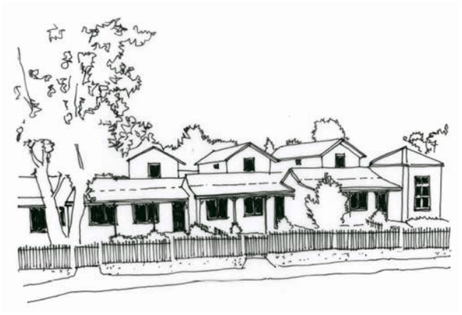
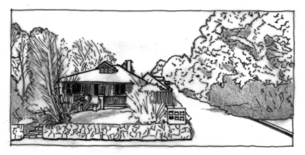
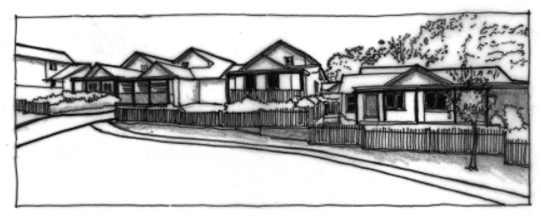
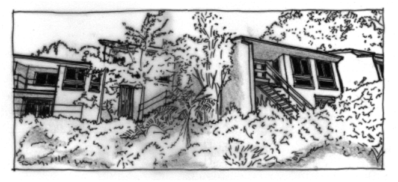
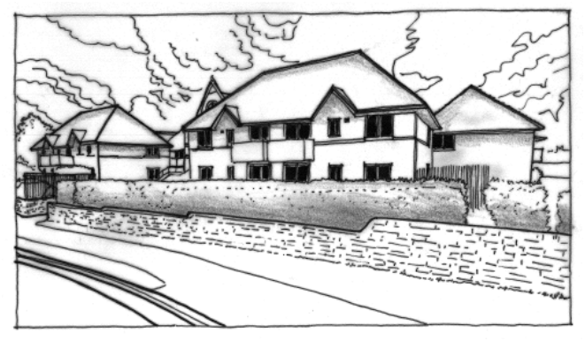

### B3.1.4.	 Medium-density residential development

#### Explanation

Some older lots within the Blue Mountains, mostly close to town centres, may be appropriate for urban renewal in the form of new medium-density development. These types of developments can have a significant impact upon streetscape and character values, and can determine the developing character of areas undergoing transition. Proper integration of these types of new development into traditionally low-density neighbourhoods is critical to ensure the streetscape retains coherence and a pleasing and attractive pedestrian-friendly environment. Design issues relating to the scale, forms, roof forms, materials, detailing, colours and landscaping concept are dealt with in this part. These controls apply to zones E1, E2, R1 and R3, where character considerations apply to a village setting.

Note: Reference should be made to the additional provisions for medium-density development in Part F1 Residential Development.

#### Objectives

Part B3: Character and Design

O1. To ensure that medium-density residential development adequately considers the scale, forms, roof forms, materials, detailing, colours and landscaping of new developments.

#### Controls

C1. Infill development is to demonstrate compliance with the following design indicators where relevant:

(a) modest scale – new development is not to dominate the surrounding environment, but is to be consistent with the predominant scale of existing development, including dominant ridge and/or parapet lines and building massing (building volume and size); and

(b) repetition of forms – New development is to provide good articulation of forms to achieve a modest scale, and provide a repetition of forms that expresses a rhythm and pattern of individual units. To create diversity within repeating forms, there can be differentiation by colour or texture of materials or surfaces; and

> [Picture on page 45: a picture, saved as a picture (images/part-b-context-site-analysis-and-design-page-45-1.gif, 150 dpi).]

Part B3 - Figure 7: Successful medium-density development incorporates simple rhythms, referential roof forms and details, and a modest scale to achieve a successful outcome.

Part B3: Character and Design

(c) traditional roof forms – new development in older areas can relate to existing development by using traditional forms, the most significant being gabled and/or hipped roof forms with a pitch of approximately 35 degrees, and skillion verandah forms to the front and side elevations; and

(d) quality materials – new development should wherever possible be constructed of quality materials, including high quality dry-pressed bricks, corrugated metal roofing, terracotta roof tiles, stone, render and solid timber. The materials and finishes should relate to the surrounding established context, and be used in appropriate locations and proportions; and

(e) simple detailing without overt imitation – the use of verandahs with posts or piers, vertically-proportioned windows, awnings to windows, and articulated fencing that filters views; and

(f) traditional colours – colour schemes are to be generally from a natural and/or historic palette, whether strong heritage colours or muted bushland tones as appropriate. Intense and/or excessively bright colours are to be avoided; and

(g) landscaping – landscaping is to soften the edges of new development, frame primary elevations and provide visual layers through thoughtfully-placed plantings.

> [Picture on page 46: a picture, saved as a picture (images/part-b-context-site-analysis-and-design-page-46-1.gif, 150 dpi).]

Part B3 - Figure 8: An original building on a large lot can provide room for medium-density housing development to the rear whilst retaining the character of the existing streetscape.

> [Picture on page 46: a picture, saved as a picture (images/part-b-context-site-analysis-and-design-page-46-5.gif, 150 dpi).]

Part B3: Character and Design

Part B3 - Figure 9: The use of picket fencing, front verandahs with timber posts, and gabled roof forms in this example provide simple but effective references to more traditional housing types.

> [Picture on page 46: a picture, saved as a picture (images/part-b-context-site-analysis-and-design-page-46-10.gif, 150 dpi).]

Part B3 - Figure 10: Medium-density housing can incorporate some level changes and substantial landscaping to integrate successfully with bushland areas.

> [Picture on page 47: a picture, saved as a picture (images/part-b-context-site-analysis-and-design-page-47-1.gif, 150 dpi).]

Part B3 - Figure 11: The use of quality materials, references to traditional detailing and well-designed landscaping can contribute to strong urban design infill. In this example, new housing around an existing church uses stone walling, large roof forms and gablets to create a sense of place.

Part B3: Character and Design
