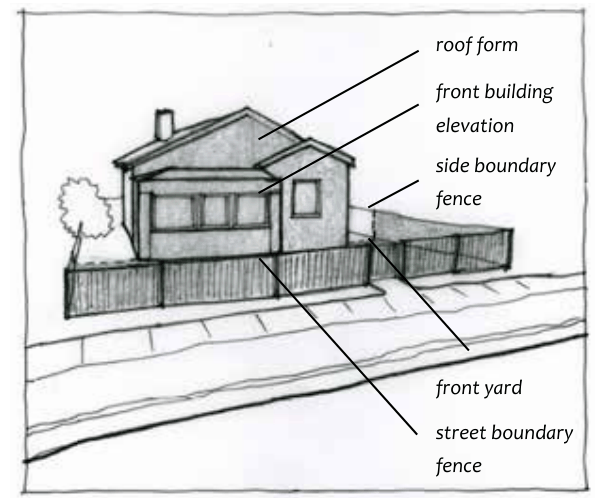
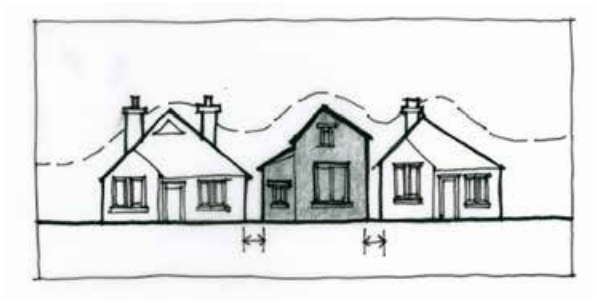

### B3.2.1.	 Context considerations

#### Explanation

Context can be defined as the key natural and built features of an area. This includes the underlying natural landform, distinctive landscape elements, date and style of buildings, scale and form of buildings, street and subdivision patterns, setbacks, materials, building techniques and details, views, vistas and skylines, the solid to void relationships and orientation.

Part B3: Character and Design

This part applies particularly to the streetscape and the street front zone of properties, and is particularly important where there is a consistent and/ or established character. The street front zone (sometimes referred to as the ‘front building setback’) is what is visible from the street, and includes the front and side boundary fences and front garden, and also the front elevation and front and side roof plane/s wherever visible. The scope and type of landscaping is also a consideration in the street front zone. The street front zone establishes the connection between the public and private domains and therefore sets or contributes to the context and character of the neighbourhood.

> [Picture on page 49: a picture, saved as a picture (images/part-b-context-site-analysis-and-design-page-49-24.gif, 150 dpi).]
> Words printed on the picture (copied from the PDF):
> roof form
> front building
> elevation
> side boundary
> fence
> front yard
> street boundary
> fence

Part B3 - Figure 12: Definition of street front zone.

Design considerations apply to all sites; however, factors such as the visibility of a building from the street, and the building size, siting and lot size all contribute to the impact of a building on its context. This section applies to zones R2, C2, C3 and C4, where considerations apply to a low-density, mixed character and/or a sloping, bushland setting.

#### Objectives

O1. To ensure that new development is responsive and sympathetic to the surrounding context in scale, massing, orientation, siting, form, construction and materials.

O2. To retain, conserve and enhance the setting and character of streetscapes and the contribution of significant natural and cultural features.

O3. To ensure that new development emphasises the street and public domain as a vibrant, safe and attractive place for activity and community interaction.

O4. To encourage contemporary architectural expression that is also sensitive to the natural and built setting.

Part B3: Character and Design

O5. To respect and reinforce established bushland character through sensitive design, and to promote contemporary design that has a good contextual fit with an established bushland setting.

#### Controls

C1. Development proposals are to identify local character considerations and demonstrate how new buildings will respond and contribute to the quality and identity of the area. For single dwellings this information can be included in the statement of environmental effects.

C2. Buildings are to be located to ensure compatibility with the site layout and design of adjoining buildings and the prevailing streetscape, in particular in terms of scale, form and other defining elements, whilst allowing for reasonable variation to enable design solutions that avoid uniformity and respond appropriately to context and site characteristics. Refer to Part B3 - Figure 13.

> [Picture on page 51: a picture, saved as a picture (images/part-b-context-site-analysis-and-design-page-51-1.gif, 150 dpi).]

Part B3 - Figure 13: Contextual fit within an existing streetscape.

C3. New development is to minimise visual impacts upon bushland settings, including scenic drives, the Blue Mountains National Park and other significant elements through the use of design, colours and materials which preserve important natural and cultural settings.

C4. New development is to provide legibility, by creating places and spaces that can be easily and positively remembered by people. This can include the creation of architectural elements, paths, and landscaping that have a distinctiveness. Those elements are to contribute to the overall impression of the urban environment.

Part B3: Character and Design

C5. Buildings are to formally address the street, street corners, parks and open spaces and shared driveways through the visually harmonious placement of windows, doors, verandahs, porches and or entry areas to improve streetscape, access and passive surveillance.
