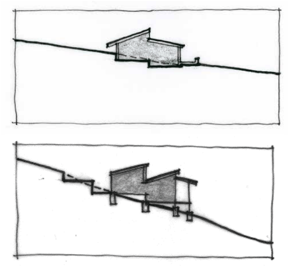

### B3.2.2.	 Siting and site design

#### Explanation

Siting is the location and orientation of the building. Appropriate siting will take into account factors both internal and external to the site: the specific site constraints and opportunities, and the relationship of the building to surrounding buildings and building patterns. Sloping land is common in the Blue Mountains, with steeply sloping land of 1 in 5 or higher usually severely constrained, with site access problems, erosion potential, fire hazards, winds, development visibility, site disturbance and costs greatly increased. The design controls below require adequate consideration of some of the basic design issues related to siting of structures, and compatibility with the clauses of LEP 2015 identified in the note below. This section applies to zones R2, C2, C3 and C4, where considerations apply to a low-density, mixed character and/or a sloping, bushland setting.

Note 1: Properties that are considered slope constrained, at risk of landslide, or proposals that require earthworks will need to consider clauses 6.4 (Protected area

– slope constraint area), 6.5 (Protected area – landslide risk) and 6.14 (Earthworks) of LEP 2015. These clauses seek to identify and protect areas where topography and slope make development unsuitable. Properties affected by this mapping can be identified through the LEP 2015 maps.

Note 2: For landscaping controls and guidelines, refer to Part C3 Landscaping of this DCP.

#### Objectives

O1. To ensure that buildings are sited to fit harmoniously with the existing topography and to minimise visual impacts upon natural settings.

O2. To ensure that the siting of buildings considers significant site constraints such as slope, and minimises site disturbance.

O3. To ensure that the siting of buildings avoids overshadowing of adjoining buildings and that adverse impacts to the solar access to living areas and private open space of adjoining buildings are minimised. Note: Amenity of residential building is covered in detail in Part F1 Residential Development of this DCP.

Part B3: Character and Design

#### Controls

C1. Development siting and design is to respect and enhance the natural landscape attributes that contribute to the character and distinct sense of place of the streetscape and neighbourhood, including:

(a) prominence of ridgelines, and

(b) landmarks, and

(c) topography, and

(d) views, vistas and outlooks, and

(e) waterways, and

(f) vegetation.

C2. Buildings, particularly in bushland settings, are to be located to minimise adverse physical and visual impacts on the site.

Slope controls

C3. Development is encouraged to follow the slope of the site and reduce the need for significant cut and fill through split level design.

> [Picture on page 53: a picture, saved as a picture (images/part-b-context-site-analysis-and-design-page-53-1.gif, 150 dpi).]

Part B3 - Figure 14: Design on sloping sites is to respond to the topography.

C4. Development on land steeper than 1 in 5 is to use split level design and raised floor construction with a protected underfloor where possible.

Part B3: Character and Design

C5. Slab on ground construction is not to be used on slopes steeper than 1 in 10.  Split-level slab on ground construction may be acceptable where slabs follow ground levels.

Site disturbance controls

C6. Buildings are to be sited and designed to keep site disturbance to a minimum. This includes changes in natural ground level, removal of natural topographical features and vegetation and disruption of natural water run-off.

C7. Cut and fill is to be minimised as far as possible and be contained within the building footprint where conditions allow. Cut and fill is generally to be limited to a maximum of 1m in height and depth unless contained within or retained by the walls of the building footprint, particularly where there is potential for adverse environmental impacts or impacts upon adjoining properties.

C8. Roads and paths are to follow the landform where possible.
