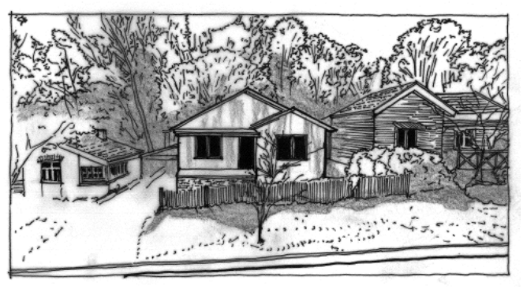
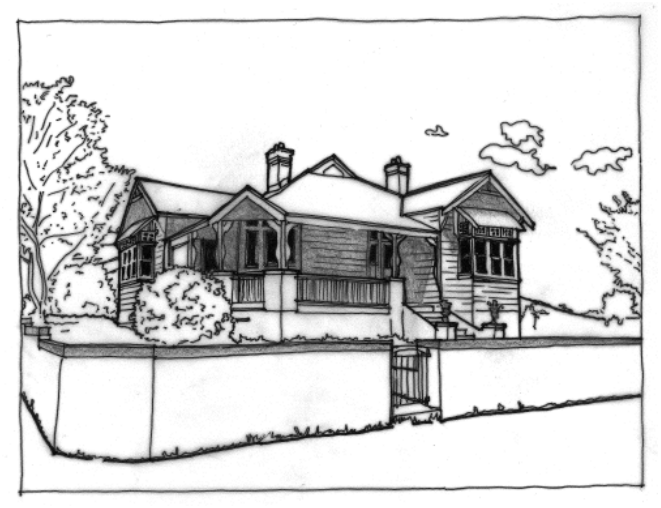
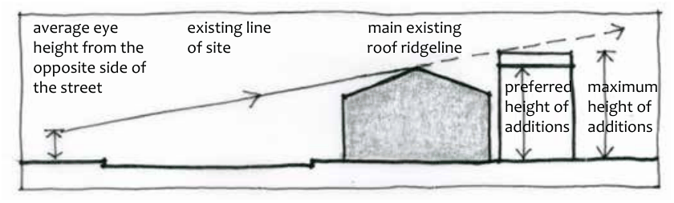

### B3.2.3.	 Building scale, forms and articulation

#### Explanation

The scale of a building is its relative size compared to other elements such as the street, surrounding buildings and the human scale. A building has an overall scale, and can also incorporate elements that give a deliberate perception of scale, in order to reduce perception of height and bulk and to relate to the human scale. Form includes the overall shape, volume and arrangement of its parts. The form of the building will dictate to a large degree the presentation and appearance of the building from the street, as well as the ability to integrate with surrounding development. Form, along with appropriate scale, is a major determinant of high quality design and the protection and enhancement of streetscape qualities. Residential buildings are generally increasing in size, and the desire for amenity and facilities is expanding. These factors are creating a slow but inexorable change in the character, construction and size of new residential buildings. This section applies to zones R2, C2, C3 and C4, where considerations apply to a low-density, mixed character and/or a sloping, bushland setting.

#### Objectives

Part B3: Character and Design

O1. To ensure that building forms provide a presentation appropriate to the surrounding neighbourhood and immediate neighbours in terms of visual appearance and amenity.

O2. To ensure that new forms preserve and enhance site characteristics, site constraints and neighbourhood amenity.

O3. To ensure that building forms provide for quality design of buildings and quality external and internal spaces.

O4. To ensure that new building forms allowed under maximum floor space ratio and building height controls do not inhibit proper consideration of other relevant objectives and controls.

#### Controls

C1. Provide an appropriate bulk and scale to suit the scale of the street and the surrounding buildings. Building design should recognise the predominant scale (height, bulk, density etc.) of the setting and respond sympathetically. The impact of an inappropriately scaled building cannot be compensated for by building form, design or detailing.

> [Picture on page 55: a picture, saved as a picture (images/part-b-context-site-analysis-and-design-page-55-1.gif, 150 dpi).]

Part B3 - Figure 15: Contemporary infill dwellings should be sympathetic to the surrounding context; in this example the referencing of adjacent forms is harmonious, and the retention of the original fence and landscaping ease contextual fit.

C2. Provide a considered response to the scale of existing development in precincts undergoing transition. Proposed bulk and height needs to achieve the scale identified for the desired future character of the area.

Part B3: Character and Design

C3. Where new development is proposed for a corner site, the building is to provide a building form and detailing that addresses both primary and secondary frontages.

> [Picture on page 55: a picture, saved as a picture (images/part-b-context-site-analysis-and-design-page-55-13.gif, 150 dpi).]

Part B3 - Figure 16: A traditional building responding to a corner site, enhancing both the corner and the resulting architecture.

C4. Development is to retain the detached dwelling character of lots through filtered views down side boundaries in low-density residential areas.

Building articulation

C5. Design is to seek a fine-grained and articulated architectural expression. Excessively long roof forms, roof ridges, and unbroken unarticulated walls are to be eliminated. Floor plans are to be articulated such that any wall or roof plane is not to be longer than 15 metres without being articulated by the intersection of other forms and/or details.

Alterations and additions

C6. Additions to an existing building are generally to be:

(a) located to the rear or side of the existing building when viewed from the street front zone, and

(b) not visible over the roof ridge of the primary building, and

(c) compatible with the existing building in regards to bulk and scale, roof forms and materials.

> [Picture on page 56: a map, saved as a picture (images/part-b-context-site-analysis-and-design-page-56-17.gif, 150 dpi); the street names and other small labels are on the picture.]
> Labels printed on the map (copied from the PDF, in no particular order):
> existing line · of site · main existing · roof ridgeline · average eye · height from the · opposite side of · the street · preferred · height of · additions · maximum · height of · additions

Part B3: Character and Design

Part B3 - Figure 17: Acceptable envelope for rear alterations and additions.
