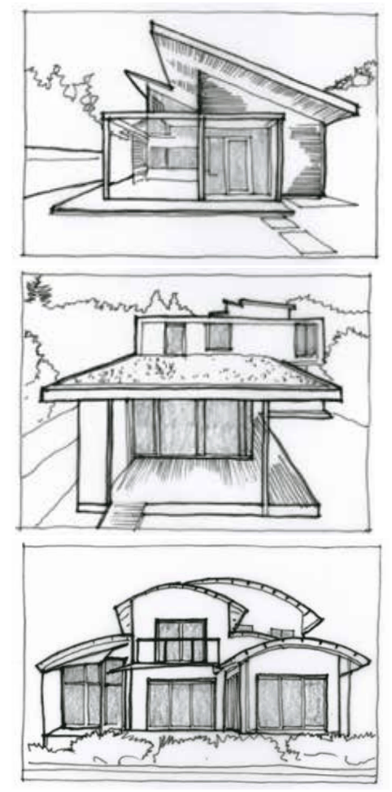

### B3.2.4.	 Roof forms

#### Explanation

Roof forms vary with the layout of the building.  The layout of the building’s interior and external walls determine the ultimate form of the roof; the interior, walls, floor levels, openings and roof must function harmoniously to create the most functional and pleasing internal and external forms. This section applies to zones R2, C2, C3 and C4, where considerations apply to a low-density, mixed character and/or a sloping, bushland setting.

#### Objectives

O1. To ensure that the design of roof forms maximises the potential for functional internal layouts and building envelopes.

O2. To ensure that the design of roof forms is compatible with the surrounding streetscape where desirable.

O3. To ensure that roof designs in bushland settings are compatible with sloping topography.

#### Controls

C1. Roof forms should complement the building envelope, provide good functionality and present well to the street.

> [Picture on page 57: a picture, saved as a picture (images/part-b-context-site-analysis-and-design-page-57-11.gif, 150 dpi).]

Part B3: Character and Design

Part B3 - Figure 18: Atypical roof forms in the Blue Mountains: single skillion roofs, flat roofs and curved roofs.

C2. In bushland settings, rooflines should follow slopes and be below the established tree canopy wherever possible.

C3. Proposals with earth-covered roofs will require specialist information to be submitted for assessment and will be considered on merit.
