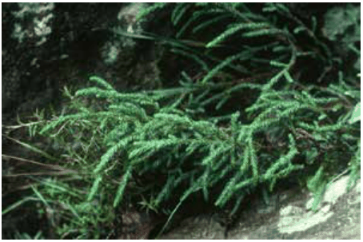
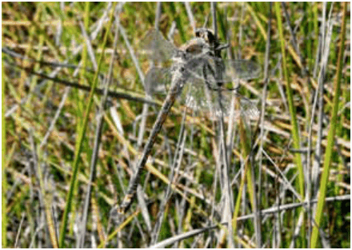

### C1.1. Biodiversity & Natural Resources

#### Objectives

O1. To protect and enhance biodiversity, environmentally sensitive or significant features and natural resources where they occur on or adjacent to, sites proposed for development.

O2. To apply the principles of ecologically sustainable development including: conserving biological diversity and ecological integrity, exercising the precautionary principle and ensuring inter-generational and intra-generational equity.

O3. To balance the conservation of the natural environment with the protection of life and property from bush fire.

#### Controls

C1. Protect and enhance biodiversity, environmentally sensitive or significant natural features and natural resources by:

(a) implementing sustainable development design, layout and practices, and

Part C1: Biodiversity and Natural Resources

(b) maintaining native flora and fauna and their habitat, native vegetation diversity, structure, function and linkages, and the ecological processes and services provided by an ecosystem, and

(c) maintaining natural geological, landscape and escarpment features and habitat areas, and

(d) identifying all likely environmental impacts that may result from the proposed development, and

(e) avoiding, minimising, mitigating and offsetting environmental impacts in an acceptable way using effective measures, ensuring all practical opportunities to avoid environmental impact are utilised.

Note: The consideration of all likely environmental impacts that may result from the proposed development includes 10/50 vegetation clearing entitlement areas (NSW RFS Vegetation Clearing Code of Practice).

C2. Provide a site responsive development and protect the environmental values of the site by ensuring the location and design of the development:

(a) effectively integrates with the natural topography and reflects and compliments natural site features through the location of structures, outlook, design and materials, and

(b) is located as far as practicable within existing cleared areas and avoids unnecessary clearing of native trees and other native vegetation, and

(c) minimises site disturbance and cut and fill, and

(d) is located outside of environmentally sensitive land as far as practicable, and

(e) provides adequately sized buffer areas to protect environmentally sensitive or significant natural features, and

(f) maximises the retention of native vegetation linkages across the landscape, and

(g) incorporates best practice water management techniques to protect the surface and groundwater regimes and water quality of the site.

C3. Development is to balance the conservation of the natural environment with the protection of life and property from bushfire by:

Part C1: Biodiversity and Natural Resources

(a) locating and designing developments and asset protection zones that minimise impacts on native flora and fauna and where possible, are located outside of environmentally sensitive areas, and

(b) considering measures to avoid and minimise environmental impact when implementing all appropriate bushfire protection measures, and

(c) utilising environmentally sensitive methods for fuel reduction in bushland areas.

Note: With reference to C3(b), these measures may include radiant heat shields; sprinklers; increased building construction Bushfire Attack Levels (BAL) or alternative development location

C4. Undertake all reasonable environmental protection works including conservation, regeneration, restoration, management and maintenance to protect and enhance the condition, structure and function of retained bushland and natural areas within the site, including specific environmental protection works necessary for the protection of:

(a) threatened species, threatened populations, and threatened ecological communities and their habitat, and

(b) significant vegetation communities or rare flora species, and

(c) fauna corridors, and

(d) ecological buffer areas, and

(e) watercourses, wetlands and riparian land, and

(f) escarpment areas and geological features, and

(g) National Park and World Heritage Areas.

C5. To protect biodiversity, best management practices are to be implemented in accordance with:

(a) Part C2 - Bushland and weed management - environmental protection works and environmental and priority weed control, and

(b) Part C3 - Landscaping - environmentally sensitive landscaping, and

(c) Part C4 - Bushfire - design and vegetation management in asset protection zones, and

(d) Part C6 - Water management - water sensitive urban design, and

(e) Part E4 - Site management - erosion and sedimentation controls.

Part C1: Biodiversity and Natural Resources

C6. Prior to granting consent to development that has the potential to impact upon biodiversity and environmentally sensitive features or areas, a Flora and Fauna Assessent prepared in accordance with Council’s guideline may be required. In some circumstances, depending on the scale and impact of a proposed development, the condition of the site and history of environmental assessment, a Vegetation Survey and Species Inventory may be required to be prepared instead of a Flora and Fauna Assessment.

Note 1: A Flora and Fauna Assessment is often required in (though not limited

to) the following circumstances where:

• areas of intact bushland will be removed or modified by the development, or

• LEP 2015 environmental protection zones or mapped protected areas are likely to be impacted, or

• threatened species, threatened ecological communities, significant vegetation communities or their habitat are likely to be directly or indirectly impacted, or

• surface or groundwater changes may result, particularly if on-site effluent disposal or groundwater interception is proposed within the catchment of a groundwater dependent ecosystem, or

• proposed works may directly or indirectly impact upon a habitat features such as watercourses or waterbodies, trees with hollows, caves, crevices or other rock habitat features.

Note 2:  Where Council determines that a significant effect on threatened species, threatened populations or threatened ecological communities and their habitats are likely a Species Impact Statement is to be prepared in accordance with State government guidelines.

C7. A Vegetation Management Plan (VMP) prepared in accordance with Council’s guideline may be required to guide the development of the site in circumstances where:

(a) environmental protection works including but not limited to conservation, regeneration, restoration, management and maintenance are necessary, or

(b) the construction or future operation of the development will require removal, or ongoing management of, native vegetation and/or habitat

Part C1: Biodiversity and Natural Resources

C1.2. Threatened Species, Threatened Populations and

### Threatened Ecological Communities

#### Explanation

The Blue Mountains is home to many threatened flora and fauna species, populations and communities listed for protection under the following legislation:

• NSW Biodiversity Conservation (BC) Act, 2016 and records identified on the

BioNet Atlas,

• NSW Fisheries Management Act, 1994

• Commonwealth Environment Protection and Biodiversity Conservation (EPBC) Act,

1999\. Threatened flora found within the Blue Mountains LGA includes Leionema lachnoides, Pultenaea glabra (Smooth Bush Pea), Acacia bynoeana (Bynoe’s Wattle), Persoonia acerosa (Needle Geebung), Pherosphaera fitzgeraldii (Dwarf Mountain Pine) and Leucopogon fletcheri subsp. Fletcheri.

> [Picture on page 14: a picture, saved as a picture (images/part-c-environmental-management-page-14-15.gif, 150 dpi).]

Part C1: Biodiversity and Natural Resources

Part C1 - Figure 2: Pherosphaera fitzgeraldii Threatened fauna species found within the Blue Mountains LGA include Petalura gigantea (Giant Dragonfly), Eulamprus leuraensis (Blue Mountains Water Skink), Hopocephalus bungaroides (Broad-headed Snake), Calyptorhynchus lathami (Glossy Black-Cockatoo), Cercartetus nanus (Eastern Pygmy-Possum) and Dasyurus maculatus (Spotted-tailed Quoll).

> [Picture on page 14: a picture, saved as a picture (images/part-c-environmental-management-page-14-23.gif, 150 dpi).]

Part C1 - Figure 3: Giant Dragonfly

A threatened population of Pultenaea villifera var. villifera located in the Springwood, Winmalee and Warrimoo areas is listed in the NSW BC Act 2016. Critically endangered, endangered and vulnerable ecological communities (CEEC, EEC or VEC) listed in Schedule 2 of the NSW BC Act 2016 and located within the Blue Mountains LGA include:

• Blue Mountains Shale Cap Forest in the Sydney Basin Bioregion (EEC),

• Blue Mountains Swamps in the Sydney Basin Bioregion (VEC),

• Montane Peatlands and Swamps of the New England Tableland, NSW

North Coast, Sydney Basin, South East Corner, South Eastern Highlands

and Australian Alps Bioregions (EEC),

• Newnes Plateau Shrub Swamp in the Sydney Basin Bioregion (EEC),

• Shale/Sandstone Transition Forest (CEEC),

• Sun Valley Cabbage Gum Forest in the Sydney Basin Bioregion (CEEC),

• Sydney Turpentine-Ironbark Forest (CEEC),

• Blue Mountains Basalt Forest (EEC),

• River-flat Eucalypt Forest on Coastal Flood Plains (EEC).

Threatened ecological communities (TECs) listed under the Commonwealth Environment Protection and Biodiversity Conservation Act, 1999 include:

• Shale/Sandstone Transition Forest (CEEC),

Part C1: Biodiversity and Natural Resources

• Temperate Highland Peat Swamps on Sandstone (EEC)

• Turpentine-Ironbark Forest, in the Sydney Basin Bioregion (CEEC)

• Upland Basalt Eucalypt Forest of the Sydney Basin Bioregion (EEC)

The above listed threatened communities are also recognised by the Local Environment Plan as being significant vegetation communities. Many key threatening processes, including the removal of vegetation and habitat loss or change, predation by pest animals, weed invasion and infection by diseases, have been identified in the Act 2016 and the EPBC Act, 1999 as leading to the decline or threat of extinction of threatened species, populations or ecological communities. Clause 1.7 of the Environmental Planning and Assessment Act 1979 gives effect to Parts 7 of the Biodiversity Conservation Act 2016 and Part 7A of the Fisheries Management Act 1994. These parts require an assessment to determine whether a development proposal is likely to result in a significant adverse effect on threatened species, populations or ecological communities or their habitats. Council must consider these parts in the determination of all development applications. A Flora and Fauna Assessment may be required to be prepared in accordance with Council’s guideline.

Note: Commonwealth assessment and approval under the EPBC Act, 1999 is

independent of the Council development application process. It is the responsibility of the applicant to meet obligations under the EPBC Act. However, it is recommended that potential impacts under the EPBC Act are considered concurrently by a Flora and Fauna Assessment, where this is being undertaken for the purpose of a development application.

#### Objectives

O1. To protect, enhance and restore threatened species, threatened populations and threatened ecological communities (TECs) and their habitat.

#### Controls

C1. Identify the location, extent and nature of all threatened species, threatened populations and TECs that occur within the site, relative to the development proposal, on a Site Analysis Plan. Refer to B1 Site Analysis and Part I – Submission Requirements.

C2. The location, design and implementation of the development and any asset protection zone is to demonstrate achievement of the following:

Part C1: Biodiversity and Natural Resources

(a) in satisfying clause 1.7 of the Environmental Planning and Assessment Act 1979, there is to be no significant adverse impact upon any threatened species, threatened populations or threatened ecological communities or their habitats, and

(b) consistency with the management actions and measures specified in all applicable recovery plans or priority action statements for relevant listed threatened species, threatened populations or TECs, and

(c) be sited outside of land containing the threatened species, threatened populations and threatened ecological communities and their habitat, and the ecological buffer areas required to protect them, unless no practical alternative is available, and

(d) maintain, or enhance where necessary, the natural environmental, hydrological and micro-climatic conditions in which that threatened species, threatened population or threatened ecological community exists, and

(e) protect, or enhance where necessary, the natural structure, species diversity and ecological processes of the native vegetation community, within which the threatened species or threatened population exists, or that are representative of the threatened ecological community.

C3. Prior to granting consent to development that has the potential to impact upon threatened species, threatened populations or threatened ecological communities, or their habitats, a Flora and Fauna Assessment prepared in accordance with Council’s guideline may be required.

C4. A Biodiversity Development Assessment Report (BDAR) is required to be submitted with the application when the Biodiversity Offset Scheme (BOS) applies. The BOS applies when a development exceeds the BOS thresholds or is likely to have a significant impact on threatened species or threatened ecological communities according to the test of significance in section 7.3 of the Biodiversity Conservation Act 2016.

Note: Seeking preliminary advice from Council prior to the preparation of a BDAR is strongly recommended.

C5. A Vegetation Management Plan (VMP) prepared in accordance with Council’s guideline may be required to guide the development of the site.  The VMP is to demonstrate the appropriate protection, rehabilitation, restoration and management of threatened species, populations, and threatened ecological communities, and their habitat.

Part C1: Biodiversity and Natural Resources
