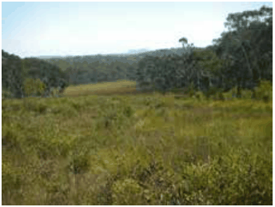
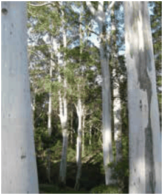

### C1.3. Significant vegetation and rare flora species

#### Explanation

Native vegetation mapping in the Blue Mountains local government area has identified 31 significant vegetation communities (identified in LEP 2015 Schedule 6), including Blue Mountains Heath and Scrub, Blue Mountains Escarpment Complex, Megalong Granite Forest and Blue Gum River Flat Forest. A number of these significant vegetation communities are also currently listed as critically endangered, endangered or vulnerable ecological communities in the NSW Biodiversity Conservation Act 2016 and the Commonwealth Environment Protection and Biodiversity Conservation Act 1999. Rare flora species as referred to in the LEP 2015 and this DCP means any flora species listed in the publication entitled “Rare or Threatened Australian Plants”, Briggs & Leigh, 1995 Revised Edition, also referred to as ROTAP species. Rare flora such as Eucalyptus burgessiana (Faulconbridge Mallee Ash), Lomandra brevis (Tufted Mat-rush) and Lissanthe sapida (Native Cranberry) and Almaleea incurvata are supported by unique habitats within the Blue Mountains LGA.

Part C1: Biodiversity and Natural Resources

Significant vegetation communities and rare species are to be protected in accordance with the provisions of the LEP 2015 clauses 6.1 (Impact on environmentally sensitive land), 6.6 (Protected area-vegetation constraint area) and 6.7 (Protected area-ecological buffer area), and Schedule 6.

> [Picture on page 18: a picture, saved as a picture (images/part-c-environmental-management-page-18-22.gif, 150 dpi).]

Part C1 - Figure 4: Blue Mountains Swamp Community

> [Picture on page 18: a picture, saved as a picture (images/part-c-environmental-management-page-18-24.gif, 150 dpi).]

Part C1 - Figure 5: Eucalyptus deanei in Blue Mountains Shale Cap Forest

#### Objectives

O1. To protect, enhance and restore significant vegetation communities and rare flora species, and the ecological buffers required to protect them.

#### Controls

C1. Identify the location, extent and nature of all significant vegetation communities and rare species of flora that occur within the site, relative to the development proposal, on a Site Analysis Plan. Refer to

B1 Site Analysis and Part I – Submission Requirements.

C2. The location, design and implementation of the development and any asset protection zone is to demonstrate achievement of the following:

(a) In accordance with the provisions of clause 6.1 (Impact on environmentally sensitive land) of LEP 2015, there is to be no adverse impact on any significant vegetation communities and rare flora species, and

Part C1: Biodiversity and Natural Resources

(b) Be sited outside of land containing the significant vegetation communities and rare flora species, and the ecological buffer areas required to protect them, unless no practical alternative is available, and

(c) Maintain, or enhance where necessary, the natural environmental, hydrological and micro-climatic conditions in which the significant vegetation communities and rare flora species exists, and

(d) Protect, or enhance where necessary, the natural structure, species diversity and ecological processes of the native vegetation community within which rare flora species exists, or that are representative of the significant vegetation communities.

C3. Prior to granting consent to development that has the potential to impact upon significant vegetation communities and rare flora species, or their habitats, a Flora and Fauna Assessment prepared in accordance with Council’s guideline may be required.

C4. A Vegetation Management Plan (VMP) prepared in accordance with Council’s guideline may be required to guide the development of the site.  The VMP is to demonstrate the appropriate protection, rehabilitation, restoration and management of threatened species, populations, and threatened ecological communities, and their habitat.
