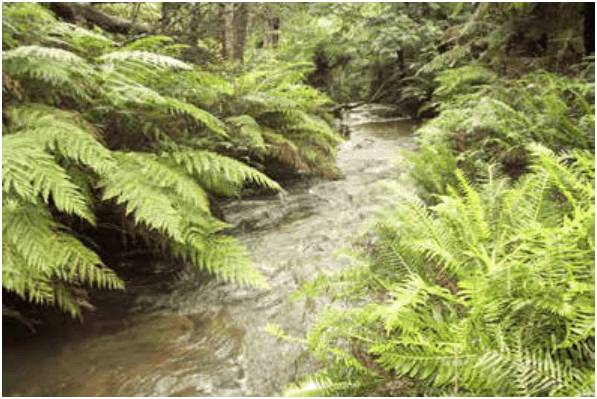
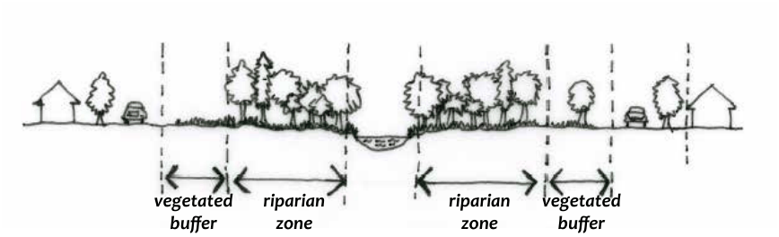

### C1.6. Riparian land and watercourses

#### Explanation

Watercourses and adjacent riparian land together form a riparian corridor that provides important ecosystem services and protects catchment health. Riparian land contains the transition zone between dry terrestrial and aquatic environments. A healthy riparian corridor contributes significantly to the biodiversity value and stream health of a watercourse. They help sustain the food chain for wildlife and provide vegetation connectivity between wildlife habitats. The protection and restoration of native vegetation on riparian land (within a riparian zone) is important for providing bed and bank stability, protecting water quality and providing food, shade, shelter and breeding sites for terrestrial, riparian and aquatic wildlife. Vegetated buffer areas are needed adjacent to riparian zones to protect surface and groundwater regimes, minimise the entry of pollutants and mitigate adverse edge effects of development on riparian zone habitat areas.

Part C1: Biodiversity and Natural Resources

Development applications for works in and near watercourses may also require State Government Approval under the Water Management Act 2000 or Fisheries Management Act 1994 and are to be lodged with Council as Integrated Development. These developments are to comply with State Government requirements and guidelines for in-stream works, riparian corridor protection and fish passage. Riparian land, wetlands and watercourses are to be protected in accordance with the provisions of the LEP 2015 clause 6.1 (Impact on environmentally sensitive land) and clause 6.8 (Protected area – riparian lands and watercourses).

> [Picture on page 25: a picture, saved as a picture (images/part-c-environmental-management-page-25-27.gif, 150 dpi).]

Part C1 - Figure 6: Riparian land and watercourse - Leura Falls Creek

#### Objectives

O1. To protect, enhance and restore watercourses, wetlands and riparian lands and their natural hydrologic, hydraulic, geomorphic and ecological functions.

O2. To protect and enhance the condition and function of riparian and aquatic ecosystems and the life forms they support.

O3. To protect and enhance surface and ground water quality and catchment health.

O4. To provide vegetated buffers between development, and watercourses and their riparian zones.

O5. To rehabilitate degraded watercourses, riparian corridors and riparian vegetation.

#### Controls

C1. Identify the location, extent and nature all watercourses, wetlands and riparian land that occur within the site, relative to the development proposal, on a Site Analysis Plan. Refer to B1 Site Analysis and Part I – Submission Requirements.

Part C1: Biodiversity and Natural Resources

C1. If development is located adjacent to a watercourse, then that development is to comply with LEP 2015 clause 6.8 (Protected area – riparian lands and watercourses).

C2. The location, design and implementation of the development and any asset protection zone are to be sited outside of watercourses, wetlands and riparian land unless no practical alternative is available.

C3. Maintain and restore where necessary the health and integrity of watercourses and riparian land by:

(a) conserving and enhancing riparian corridors, and

(b) protecting the natural landforms and functions of water courses and riparian land, and

(c) avoiding modifications to natural watercourses, and

(d) facilitating the restoration of degraded watercourses, and

(e) applying best-practice design to in-stream works.

C4. Riparian corridors are to be conserved and enhanced by demonstrating the following:

(a) A native vegetation riparian zone is to be protected, and enhanced where necessary, on both sides of a watercourse as shown in Part C1 - Figure 7.

(b) To mitigate the adverse edge effects of adjacent development, particularly for intensive land uses, a vegetated buffer area is to be provided where ever possible between built or hard development surfaces and riparian zones as shown in Part C1 - Figure 7.

> [Picture on page 27: a picture, saved as a picture (images/part-c-environmental-management-page-27-11.gif, 150 dpi).]
> Words printed on the picture (copied from the PDF):
> vegetated
> riparian vegetated
> buffer
> buffer
> riparian
> zone
> zone

Part C1 - Figure 7: A native vegetation riparian zone is to be provided on both sides of a watercourse

Part C1: Biodiversity and Natural Resources

(c) The riparian zone for a watercourse is to be in the range of 10 to 60m, provided on each side of the watercourse and measured from the top of each bank.

(d) The location, extent and nature of riparian zones and vegetated buffer areas required to protect the watercourse, are to be identified, relative to the development proposal, on a Site Analysis Plan.

(e) Council will assess the riparian corridor requirements of each development on its merits. In determining the actual width of the riparian zones and any vegetated buffer areas, the following factors are to be considered:

i. Land use zoning and the relevant objectives of the LEP 2015 and this DCP.

ii. Achievement of multiple outcomes including protection of biodiversity, riparian and aquatic systems, ecological processes, water quality and soil and stream stability.

iii. Maintaining or restoring riparian corridor connectivity up and downstream of the site.

iv. Protection of any significant vegetation communities or other flora determined to have regional, State or Com-monwealth significance.

v. Stream order of the watercourse as defined by the Strahler system.

vi. Adjacent land use intensity.

vii. Buffer area composition and site characteristics.

(f) Native vegetation within the riparian zone is to be protected or regenerated/revegetated where necessary, to achieve, fully structured form (trees, shrubs and groundcover species) or other structure representative of the locally occurring riparian community.

(g) Riparian corridors are to be linked, with other areas of native vegetation to enhance fauna corridors and connectivity between significant natural features wherever possible.

C5. Natural landforms and functions of watercourses and riparian land are to be protected by ensuring any development:

Part C1: Biodiversity and Natural Resources

(a) maintains the natural hydrologic regime and hydraulic conditions, and

(b) preserves the natural alignment of watercourses, and

(c) conserves natural habitat and landscape features that are necessary for the watercourses and riparian zones to function effectively, and

(d) maintains the natural geomorphic and ecological forms and functions of watercourses and riparian land, and

(e) maintains bed and bank stability, prevents erosion and sedimentation and preserves the diversity of in-stream aquatic habitats, and

(f) maintains environmental flow characteristics of the downstream watercourse as far as practicable, and

(g) protects the natural structure, species diversity and ecological processes of the native vegetation communities that occur on riparian land, and

(h) protects water quality and in-stream habitat with effective erosion and sedimentation controls and environmental protection works necessary to prevent erosion and pollution and maintain stream stability.

C6. Avoid modifications to natural watercourses by ensuring:

(a) watercourses are not piped, filled, excavated, re-located or straightened to reduce the natural meander or flow path, and

(b) overland flow paths are identified and accommodated in site planning and development design.

C7. Facilitate the restoration of degraded watercourses by ensuring consideration is given to the following:

(a) Where a development will have a direct impact on a watercourse that has been piped or modified with a constructed channel or gabion wall, this should be removed to restore a natural channel form except where: it is technically unfeasible to reverse the piping or channelization, or restoration of a natural channel form will create a hazard, and

(b) The design and location of any development is not to preclude the future retrofit of piped or otherwise modified watercourses into an open natural channel form.

C8. In-stream works are to achieve best practice design by:

Part C1: Biodiversity and Natural Resources

(a) emulating the natural contours of the bed and banks of the watercourse, not obstructing or adversely affecting the flow of water and maintaining the ecological values and functions of the riparian corridor, and

(b) minimising the number of watercourse crossings, and

(c) providing stormwater outlets that are located to avoid impacts to existing native vegetation, directed downstream, graded at bed level or just below any permanent water level and providing adequate scour protection, and

(d) comprising a design and materials compatible with the natural environment e.g. an environmentally sensitive soft-engineered design, such as a rock-rip rap. Gabions or concrete are to be avoided, and

(e) where appropriate, bank or swamp stabilisation works are to preferably use biodegradable techniques such as brush or coir logs, and

(f) incorporating the re-establishment of native vegetation within disturbed areas utilising locally native sedges, rushes, groundcovers, shrubs and trees as appropriate for the location within the watercourse, riparian zone or floodplain. Revegetation is to emulate the naturally occurring community, species diversity and density.

C9. Prior to granting consent to development that has the potential to impact upon watercourses, wetlands and riparian land, a Flora and Fauna Assessment prepared in accordance with Council’s guideline may be required. The assessment is to provide recommendations for the size and treatment of riparian zones and any vegetated buffer areas, necessary to protect watercourses and riparian land.

C10. A Vegetation Management Plan (VMP) prepared in accordance with Council’s guideline may be required to guide the development of the site.  The VMP is to demonstrate the appropriate protection, rehabilitation, restoration and management of fauna corridors and native vegetation connectivity.

Part C1: Biodiversity and Natural Resources
