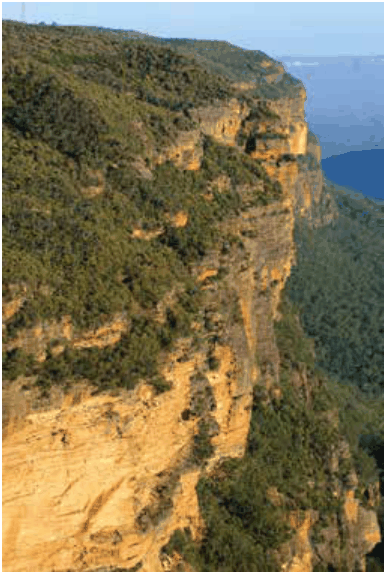

### C1.7. Escarpment areas and geological features

#### Explanation

The escarpment areas of the Blue Mountains comprise a range of unique landforms and features including moist sheltered rock faces, gorges, crevices, ledges, caves, bush rock, steep vegetated slopes and extensive outcroppings of sandstone, escarpments, geological formations and talus slopes. These diverse escarpment landforms and features are associated with a complex variety of distinctive vegetation communities that can vary on a very small scale, ranging from moist cliff line vegetation, heath, swamp, rainforest, mallee and forest. Collectively, this vegetation is recognised as a significant vegetation community, Blue Mountains Escarpment Complex in LEP 2015 Schedule 6. Escarpment areas support a great diversity of plant species, forms and habitat niches and provides unique habitat for many rare or threatened species of flora and fauna. Escarpment areas and geological features are to be protected in accordance with the provisions of the LEP 2015 clause 6.1 (Impact on environmentally sensitive land), and clause 6.12 (Protected area - escarpment).

> [Picture on page 31: a picture, saved as a picture (images/part-c-environmental-management-page-31-18.gif, 150 dpi).]

Part C1: Biodiversity and Natural Resources

Part C1 - Figure 8 Blue Mountains escarpment

#### Objectives

O1. To protect the rock faces, crevices, ledges, caves, talus slopes, bush rock, rock outcrops, escarpments, geological formations, steep vegetated slopes and other significant landscape features that comprise the escarpment system of the Blue Mountains.

O2. To protect the Blue Mountains natural and cultural heritage and its distinctive character and amenity.

O3. To protect unique and rare flora and fauna habitat values and distinctive vegetation communities that the escarpment areas / system supports.

#### Controls

C1. Identify the location, extent and nature of all geological and landscape features comprising escarpment areas within the site, relative to the development proposal, on a Site Analysis Plan. Refer to B1 Site Analysis and Part I – Submission Requirements.

C2. Moist sheltered rock faces, crevices, ledges, caves, talus slopes, bush rock, rock outcrops, escarpments, geological formations, steep vegetated slopes and other significant landscape features that comprise the escarpment system of the Blue Mountains are to be protected and maintained as part of any development.

C3. The location, design and implementation of the development and any asset protection zone is to demonstrate achievement of the following:

(a) The integrity of geological and landscape features comprising the escarpment area are maintained, and

Part C1: Biodiversity and Natural Resources

(b) The protection of vegetation features comprising the escarpment area is maximised, and

Note: The escarpment area provides natural habitat requirements for many threatened flora and fauna species, threatened ecological communities and significant vegetation communities and rare flora. The development is to comply with the provisions of Part C1.2 (Threatened Species, Threatened Populations and Threatened Ecological Communities) and Part C1.3 (Significant vegetation and rare flora species).

(c) Be sited outside of geological, landscape and vegetation features comprising the escarpment area unless no practicable alternative is available, and

(d) Canopy conservation within the escarpment area is maximised. Demonstrate the development and asset protection zones will not have an unacceptable impact with a view analysis from points where the site is visible.
