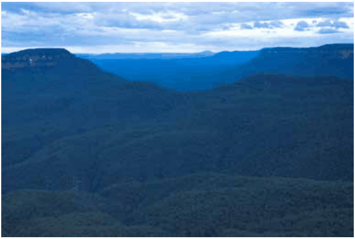

### C1.8. National Park and World Heritage Areas

#### Explanation

Blue Mountains National Park is part of the Greater Blue Mountains World Heritage Area; listed for its remarkable geographic, cultural and botanic values. Development can result in the degradation of the National Park due to urban edge effects including nutrient enrichment, weed invasion and stormwater pollution and erosion. Natural vegetated buffer areas are required to protect the natural, conservation, scientific, scenic, aesthetic, historical, and cultural and heritage values of the Blue Mountains National Park where adjoining development is proposed. National Parks are included within LEP 2015 as Zone C1 National Parks and

#### Nature Reserves.

National Parks are to be protected in accordance with the National Parks and Wildlife Act, 1974. The potential impacts of adjoining development are required to be managed in accordance with the provisions of the LEP 2015 clause 6.1(3) (Development near Blue Mountains National Park).

> [Picture on page 33: a picture, saved as a picture (images/part-c-environmental-management-page-33-17.gif, 150 dpi).]

Part C1: Biodiversity and Natural Resources

Part C1 - Figure 9: Blue Mountains National Park

#### Objectives

O1. To maintain the natural, conservation, scientific, scenic, aesthetic, historical, and cultural and heritage values of the Blue Mountains National Park (which forms part of the Greater Blue Mountains World Heritage Area).

O2. To recognise the importance of the Blue Mountains National Park as the setting of the City.

O3. To provide adequately sized native vegetation buffer areas to protect the natural environment of the Blue Mountains National Park.

#### Controls

C1. Development and any bush fire asset protection zone located on land adjacent to the Blue Mountains National Park is to protect the natural landscape and the aesthetic, historical, heritage, natural, scenic and scientific attributes of the land within the Blue Mountains National Park.

C2. Identify and incorporate all necessary measures to effectively avoid, remedy or mitigate any adverse environmental impact on land within the Blue Mountains National Park. Ensure all opportunities to avoid environmental impact are utilised.

C3. The location, design and implementation of the development and any asset protection zone is to provide an adequately sized native vegetation buffer area, to mitigate adverse environmental impacts of the development on the adjoining Blue Mountains National Park land.

C4. Identify the location, extent and nature of any native vegetation buffer areas required within the site to protect the Blue Mountains National Park, relative to the development proposal, on a Site Analysis Plan. Refer to B1 Site Analysis and Part I – Submission Requirements.

Part C1: Biodiversity and Natural Resources
