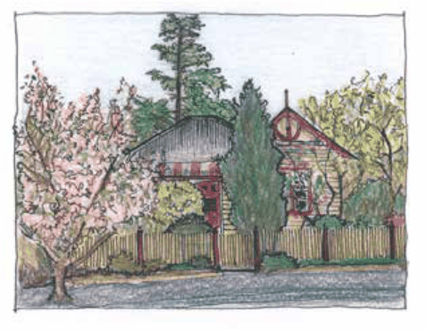

### C3.1. Landscaping Objectives

O1. To ensure that landscaping preserves and contributes to the visual amenity of the Blue Mountains and the existing and past cultural landscape.

O2. To promote the use of a landscaping style which reflects and reinforces the character of the locality and the maintenance of any aesthetic, cultural, scientific and biodiversity values which apply to the site.

O3. To encourage the retention of trees and other vegetation which are of ecological, aesthetic and cultural significance, through the integration of these features into the landscape.

O4. To provide adequate landscaping in accordance with the type, scale, location, climatic conditions and land use zone of the proposed development.

O5. To ensure that landscaping is designed, constructed and maintained to appropriately manage the interface between the natural landscape and the urban environment, in a manner consistent with the sustainability of the Blue Mountains ecological systems and biodiversity and the need to protect life and property from bush fire.

Part C3: Landscaping

O6. To minimise the potential harm to fauna and flora habitat areas and ecological processes through the selection of non-invasive plant material as a first choice for landscaping in all land use zones.

O7. To ensure that landscaping does not unreasonably interfere with the liveability and/or solar access to buildings or open space areas on adjoining properties.

O8. To promote climate change adaptation through landscape design which minimises water use, provides for microclimate modification, reduces urban heat, consolidates and interconnects vegetation, habitat and waterways, is resilient to storms and drought and minimises bushfire risk.

O9. To achieve a neutral or beneficial effect on the urban forest tree cover, to mitigate urban heat island effect and maintain biodiversity, landscape amenity and liveability.

> [Picture on page 75: a picture, saved as a picture (images/part-c-environmental-management-page-75-1.gif, 150 dpi).]

Part C3 - Figure 1: “It is possible to beautify almost any area, whatever shape or size, with a garden”. Ellis Stones
