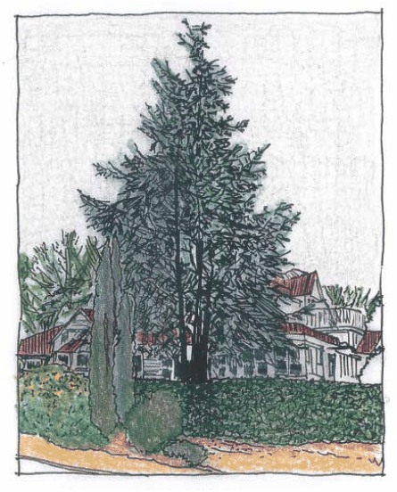

### C3.3. Retention and protection of trees and other

### vegetation

#### Explanation

The retention of established trees and other vegetation on development sites contributes to the conservation of existing landscape amenity, the retention of habitat components within the urban setting, and may reduce the overall environmental impact of new development.

#### Controls

C1. Development should minimise the removal of mature vegetation and site disturbance, and wherever practicable, existing established indigenous or other desirable landscape trees and other vegetation are to be prioritised for retention and incorporation into the landscape design.

Note: Trees and landscape settings within conservation areas or heritage items may require special consideration for retention. Refer to D9.4 Curtilages, settings, gardens and landscape settings, and C5.3 .

Part C3: Landscaping

C2. Vegetation retention is to consider resilience. Healthy, structurally sound and undamaged trees and other vegetation are to be the first priority for conservation within proposed landscape areas.

C3. Consideration is to be given to the retention of trees in groups wherever it is possible to do so, as this generally provides increased resistance to storm events.

C4. Existing street front and road reserve plantings and remnant vegetation are to be conserved except where their removal is necessary for site access via a single road opening, which is to be located so as to minimise vegetation loss.

C5. Where the removal of landscape features which contribute to the streetscape or character of the locality is required to enable development, their loss is to be adequately compensated by replanting, subject to:

(a) whether site conditions permit replanting, and

(b) the necessity for further planting, having regard to the overall retention of trees and vegetation on the development site.

Note:  Species selected to meet compensatory tree planting requirements should generally be of an equivalent stature (particularly height at maturity) to the landscape elements removed.

> [Picture on page 77: a picture, saved as a picture (images/part-c-environmental-management-page-77-1.gif, 150 dpi).]

Part C3 - Figure 2: Streetscape trees: Tall streetfront trees with strong architectural form may enhance the amenity of the locality and contribute significantly to the neighbourhood character.

Part C3: Landscaping

C6. Cut and fill and other soil modification is to be avoided in locations where vegetation and trees are to be retained. Where this cannot be avoided, an Arboricultural Impact Assessment is to be submitted which provides an assessment of the safe useful life expectancy (SULE) of that vegetation as it is affected by the proposal.

C7. Provision is to be made for the adequate protection of existing trees and vegetation to be retained. Exclusion zone fencing and any other measures determined to be necessary to ensure their protection during construction, are to be detailed on a landscape plan or similar documentation.

Note: A Tree Removal and Retention Plan or an Arboricultural Survey Report of existing trees on the development site and/or on lands which immediately adjoin the development area may be required. This may be necessary to determine the viability and suitability of trees for retention in the landscape, and in order to determine the extent of tree protection required.
