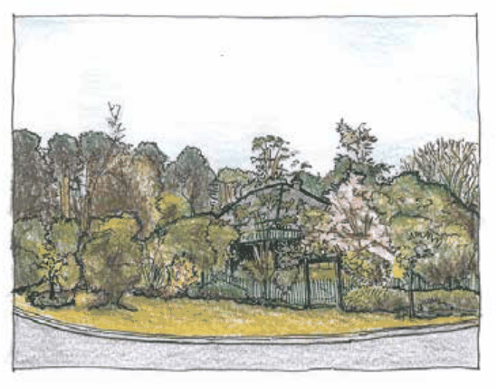

### C3.4. Landscape design, scale and amenity

#### Explanation

Landscaped areas perform a multiplicity of functions; some primary (such as screening and privacy or conservation of local amenity) and others secondary (including micro-climate modification).  In the development of the landscape design, it is therefore important to identify all of the functional requirements that relate to a development, so that these can inform your design requirements.

#### Controls

C1. Landscape design should be responsive and complementary to the bulk and scale of the proposed development. It is to include plant material capable of achieving sufficient mature height to achieve a balance between the built form and the landscape elements.

C2. Sufficient space is to be reserved for the installation of appropriate plantings within parts of the site proposed for private open space areas, deep soil zones and permeable surfaces. These areas are to be effectively distributed on the site to achieve a visual balance between the built form and open space.

Part C3: Landscaping

C3. Landscape planting is to assist in minimising the visual impact of the development from public areas and from adjoining properties, whilst also maintaining opportunities for natural surveillance. To achieve this outcome, screen planting should  generally be provided at the following densities within garden bed areas:

(a) trees at 8m centres, and

(b) larger shrubs at 3m centres, and

(c) medium shrubs at 1.5m - 2m centres, and

(d) groundcovers and small shrubs at 0.5m – 1.0m centres.

Note 1:  The outcome can be adjusted by varying the planting density of large to medium shrubs.

Note 2: The overall depth and continuity of the screen planting area may need to be adjusted on bushfire prone land.

C4. A proportion of the front building setback on land within Residential Zones and within Zones C3 Environmental Management and

C4 Environmental Living is to be maintained as landscaped area (comprised of garden beds containing trees, shrubs and groundcovers or areas of retained indigenous vegetation).  As a general guide:

(a) 25% for lots less than 18m wide, and

(b) 50% for lots greater than 18m wide.

Note: Provision for the planting of trees is encouraged in the property front setback area unless the width of the block or the dimensions of the existing front setback area are inappropriate for tree planting.

> [Picture on page 79: a picture, saved as a picture (images/part-c-environmental-management-page-79-11.gif, 150 dpi).]

Part C3: Landscaping

Part C3 - Figure 3: Landscape scale: Tall mid-block canopy plantings form a visual backdrop for multiple layers of more complex and smaller-scale plantings in proximity to the dwelling.

C5. The landscape is to incorporate garden bed areas of appropriate dimension and sufficient soil volume, to enable the successful establishment of landscape elements. The following minimum garden bed widths are generally required:

(a) garden beds without trees: 1.5m, and

(b) garden beds with trees: 5m.

Note: The soil volume required for tree establishment may, under certain circumstances, be partially met by any pervious area devoid of structures, which adjoins a narrower garden bed.  Also see requirements for deep soil zones.

C6. Deep Soil Zones, retained as areas of natural ground, free of artificial structures and with a relatively unmodified soil profile are to be provided within the development site. Deep Soil Zones are to have minimum dimensions of 3m x 3m in order to permit the establishment and growth of large trees, and to promote rainwater infiltration.  The following minimum areas are to be provided:

(a) single dwelling development within Zones C3 Environmental Management and C4 Environmental Living:  40% of the site area, and

(b) within Zone R1 General Residential, R2 Low Density Residential and R3 Medium Density Residential: 15% of the site area, and

(c) within Zone E3 Productivity Support and E4 General Industrial: 10% of the site area.

(d) within Zone SP3 Tourist: 20% of site area.

Part C3: Landscaping

C7. The principles of passive solar design are to be incorporated into landscape design and the selection and location of tree and hedge species. There is to be consideration of the current and future amenity of residents and neighbours in terms of solar access, including ensuring that existing roof mounted solar energy systems are taken into account and not obstructed by vegetation.

C8. The location of structures, services (overhead and underground) and footpaths is to be adequately considered during the design of the landscape and in the selection of plant material. This will reduce potential future damage to these features.

C9. Stormwater management, including improved infiltration and the reduction of overland flow, is to be promoted within the landscape design and in the selection of plant material. The inclusion of Water Sensitive Urban Design features is to be considered.

Note: Refer to Part C6 Water Management of this DCP, with particular reference to Water Sensitive Urban Design (WSUD).

C10. Landscaping should contribute in a positive manner to bushfire protection strategies. The design is to ensure that landscaped areas are established and maintained in accordance with any Asset Protection Zone (APZ) requirements that may apply to the site, particularly in relation to building setbacks, vegetation density and canopy continuity.

Note: Refer to Part C4 Bushfire of this DCP.

C11. Landscaping in the vicinity of a heritage item is not to detract from the heritage value of the place. Careful consideration is to be given to plant selection and placement to ensure the potential for overshadowing or visual obstruction of heritage features is minimised.

Note: Refer to D5 Development in the vicinity of heritage items or conservation areas.

C12. Constructed elements within the landscape, including retaining walls, excavated and filled areas and ponds, are to be designed and located so as not to adversely impact on retained trees, natural features or an adjoining property.

Note 1: Adverse impacts may include damage to plant roots, diversion of stormwater runoff, modification or interference with ground water or surface aquifers, and any changes to the structural integrity of existing fencing or privacy screening.

Note 2: If the ground level is modified within the canopy spread of a tree to be retained, an arborist’s report may be required to assess the impact of the proposed works. Refer to AS4970 Protection of Trees On Development Sites.

Part C3: Landscaping
