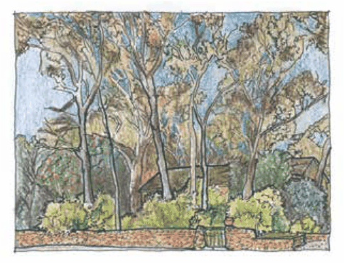

### C3.5. Plant Material Selection

#### Explanation

Plant material is one of the key elements to consider within the landscape design.  Living in the Blue Mountains does not limit plant selection to the use of only indigenous species.  Although this is an objective of some land use zones (C3 Environmental Management and C4 Environmental Living), within other residential zones (R1 General Residential, R2 Low Density Residential and R3 Medium Density Residential), the use of exotic species may be more appropriate, depending upon the character and setting of the development site. However, when using non-indigenous species in any zone, whether these are native or exotic, it is important to ensure that these are not known to be invasive in bushland areas of the Blue Mountains.

#### Controls

C1. Plant material selection is to consider the land use zone within which the development is located, and compatibility with the specific objectives of that zone.

C2. Plant selection for all landscaping work is to consider its suitability to existing site conditions such as soils, aspect, drainage, elevation above sea level and prevailing climatic conditions.

Part C3: Landscaping

C3. Plant material selected for use within each area of the landscape is to include an appropriate range of height and foliage density to meet specific landscape functional requirements identified for the landscape.

C4. Plant material with high aesthetic appeal, longevity, water use efficiency and known or predictable maintenance requirements should be prioritised for use in the landscape.

> [Picture on page 82: a picture, saved as a picture (images/part-c-environmental-management-page-82-27.gif, 150 dpi).]

Part C3 - Figure 4: Blended landscapes: Indigenous canopy trees can be combined with traditional elements such as dry stone walls and exotic understorey plantings.

C5. Landscape planting proposed along front and side boundary alignments is to consider the plants mature height, width and root architecture to ensure that they will not unreasonably impact on adjoining land.

C6. Plant species listed within Part C2.3 Weeds of the Blue Mountains of this DCP, are not to be included in any new landscaped areas.

C7. Where development is located in or adjoining environmentally sensitive areas, the selection of plant material is to be restricted to appropriate locally indigenous vegetation.

C8. Within Asset Protection Zones, plant material selected for use is to contain low levels of volatile oils, possess high leaf moisture content and retain low levels of dead material, flaky or stringy bark.

Note: Refer to Part C4 Bushfire of this DCP.

C9. Landscape planting and plant selection within any road verge area is to be in accordance with the Blue Mountains City Council Street Tree Masterplan guidelines.

Note: Refer to Part E8 Public Domain of this DCP.

Part C3: Landscaping

C10. Deciduous species are to be located away from stormwater flow paths and roadways to limit the pollution and obstruction of waterways from leaf material.
