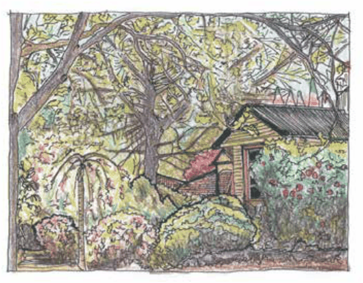

### C3.8. Additional Zone Specific Controls

#### Explanation

Each land use zone listed under LEP 2015 has specific objectives for development, and a number of these relate to character, landscape and environmental outcomes. This section provides guidance and controls relating to the landscape character for specific land use zones, and identifies the level of detail required within the landscape plan.

#### Controls

C1. A landscape plan is required to support any development application within Zones R1 General Residential, R2 Low Density Residential,

R3 Medium Density Residential; E3 Productivity Support;

E4 General Industrial, C3 Environmental Management,

C4 Environmental Living; W1 Natural Waterways and SP3 Tourist except for those developments which do not include external works, or are for minor additions and alterations.

Note 1:  The following zone specific controls, in combination with the former general controls, and any development specific controls which are nominated elsewhere in this DCP, provide guidance relevant to the character, style and spatial extent of landscaping required within each land use area.

Part C3: Landscaping

R1 General Residential, R2 Low Density Residential and R3 Medium

#### Density Residential

C2. Sufficient landscape planting is to be included as an integral component of any development proposal, except for minor additions and alterations.

C3. Landscape style and plant selection is to recognise and maintain the distinct character of the relevant village location and is to maintain appropriate transitions to adjoining land uses.

C4. The established traditional streetscape character and heritage values are to be retained and enhanced by the use of appropriate landscape design and thoughtful species selection, whilst being mindful of issues such as solar access and the location of overhead and underground services.

C5. Given the invasive potential of certain traditional plant species, the use of alternative, non-invasive or low weed risk species capable of achieving the desired landscape outcomes is to be investigated for all new landscaping works.

> [Picture on page 87: a picture, saved as a picture (images/part-c-environmental-management-page-87-1.gif, 150 dpi).]

Part C3 - Figure 5: Enhanced cultural landscape: Landscaping within heritage precincts and along major tourist routes should seek to retain and enhance traditional garden settings and promote interactive street frontages.

Part C3: Landscaping

C6. Interactive street frontages are to be promoted through the use of tiered planting in preference to tall mono-specific hedges within the front setback. The planting palette in these areas should contain a suitable selection of tree, shrub and groundcover species of mixed form and colour to enhance the street front presentation, visual accessibility and local amenity.

C7. Where development is located on streets which represent major tourist routes, priority is to be given to the retention of healthy and structurally sound indigenous canopy trees or mature landscape trees which retain and frame view lines. The planting of tall hedges which may impede views is not supported.

C8. Street trees are to be provided at a ratio of 1 per 9 linear metres of site frontage.

Note: Species selection is to be in accordance with the guidelines provided within the Street Tree Master Plan. Refer to Part E8 Public Domain, of this DCP.
