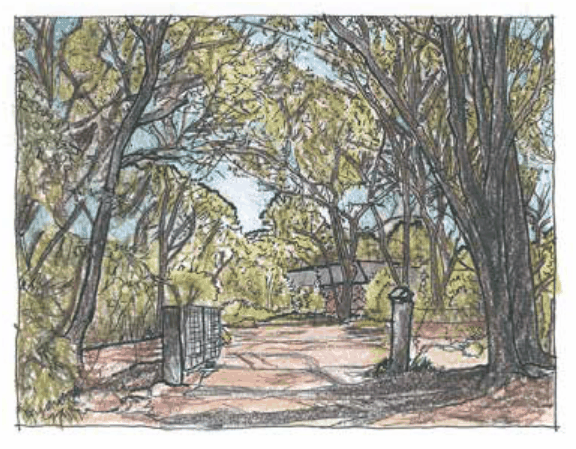

#### E3 Productivity Support and E4 General Industrial

C9. A landscape setting for industrial land uses is to be promoted, and wherever possible, existing bushland, environmentally sensitive features or other local character elements are to be retained and incorporated into the landscape setting.

C10. Dominant plant species selected for use should be non-invasive and long lived exotic or native species of moderate diversity, with low maintenance requirements. Plant material selected needs to be tolerant of higher intensity site use.

C11. Landscape elements proposed are to be consistent with any provided or required Water Sensitive Urban Design (WSUD) elements, and are not to result in any conflict in achieving water quality outcomes.

C12. Street trees are to be provided at a ratio of 1 per 9 linear metres of site frontage.

Note: Species selection is to be in accordance with the guidelines provided within the Street Tree Master Plan. Refer to Part E8 Public Domain, of this DCP.

C3 Environmental Management and C4 Environmental Living

C13. Landscape style is to reflect the characteristics of the locally indigenous vegetation and reinforce the bushland character and natural qualities of the environment. The use of single species or formal style hedges and other formal planting styles is discouraged.

> [Picture on page 88: a picture, saved as a picture (images/part-c-environmental-management-page-88-18.gif, 150 dpi).]

Part C3: Landscaping

Part C3 - Figure 6: Landscape settings in zone C3 Environmental Management: Landscape settings feature retained indigenous vegetation as a dominant element to minimise the visual impact of development.

C14. Within Zone C3 Environmental Management existing locally indigenous plant species are to be retained within the front setback to the maximum practical extent so as to maintain the bushland character and provide mitigation of the visual impact of the proposed development, subject to protecting life and property from bushfire.

C15. Within Zone C4 Environmental Living, existing locally indigenous plant species, where present, are to be retained and incorporated into site landscaping.

C16. Locally indigenous or other non-invasive native species are to be provided as the dominant component of new planting. As a guide, the following proportions are recommended:

(a) within Zone C3 Environment Management: 80%, and

(b) within Zone C4 Environmental Living: 60%.

Plant selection should prioritise species of high habitat value and low flammability.

C17. Within areas adjoining or overlooking the Blue Mountains National Park, existing locally indigenous vegetation and/or new landscaping is to be provided between the built form and the Park boundary, subject to protecting life and property from bushfire, so as to minimise the visual impact of development.

C18. Where natural features such as rock outcrops occur on site, these are to be protected and conserved for their amenity and habitat value.

Part C3: Landscaping

C19. Where indigenous vegetation has been previously cleared or damaged, replanting of locally indigenous species is to be provided so as to emulate a bushland setting for the development, subject to the provision of any required Asset Protection Zone (APZ). New planting is to include species from all stratum (tree, shrub and ground layer) which may have naturally occurred in the locality.

Note: Additional environmental protection works may be required to facilitate the establishment of plantings. Refer to Part C2 Bushland and Weed Management.

C20. Should additional or complementary planting be required in areas identified as containing a Significant Vegetation Community or a threatened ecological community, only local provenance plant material is to be used.

C21. Plant species listed within Part C2.3 Weeds of the Blue Mountains of this DCP are not to be retained or used in any new landscaped areas. Existing weed infestations are to be systematically and progressively controlled.

Note: Refer to Part C2.2 for weed control requirements

C22. Landscaped areas are to contain good structural and plant diversity to provide a variety of habitat niches for a broad range of indigenous wildlife. Excavated bush rock should be reused in the landscape to create habitat complexity and assist in soil conservation.

C23. Within zone C3 Environmental Management, development for the purposes of horticulture  is to be designed to minimise adverse impacts on adjoining natural areas through implementation of the following elements:

(a) ensuring that the planted area is adequately bunded to minimise impacts from fertilizers and irrigation, and

(b) providing buffer plantings which are nutrient tolerant and non-invasive around the perimeter of horticultural areas to limit nutrient leachate.
