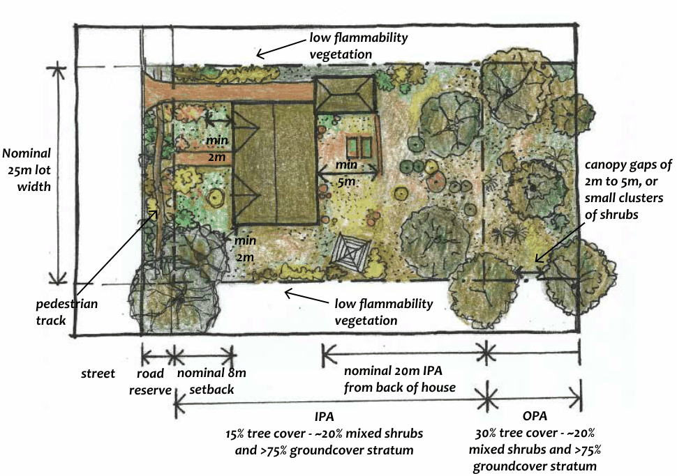

### C4.4. Asset Protection Zones

#### Explanation

Asset Protection Zones (APZs) are one of the key bushfire protection measures outlined in Planning for Bushfire Protection 2019 (PBP) and further detailed in the document Standards for Asset Protection Zones. The implementation of APZs, in combination with measures such as the construction standard and design of a building, the provision of adequate water supply and suitable landscaping, reduce the bushfire risk to life and property. Asset Protection Zones generally fall into the following two categories:

• Inner Protection Areas (IPA)

The IPA is located closest to the building or asset, is intended to provide defendable space and to manage heat intensities at the surface of the building.

• Outer Protection Areas (OPA)

The OPA is located beyond the Inner Protection Area, and is intended to slow the fire, filter embers and reduce the likelihood of a crown fire. The requirements and specifications for these types of APZs are contained in PBP.

Part C4: Bushfire

Where APZs are required within bushland areas, it is important that vegetation modification (i.e. slashing, pruning, thinning and removal) is undertaken in a way which will comply with the relevant bushfire legislation, as well as the requirements for environmental protection under LEP 2015.

#### Controls

C1. Development is to balance the conservation of the natural environment with the protection of life and property from bushfire by:

(a) locating and designing developments and asset protection zones that minimise impacts on native flora and fauna and where possible, are located outside of environmentally sensitive areas, and

(b) considering measures to avoid and minimise environmental impact when implementing all appropriate bushfire protection measures, and

(c) utilising environmentally sensitive methods for fuel reduction in bushland areas.

Note: With reference to C1(b), these measures may include radiant heat shields; sprinklers; increased building construction Bushfire Attack Levels (BAL) or alternative development location

C2. The extent, nature, method and timeframes for vegetation modification required to establish and/or maintain the required asset protection zones is to be detailed and implemented in accordance with a Vegetation Management Plan (VMP) or  as otherwise conditioned by Council in the development consent.

C3. Vegetation modification is to involve the minimum level of disturbance (i.e. slashing, pruning, thinning or removal) to existing vegetation required to comply with PBP and Standards for Asset Protection Zones.

C4. Vegetation modification is to maintain the natural vegetation character and habitat values of the site by retaining and/or allowing the regeneration of elements of each stratum (groundcover/ shrub/ canopy).

C5. To achieve the reduced fuel levels, any indigenous vegetation removal is to selectively target the removal of more flammable species and prioritise the retention of those species with lower flammability and high habitat value.

C6. Undertake vegetation modification using methods which result in minimal soil disturbance and minimal damage to adjacent bushland to be retained.

Part C4: Bushfire

C7. Ensure retained shrub and tree clumps do not form a continuous canopy across the APZ and prune selected limbs to achieve both vertical and horizontal separation in preference to complete tree removal.

C8. Maintain at least 75% cover of appropriate ground layer vegetation, and up to 90% on steep slopes to reduce the potential for soil erosion and weed invasion.

C9. Where tree removal is required to achieve canopy separation:

(a) Select trees for removal based on their type, health and structure, and prioritise trees of poor quality and form, and

(b) Only remove trees where necessary to achieve a 15% canopy cover for an IPA or a 30% canopy cover for OPA, and

(c) Only remove trees where necessary to achieve a maximum canopy separation of two to five metres between clusters or islands of vegetation or between retained vegetation and built structures, and

(d) Aim to retain a variety of age classes of trees within the APZ to ensure sustainability of the canopy, and

(e) Retain tall, forest form trees with light or open canopies in small clumps or islands, where they are better able to resist wind , and

(f) Stumps may be ground or retained in situ to maintain soil stability, and

(g) Prioritise species with smooth or hard, persistent bark for retention over rough or ribbon barked species within the IPA, and

(h) To retain greater habitat complexity, species with rough, flaky or ribbon bark may be retained in small numbers within the APZ, but not directly adjacent to any asset, and

(i) Avoid removal of trees with hollows, or where there is evidence of fauna occupation. Where removal of an occupied tree is unavoidable, safe removal and relocation of fauna is to be undertaken by a licensed wildlife handler prior to carrying out any works.

C10. Weed removal is to be prioritised over indigenous vegetation removal within any APZ. Any priority or environmental weeds are to be removed to ensure regeneration of these weeds does not occur.

Note: For a list priority and environmental weeds refer to Part C2.3 Weeds

Part C4: Bushfire

of the Blue Mountains of this DCP.

C11. Where the APZ extends into degraded bushland, facilitate the restoration of cleared or degraded areas, using low impact bush regeneration methods or native revegetation using native species local to the area, within the limits of maintaining the required fuel levels.

C12. Employ strategies to ensure the maintenance of soil and slope stability on land with slope in excess of 20%.

#### Nominal

#### 25m lot

width

> [Picture on page 103: a map, saved as a picture (images/part-c-environmental-management-page-103-4.gif, 150 dpi); the street names and other small labels are on the picture.]
> Labels printed on the map (copied from the PDF, in no particular order):
> low flammability · vegetation · min · 2m · min · 5m · 2m to 5m, or · small clusters · of shrubs · min · 2m · pedestrian · track · low flammability · vegetation · nominal 8m · street · nominal 20m IPA · from back of house · setback · road · reserve · OPA · IPA

canopy gaps of

#### 30% tree cover - ~20%

mixed shrubs and >75%

#### 15% tree cover - ~20% mixed shrubs

and >75% groundcover stratum

groundcover stratum

Part C4: Bushfire

Part C4 - Figure 1: Indicative diagram of the appropriate native vegetation retention, tree layout and plantings for a dwellings house with an Inner Protection Area (IPA) and an Outer Protection Area (OPA) in bushfire prone area.

C4.5. Plant species selection and landscape design in

### Bush Fire Prone Areas

#### Explanation

Bush fire protection often incorporates a number of different measures for any single property, including the implementation of Asset Protection Zones (APZs) and the construction standards of a building. Appropriate species selection for retention and planting on bush fire prone land can also contribute to lessening the bushfire risk to a property. Two terms are often used when talking about the flammability characteristics of a plant, and these have very specific and quite different meanings. Fire resistant is a term that describes plant species that survive being burnt and will regrow after a bushfire. They are resistant to being killed by a bushfire, but not to being burnt. Therefore, they may be highly flammable and inappropriate for a garden in a high bushfire risk area. Fire retardant can also be misleading when referring to plants. It implies that a plant will not burn readily or may slow the passage of a fire. All plants will burn under the right conditions, however, certain species are less likely to ignite or burn as intensely as others, and many have growth characteristics which make them less likely to promote the spread of fire.

Part C4: Bushfire

Poorly located vegetation that burns readily may expose a house to increased levels of radiant heat and flame contact. Well-placed vegetation with low flammability may help protect houses by:

• reducing the amount of radiant heat received by a house, and

• reducing the chance of direct flame contact on a house, and

• reducing wind speed around a house, and

• deflecting and filtering embers, and

• reducing flammable landscaping materials within the defendable space.

This section provides guidelines for the planting and retention of both native and non-invasive exotic species on bush fire prone land based on current understanding, and emphasises basic garden design principles suitable for application in these areas. The species selection provided is indicative only, and based on relevant guidelines and current theory. There are always exceptions to general plant selection guidelines. For example, Cherry Laurel (Prunus laurocerasus) a commonly used hedge plant in the Blue Mountains, and a environmental weed, is highly flammable, despite possessing large, dark green leaves with apparently low oil content.

Differences of opinion also surround the use of conifers in bushfire prone locations. Most contain high levels of resin, and have leaf and architectural characteristics which would indicate their unsuitability in bushfire prone locations, but there is both anecdotal evidence and research to suggest that this may not always be the case. The advice provided herein therefore provides guidance rather than guarantees, and ongoing research will continue to inform such advice.
