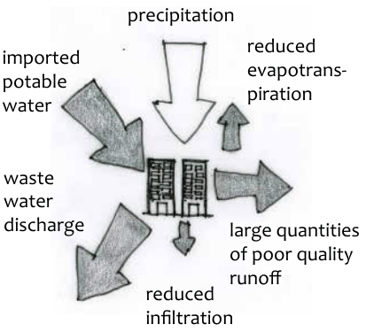
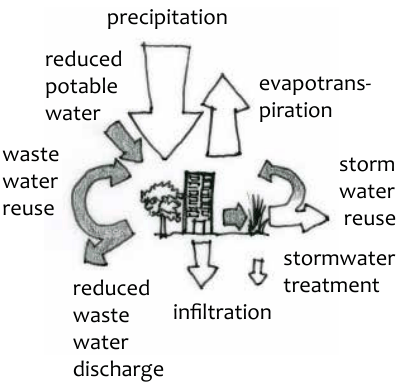
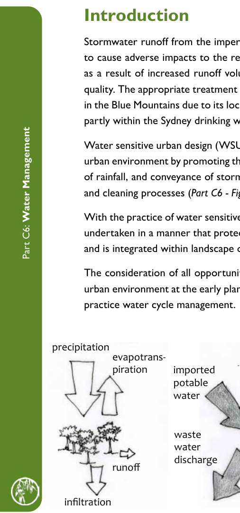

### C5.8. Pruning

#### Explanation

This part of the DCP describes the circumstances where development consent or a permit granted by the Council is not required to prune prescribed trees and vegetation.

#### Controls

C1. Development consent or a permit granted by the Council is not required for the following pruning works to prescribed trees and vegetation:

(a) the removal of structurally failed storm-damaged branches, and

(b) ‘deadwooding’, being the removal of dead wood from the tree, provided the branch being removed is not a branch with hollows on a likely habitat tree, and

Part C5: Tree and Vegetation Preservation

(c) the seasonal pruning of fruit trees for the purposes of maintaining fruit production. This exemption does not apply to the following native species Acmena spp. or Syzgium spp. (all Lilli Pilli), nor to Elaeocarpus spp. (all Blueberry Ash) Ficus coronata  (Sandpaper Fig) Ficus rubiginosa (Rusty or Port Jackson Fig) or Macadamia

spp. (Macadamia nut), and

(d) selective pruning, being only pruning to remove branches back to the nearest branch collar or junction to clear a roof, where trees directly overhang the roof of a dwelling, garage or commercial building, and only if the owner of the land where the centre of the tree originated or where the majority of the tree is growing, is in agreement, and

Note: Where the tree owner does not consent to the pruning works, the disagreement remains a civil matter between neighbours. Civil matters may be resolved through mediation services independent of Council or through Trees (Disputes Between Neighbours) Act 2006 proceedings initiated by the aggrieved neighbour.

(e) target pruning of branches overhanging public pathways from trees originating on private property, to a maximum height of 2.5m above natural ground level.

C2. Any pruning that complies with the 10/50 Vegetation Clearing Code of Practice prepared by the Commissioner of the NSW Rural Fire Service, on land to which that code applies.

C3. Pruning exemptions are valid only if conducted in compliance with Australian Standard AS 4373.

C4. All pruning and shaping of trees undertaken in accordance with the provisions of this exemption, is to ensure that the structural and aesthetic integrity of the tree is maintained.

Part C5: Tree and Vegetation Preservation

### Part C6

### WATER MANAGEMENT

### Introduction

Stormwater runoff from the impervious surfaces created by development has the potential to cause adverse impacts to the receiving natural environment and the natural water cycle, as a result of increased runoff volumes and peaks, reduced infiltration and reduced water quality. The appropriate treatment of stormwater is therefore important, and particularly so in the Blue Mountains due to its location adjacent to World Heritage listed national park, and partly within the Sydney drinking water catchment.

Water sensitive urban design (WSUD) seeks to restore the natural water balance within the urban environment by promoting the retention and reuse, evapotranspiration, and infiltration of rainfall, and conveyance of stormwater runoff within systems that enable natural filtering and cleaning processes (Part C6 - Figure 1).

With the practice of water sensitive urban design, stormwater management measures can be undertaken in a manner that protects natural hydrological processes, conserves biodiversity and is integrated within landscape outcomes to achieve improved urban amenity.

Part C6: Water Management

The consideration of all opportunities and constraints for the cycling of water through the urban environment at the early planning stage will provide for an integrated approach to best

> [Picture on page 128: a picture, saved as a picture (images/part-c-environmental-management-page-128-18.gif, 150 dpi).]
> Words printed on the picture (copied from the PDF):
> precipitation
> reduced
> evapotrans-
> piration
> large quantities
> of poor quality
> runoff
> reduced

> [Picture on page 128: a picture, saved as a picture (images/part-c-environmental-management-page-128-19.gif, 150 dpi).]
> Words printed on the picture (copied from the PDF):
> precipitation
> evapotrans-
> piration
> reduced
> potable
> water
> treatment
> infiltration
> reduced
> waste
> water

practice water cycle management.

> [Picture on page 128: a picture, saved as a picture (images/part-c-environmental-management-page-128-21.gif, 150 dpi).]
> Words printed on the picture (copied from the PDF):
> precipitation
> evapotrans-
> piration
> runoff
> infiltration

imported potable water

waste water reuse

storm water reuse

waste water discharge

stormwater

infiltration

discharge

Part C6 - Figure 1: The urban water cycle showing changes to the natural water cycle with traditional urban development and with WSUD. Source: Water by Design (2009) Concept Design Guidelines for Water Sensitive Urban Design Version 1, South East Queensland Healthy Waterways Partnership, Brisbane, March 2009)

#### PART C6 | PAGE 228

#### Read in conjunction with:

Part C - Management of the Natural Environment

#### All

#### Part E - Site Development

and Site Management

#### All

#### Submission Requirements

One or more of the following types of reports may need to accompany a development application:

Small-scale developments

• Concept Stormwater Management Plan

Part C6: Water Management

Supporting documentation including:

• Proposed and existing impervious area calculation

• Small scale stormwater quality model (s3qm) certificate (if applicable)

Large-scale developments

• Concept Stormwater Management Plan

• Water Sensitive Urban Design (WSUD) strategy Supporting documentation including:

• Proposed and existing impervious area calculation

• Pre and post development water quality analysis

• Geo-technical investigation

All development within the Sydney drinking water catchment

• WaterNSW information requirements to demonstrate a neutral or beneficial effect on water quality

#### PART C6 | PAGE 229
