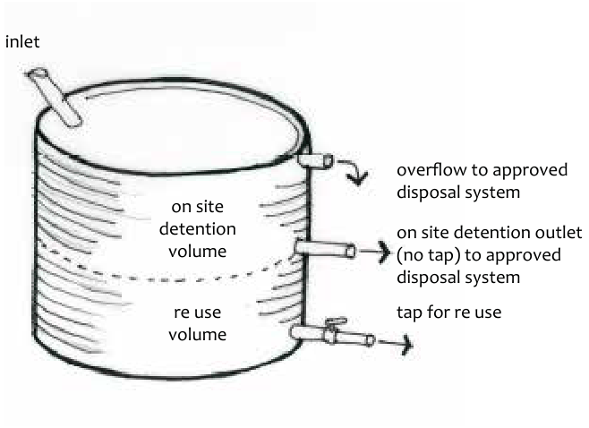
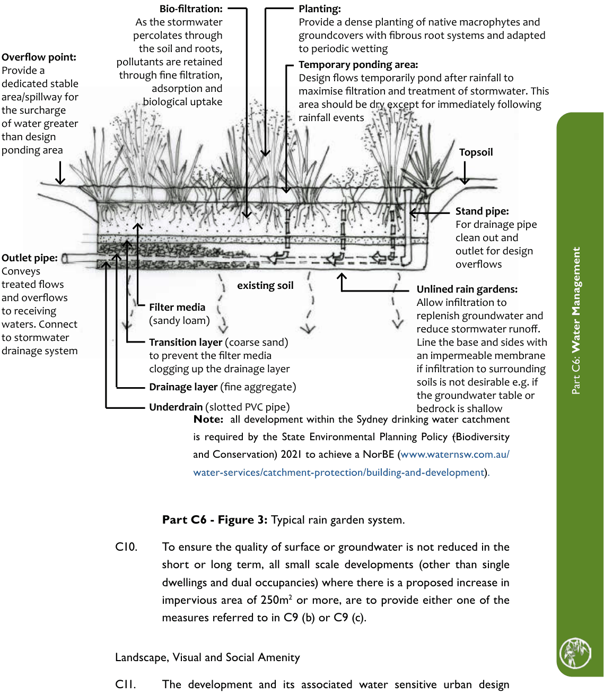

### C6.1.3.	 Water Sensitive Urban Design for Small Scale

### Development

#### Controls

Water Conservation and Re-use

C1. Maximise on-site retention and re-use of stormwater runoff through measures such as rainwater tanks, dual plumbing and accredited grey water use.

Note: Any proposed grey water treatment is to utilise a system that has been accredited by NSW Health and approved by Council.

C2. Rainwater tanks shall:

(a) have a collection capacity of not less than 4,000 litres per 100m2 of proposed additional impervious area, for the reuse of water drained from those surfaces, for development within zones

C3 Environmental Management and C4 Environmental Living, and

(b) have a collection capacity of not less than 1000 litres per 100m2 of proposed additional impervious area, for the re-use of water drained from those surfaces for development within other zones, and

Note: If the development is subject to other rainwater tank capacity requirements  to comply with the BASIX Building Sustainability Index or NSW Rural Fire Service conditions for bushfire protection, then the largest of all applicable rainwater tank capacity requirements is to be provided.

(c) include a first flush device to maximise water quality. The first flush device is to divert the first 1mm of roof water and include an outlet for drainage of the first flush device between rain events. The first flush water is to be directed to a stable vegetated area, rain garden or other absorption or infiltration measure, and

Part C6: Water Management

(d) be located and designed to maximise the percentage of roof area directed to the tank(s), and

(e) ensure overflows are drained to an adequately sized absorption or infiltration device, rain garden or bio-retention system or equivalent device, and

(f) incorporate additional storage volume for (temporary) on-site detention of stormwater where required.

C3. Where rainwater tanks are used for retention and reuse, as well as on-site detention system, the tank shall include an outlet (without a tap) to ensure that the on-site detention volume is available for the next storm. Refer to Part C6 - Figure 2.

> [Picture on page 134: a picture, saved as a picture (images/part-c-environmental-management-page-134-1.gif, 150 dpi).]
> Words printed on the picture (copied from the PDF):
> inlet
> on site
> detention
> volume
> tap for re use
> re use
> volume

overflow to approved disposal system

on site detention outlet (no tap) to approved disposal system

Part C6 - Figure 2: Combined re-use and detention tank.

C4. Industrial and commercial developments that are not subject to the requirements of the BASIX Building Sustainability Index are to:

(a) demonstrate that consideration has been given to the interaction of all elements of the urban water cycle (potable water, stormwater and wastewater), and

Part C6: Water Management

(b) identify how each water source is appropriate for its end use, and

(c) ensure any water use fittings demonstrate compliance with the minimum standards defined by Water Efficiency Labelling and Standards (WELS) Scheme, and

(d) provide alternative sources (e.g. rainwater, stormwater, recycled water, grey water) to meet demand for non-potable uses where practicable.

Stormwater Design

C5. All stormwater management measures are to be located within the site boundaries and are not to result in impacts on adjoining properties.

C6. Minimise hydrologic impacts by:

(a) ensuring that the design, location and function of stormwater management devices protects, restores or replicates the natural water cycle for the site, and

(b) maintaining pre-development surface and groundwater regimes, run-off volumes and natural flow velocities, rates, peaks, and durations, and

(c) maintaining the sites natural topography, landforms, catchment areas, drainage patterns and flow paths by minimising cut and fill and avoiding redirection of surface flows, and

(d) retaining pervious areas and preserving the natural interactions between surface and groundwater, including soil permeability, groundwater seepage and recharge areas, and

(e) minimising the size of impervious areas and the amount of runoff generated from the site, and

(f) maximising opportunities to provide on-site absorption and infiltration where site conditions are suitable, and

(g) locating stormwater treatment devices to maximise the area of impervious areas that are treated.

C7. Minimise environmental impacts by:

Part C6: Water Management

(a) ensuring that all stormwater management measures and water sensitive urban design devices do not extend below the groundwater table or into bedrock and are appropriate for the given soil permeability and depth, and

(b) locating devices wholly outside of environmentally sensitive areas and existing vegetated areas, unless no alternative is available and it is demonstrated that minimal adverse impact will result, and

(c) designing stormwater treatment measures to cater for high flows above the devices’ design size and locating them outside of the 1:100 year flow path to prevent the release of previously trapped sediment or pollutants by high flows or flood waters, and avoid damage to vegetation components, and

(d) keeping infiltration devices and rain gardens or bio-retention systems separate from on-site effluent disposal/management areas, and

(e) ensuring that developments with potential to generate pollutants such as fuels, heavy metals, oils, solvents, detergents, fertilisers, pesticides and the like, demonstrate appropriate containment and operational methods (e.g. bunding, first flush systems, dedicated vehicle washing bay), and provide appropriate water quality treatment and management measures to mitigate impacts of stormwater runoff. Such developments are to provide contingency management measures in the event of an accidental spill, and

Note: Environment pollution licenses may apply under the Protection of the Environment Operations Act, 1997.

(f) providing disposal, scour protection and dissipation mechanisms compatible with protecting the natural environment, by:

i. preferentially disposing of stormwater runoff within the site boundaries by re-use, absorption, and infiltration or evapotranspiration measures to the maximum extent that the expected site usage and site conditions allow, and

ii. minimising the area of impervious areas directly connected by piped or sealed drainage infrastructure to the receiving natural environment, and

Part C6: Water Management

iii. providing level spreading overflows to stable vegetated areas, and

iv. minimising the number of concentrated stormwater outlets, and

v. providing scour protection using environmentally sensitive, soft-engineered methods such as a rough and permeable rock riprap surface combined with native revegetation, rather than gabions, concrete surfaces or concrete grouting, and

vi. providing grassed filter strips or vegetated buffer areas to protect the receiving natural environment from stormwater runoff, and

vii. disposing of stormwater design overflows from absorption, infiltration, rain garden or bio-retention devices, which may not be otherwise disposed of within the site,  to the street gutter where the site falls to the street, and

viii. disposing of stormwater design overflows from absorption, infiltration, rain garden or bio-retention devices via a level spreading overflow to a stable vegetated area, and any other measures necessary to protect the receiving natural environment where the site falls away from the street and towards bushland or natural areas, and

ix. disposing of stormwater design overflows from absorption, infiltration, rain garden or bio-retention devices to an interallotment drainage system where the site falls away from the street and towards areas that are not bushland or natural areas, and

Note: See Part C6.5 regarding connections to interallotment drainage systems and alternate methods of stormwater disposal.

x. not piping or otherwise discharging stormwater directly to a watercourse unless no alternative is available.

Stormwater Infiltration

C8. To provide appropriate  stormwater infiltration:

Part C6: Water Management

(a) stormwater runoff from proposed impervious areas less than 50m2 in area may be directed to adjacent stable vegetated areas via single cross fall design or other appropriate method to distribute flows evenly and allow on-site absorption, infiltration and dissipation, and

Note: Stormwater runoff from impervious areas less than 50m2 as referred to above, may be a sub-catchment of a larger impervious area.

(b) stormwater runoff from proposed impervious areas greater than or equal to 50m2 in area and all rain tank overflows are to be absorbed and infiltrated, to the maximum extent possible, via an appropriately designed and adequately sized device(s) such as infiltration trench, absorption trench or pit, proprietary infiltration tunnel, an un-lined rain garden or bio-retention system or equivalent device, and

Note: infiltration may be achieved within an appropriately designed water quality treatment device such as an un-lined rain garden or bio-retention system (if required) rather than providing two separate devices.

(c) all absorption and infiltration devices are to be located at least 4m from any property boundary, retaining wall or building, and

(d) for single dwellings and dual occupancies, absorption trenches shall measure at least 600mm wide x 600mm deep x 2m long for each down pipe, and

(e) all absorption and infiltration devices are to provide suitable collection and disposal of design overflows to a stormwater drainage system (street gutter, inter-allotment drainage system or drainage easement), unless these overflows can be otherwise safely disposed of within the site.

#### Stormwater Quality

C9. To ensure the quality of surface or groundwater is not reduced in the short or long term, all single dwelling or dual occupancy developments that exceed the maximum site coverage or that have less than the minimum pervious area provisions in Part B2.4 of the DCP, are to provide one of the following measures:

(a) a rain garden or bio-retention system with the filter surface area sized to be at least 2% of the total proposed increase in impervious area, or

Part C6: Water Management

Note: A rain garden is comprised of a soil based filter (specified sandy loam material), with a sand transition layer and gravel trench underneath that contains a slotted drain pipe (ag pipe) that is connected to the drainage system. A typical system (looking through the side of the filter) is shown below.

(b) a stormwater treatment train certified by the WaterNSW Small Scale Stormwater Quality Model (s3qm) that demonstrates the achievement of a neutral or beneficial effect on water quality (NorBE), or

Note: A certificate from an assessment completed using s3qm must be submitted with these proposals. The s3qm model is available at www.s3qm.com.au and information about s3qm is available at the WaterNSW website www.waternsw.com.au.

(c) an alternative solution with equivalent stormwater quality treatment performance outcomes designed and certified by a suitably qualified person and that demonstrates the achievement of NorBE.

#### Bio-filtration:

As the stormwater percolates through the soil and roots, pollutants are retained through fine filtration, adsorption and

#### Planting:

Provide a dense planting of native macrophytes and groundcovers with fibrous root systems and adapted to periodic wetting

#### Temporary ponding area:

Design flows temporarily pond after rainfall to

#### Overflow point:

Provide a

> [Picture on page 139: a map, saved as a picture (images/part-c-environmental-management-page-139-16.gif, 150 dpi); the street names and other small labels are on the picture.]
> Labels printed on the map (copied from the PDF, in no particular order):
> biological uptake · maximise filtration and treatment of stormwater. This · area should be dry except for immediately following · rainfall events · area/spillway for · the surcharge · of water greater · than design · ponding area · Topsoil · Stand pipe: · For drainage pipe · clean out and · outlet for design · overflows · existing soil · Filter media · (sandy loam) · Outlet pipe: · treated flows · and overflows · to receiving · waters. Connect · to stormwater · drainage system · Transition layer (coarse sand) · to prevent the filter media · Unlined rain gardens: · Allow infiltration to · replenish groundwater and · reduce stormwater runoff. · Line the base and sides with

dedicated stable

Conveys

clogging up the drainage layer Drainage layer (fine aggregate)

Part C6: Water Management

Underdrain (slotted PVC pipe)

an impermeable membrane if infiltration to surrounding soils is not desirable e.g. if the groundwater table or bedrock is shallow

Note:  all development within the Sydney drinking water catchment is required by the State Environmental Planning Policy (Biodiversity and Conservation) 2021 to achieve a NorBE (www.waternsw.com.au/ water-services/catchment-protection/building-and-development).

Part C6 - Figure 3: Typical rain garden system.

C10. To ensure the quality of surface or groundwater is not reduced in the short or long term, all small scale developments (other than single dwellings and dual occupancies) where there is a proposed increase in impervious area of 250m2 or more, are to provide either one of the measures referred to in C9 (b) or C9 (c).

Landscape, Visual and Social Amenity

C11. The development and its associated water sensitive urban design measures are to enhance the landscape, visual, social and recreational amenity by:

(a) incorporating stormwater treatment and control measures into the urban and landscape design where appropriate, and

(b) incorporating local indigenous plant species into vegetated stormwater management devices to enhance the natural attributes of the Blue Mountains local government area, and

(c) ensuring the location and design of stormwater treatment and control devices do not compromise the achievement of landscape and streetscape outcomes and the protection of natural features, and

(d) maximising the retention and restoration of vegetated areas and deep-rooted trees to maintain the water table conditions, stabilise the soil, decrease runoff volumes and velocities, capture sediment and filter nutrients.

Operation and Maintenance

C12. Provide for the ongoing operation and maintenance of WSUD devices by locating and designing devices with appropriate access for all maintenance activities necessary to ensure their effective operation to meet the required performance and treatment targets over the life of the development.

Note: The designer of proposed stormwater treatment measures should prepare a maintenance schedule for each measure.

Part C6: Water Management
