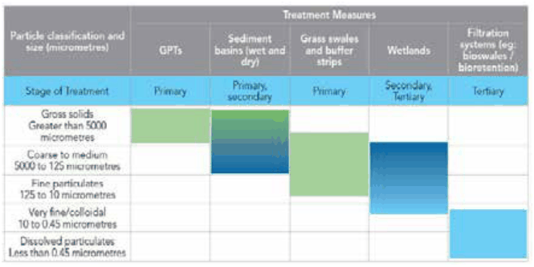

### C6.1.4.	 Water Sensitive Urban Design for Large Scale

### Development

#### Explanation

Large scale development includes any development other than single dwellings and dual occupancies, where the total impervious area of the development is equal to, or greater than, 1000m2.

#### Controls

Water Sensitive Urban Design Strategy

C1. A WSUD strategy is to be submitted with the development application for all large scale development to provide for water conservation and re-use, on-site detention, retention, water quality treatment, infiltration and safe disposal to the receiving natural environment.

The WSUD strategy is to demonstrate that the proposed development will achieve the water sensitive urban design objectives.

Note 1: Applicants and developers are to employ the services of appropriately qualified and experienced practitioners for the development of appropriate WSUD plans and strategies.

Part C6: Water Management

Note 2: Prior to lodgement of a development application, the applicant is encouraged to submit a pre-lodgement application with Council to seek advice regarding stormwater and WSUD requirements, particularly for large or complex development proposals.

Guidelines

C2. The WSUD strategy and stormwater management system is to be appropriately designed and sized in a manner consistent with the latest guidelines and current best management practices for WSUD.

Water Conservation and Re-use

C3. Demonstrate that consideration has been given to the interaction of all elements of the urban water cycle (potable water, stormwater and wastewater).

C4. Identify and implement all opportunities for on-site retention, water conservation, harvesting and re-use through measures such as rainwater tanks and dual plumbing and accredited grey water use.

Note: Any proposed grey water treatment is to utilise a system that has been accredited by NSW Health and approved by Council.

C5. Provide alternative sources to meet demand for non-potable uses where practicable, such as recycled water, roof water and harvested stormwater for vehicle washing, irrigation, water features.

C6. The water source used for a particular end use should reflect the quality required for that end use (i.e. be fit for purpose).

C7. Ensure any water use fittings demonstrate compliance with the minimum standards defined by Water Efficiency Labelling and Standards (WELS) Scheme.

C8. Rainwater tanks shall:

(a) for development on land zoned C3 Environmental Management and C4 Environmental Living have a collection capacity of not less than 4,000 litres per 100m2 square metres of proposed impervious area, for the reuse of water drained from those surfaces, and

(b) for development on land in other zones have a collection capacity of not less than 1,000 litres per 100m2 of proposed impervious area, for the re-use of water drained from surfaces, and

Part C6: Water Management

(c) provide pre-screening of organic matter (leaf litter) prior to the collection of water in the rainwater tank, and

(d) include a first flush device to maximise water quality. The first flush device is to divert the first 1mm of roof water and contain an outlet for drainage of the first flush device between rain events. The first flush water is to be directed to a stable vegetated area, rain garden or other absorption or infiltration measure, and

(e) be located and designed to maximise the percentage of roof area directed to the tank(s), and

(f) ensure overflows are drained to an adequately sized absorption or infiltration device, rain garden or bio-retention system or equivalent device.

Stormwater Treatment Performance Targets

C9. The development must demonstrate the achievement of the following stormwater treatment performance targets.

(a) Water quality

The WSUD strategy and stormwater management system is to provide appropriate water quality treatment to ensure that the quality of surface or ground water leaving the site is not to be reduced in the short or long term. The development must achieve a neutral or beneficial effect (NorBE) on water quality.

The achievement of this performance objective is to be demonstrated by using the Model for Urban Stormwater Improvement Conceptualisation (MUSIC) developed by the Cooperative Research Centre for Catchment Hydrology (now eWater) or an equivalent industry standard water quality model.

For development within the Sydney drinking water catchment, the WaterNSW (2023) ‘Using MUSIC in the Sydney Drinking Water Catchment’ guideline applies.

(b) Water quantity

Part C6: Water Management

The WSUD strategy and stormwater management system is to take all reasonable management actions appropriate for the site conditions to minimise adverse hydrologic impacts by:

i. ensuring that the design, location and function of storm-water management devices protects, restores or repli-cates the natural water cycle for the site, and

ii. maintaining pre-development surface and groundwater regimes, run-off volumes and natural flow velocities, rates, peaks, and durations, and

iii. maintaining the sites natural topography, landforms, catch-ment areas, drainage patterns and flow paths by minimis-ing cut and fill and avoiding redirection of surface flows, and

iv. retaining pervious areas and preserving the natural inter-actions between surface and groundwater, including soil permeability, groundwater seepage and recharge areas, and

v. maintaining the physical nature of pre-development flows into receiving environments (i.e. where the receiving envi-ronment receives dispersed flows, concentration of flows is to be avoided), and

vi. reducing runoff volumes and preserving natural surface and groundwater hydrologic regimes by incorporating the following measures into the WSUD strategy:

• identifying and implementing all opportunities for water conservation, harvesting and re-use, and

• minimising the size of impervious areas and the amount of runoff generated from the site, and

• locating stormwater quantity control devices to maximise the area of impervious areas that are treated, and

• maximising on-site absorption, infiltration and evapotranspiration by:

» maximising the provision of permeable surfaces, and

Part C6: Water Management

» minimising the size of impervious areas that are directly connected by piped or sealed drainage infrastructure to the receiving environment by directing runoff to infiltration and evapotranspiration mechanisms or to other grassed, vegetated or landscaped areas designed to accept these flows.

Environmental and Site Constraints and Opportunities

C10. The stormwater management system is to be appropriate for the given site conditions and address the following potential environmental and site constraints:

(a) the soil depth, character and permeability/hydraulic conductivities, and

(b) the presence of rock outcropping and depth to bedrock, and

(c) any impermeable clay layers, and

(d) the depth to groundwater, perched groundwater tables, groundwater seepage and recharge areas, and

(e) any watercourses, riparian land or groundwater dependant ecosystems, and

(f) any steep slopes, and

(g) any environmentally sensitive areas.

Note: The following Part C6 - Table 1 indicates the site constraints that should be considered for a range of WSUD measures

Part C6 - Table 1: Site constraints for various WSUD measures. Source: Adapted from Water by Design (2009) Concept Design Guidelines for Water Sensitive Urban Design Version 1, South East Queensland Healthy Waterways Partnership, Brisbane, March 2009

| WSUD Measure | site Steep | bedrock Shallow | clay e.g. soil permeability Low | sand e.g. soil permeability High | table water High | input sediment High |
|---|---|---|---|---|---|---|
| Gross pollutant capture devices | Y | D | Y | Y | D | Y |
| Sediment basins | D | D | Y | D | D | Y |
| Grass or vegetated swales | X | D | Y | D | X | D |
| Sand filter | Y | D | Y | Y | X | D |
| Bioretention systems | D | D | Y | D | X | D |
| Constructed wetlands | X | D | Y | D | D | D |
| Rainwater tanks | Y | Y | Y | Y | Y | Y |
| Porous pavements | X | X | X | Y | X | X |
| Infiltration measures | X | X | X | Y | X | X |

Part C6: Water Management

X = Constraint may preclude use

D = Constraint may be overcome through appropriate design

Y = Generally not a constraint

C11. A geotechnical investigation and report is required to be undertaken by a qualified geotechnical professional with demonstrated experience to investigate the current site conditions and suitability of the site to accommodate WSUD devices to provide stormwater water quality control, infiltration and treatment systems.

C12. The results of the investigation are to inform the WSUD strategy and confirm the nature of WSUD devices are suitable and effective for the site.

Stormwater Design Principles

C13. All stormwater management measures are to be located within the site boundaries and are to not cause nuisance to adjoining properties.

C14. Locate devices wholly outside of environmentally sensitive areas, unless no alternative is available and it is demonstrated that minimal adverse impact will result.

C15. The WSUD strategy is include a treatment train that is to comprise all necessary stormwater treatment devices, to provide the retention, filtering, infiltration and safe disposal necessary to meet the required stormwater treatment performance outcomes.

Part C6: Water Management

C16. The selection and order of stormwater management devices in the treatment train is to provide the necessary primary, secondary and tertiary treatment, in the appropriate sequence, to effectively remove the expected range of pollutants (including but not necessarily limited to sediment, gross pollutants, Total Phosphorous, Total Nitrogen, Total Suspended Solids, heavy metals, oils & greases, hydrocarbons) to achieve the required treatment.

C17. The coarse fraction of pollutants (i.e. litter and coarse sediment) must generally be removed first to ensure subsequent finer and dissolved pollutant treatments are effective.

C18. The stormwater treatment device(s) within the treatment train must be suitable for the characteristics of the target pollutants being generated from the development.

> [Picture on page 147: a picture, saved as a picture (images/part-c-environmental-management-page-147-1.gif, 150 dpi).]

Part C6 - Figure 4: Pollutant ranges for best management practice treatment measure

Source: Blacktown City Council (adapted from Ecological Engineering (2003) Landcom Water Sensitive Urban Design Strategy - Design Philosophy and Case Study Report, Landcom NSW).

C19. The treatment train is to prioritise the use of filtration and infiltration source controls where ever possible over a single end-of-line measure.

Part C6: Water Management

C20. Sediment traps, vegetated filter strips or equivalent measures are to be provided upstream of porous paving to reduce sediment inputs and minimise likelihood of clogging.

C21. To minimise site disturbance, consideration is to be given to the achievement of multiple stormwater management objectives in one device (e.g. water quality treatment, retention and detention).

C22. To prevent the release of previously trapped sediment or pollutants by high flows or flood waters, and avoid damage to vegetation components, stormwater treatment measures are to be designed to cater for high flows above the devices’ design size and located outside of the 1:100 year flow path.

C23. Any bio-retention filter areas must be the minimum size required to achieve the required stormwater treatment performance criteria and to minimise site disturbance. The minimum size required is to be demonstrated by a supporting stormwater quality analysis (e.g. via MUSIC model).

Note 1: The planting schedule is to ensure vegetative components within the bio-retention system(s) include local macrophytes and groundcovers that:

a. are adapted to local climatic conditions, and

b. are adapted to the expected high and variable nutrient and moisture conditions, and

c. are suitable for the bio-retention basin’s expected management and maintenance requirements, and

d.	 include plants with extensive fibrous root systems, spreading rhizomatous or suckering habitat in preference to plants with a clumped habit, and

e. are to be established at a minimum density of at least 8 plants per square metre across the base and any side batters of the bio-retention systems, and

f. ensure complexity and year round coverage by including at least 4 different macrophyte or groundcover species within the basin area.

C24. Roof gardens and wall gardens are to be considered and incorporated as a measure to maximise water re-use opportunities and enhance landscape outcomes where feasible to do so, particularly for developments with minimal pervious areas.

C25. Impermeable liners are to be utilised to prevent infiltration from any infiltration system or bio-retention device within areas of shallow groundwater or where potential groundwater contamination is identified.

Part C6: Water Management

C26. Developments with potential to generate pollutants such as fuels, heavy metals, oils, solvents, detergents, fertilisers, pesticides and the like, must demonstrate appropriate containment and operational methods (e.g. bunding, first flush systems, dedicated vehicle washing bay), and provide appropriate water quality treatment and management measures to mitigate impacts of stormwater runoff. Such developments are to provide contingency management measures in the event of an accidental spill to protect the natural environment.

Note: Environment pollution licenses may apply under the Protection of the Environment Operations Act, 1997.

C27. All absorption and infiltration, devices are to be located at least 4m from any property boundary, retaining wall or building.

C28. All absorption and infiltration devices are to provide suitable collection and disposal of design overflows to a stormwater drainage system (street gutter, inter-allotment drainage system or drainage easement), unless these overflows can be otherwise safely disposed of within the site.

C29. Stormwater disposal outlets are to provide scour protection and dissipation mechanisms compatible with protecting the natural environment, by:

(a) preferentially disposing of stormwater runoff within the site boundaries by re-use, absorption, and infiltration or evapotranspiration measures to the maximum extent that the expected site usage and site conditions allow, and

(b) minimising the area of impervious areas directly connected by piped or sealed drainage infrastructure to the receiving natural environment, and

(c) providing level spreading overflows to stable vegetated areas, and

(d) minimising the number of concentrated stormwater outlets, and

(e) providing scour protection using environmentally sensitive soft-engineered methods such as a rough and permeable rock riprap surface combined with native revegetation, rather than gabions, concrete surfaces or concrete grouting, and

Part C6: Water Management

(f) providing grassed filter strips or vegetated buffer areas to protect the receiving natural environment from stormwater runoff, and

(g) disposing of stormwater design overflows from absorption, infiltration, rain garden or bio-retention devices, which may not otherwise be disposed of within the site to the street gutter, where the site falls to the street, and

(h) disposing of stormwater design overflows from absorption, infiltration, rain garden or bio-retention devices via a level spreading overflow to a stable vegetated area and any other measures necessary to protect the receiving natural environment where the site falls away from the street and towards bushland or natural areas, and

(i) disposing of stormwater design overflows from absorption, infiltration, rain garden or bio-retention devices to an interallotment drainage system where the site falls away from the street and towards areas that are not bushland or natural areas, and

Note: See Part C6.5 regarding connections to interallotment drainage systems and alternate methods of stormwater disposal.

(j) not piping or otherwise discharging stormwater directly to a watercourse unless no alternative is available.

Landscape, visual and social amenity

C30. The development and its associated water sensitive urban design measures are to enhance the landscape, visual, social and recreational amenity by:

(a) incorporating stormwater treatment and control measures into the urban and landscape design where appropriate, and

(b) incorporating local indigenous plant species into stormwater and landscaping design to enhance the natural attributes of the Blue Mountains LGA, and

(c) ensuring the location and design of stormwater treatment and control devices do not compromise the achievement of landscape outcomes and protection of environmentally sensitive areas, and

(d) maximising the retention and restoration of vegetated areas and deep-rooted trees to maintain the water table conditions, stabilise the soil, decrease runoff volumes and velocities, capture sediment and filter nutrients, and

Part C6: Water Management

(e) considering, and where appropriate providing adaptability to, climate change in the design and planning of vegetation in the landscape.

Operation and maintenance – requirements, feasibility and costs

C31. Provide for the ongoing operation and maintenance of WSUD devices by locating and designing devices with appropriate access for all maintenance activities necessary to ensure their effective operation to meet the required performance and treatment targets over the life of the development.

Assets proposed to be transferred to the Council

C32. Stormwater assets proposed to be transferred to Council are to relate to the treatment of runoff from public land only.

C33. Any proposal to transfer stormwater treatment assets to Council must be demonstrated to be an effective sound solution and in the public interest.

C34. Any stormwater assets transferred to Council must be designed and located in a manner that ensures effective ongoing operation and maintenance.
