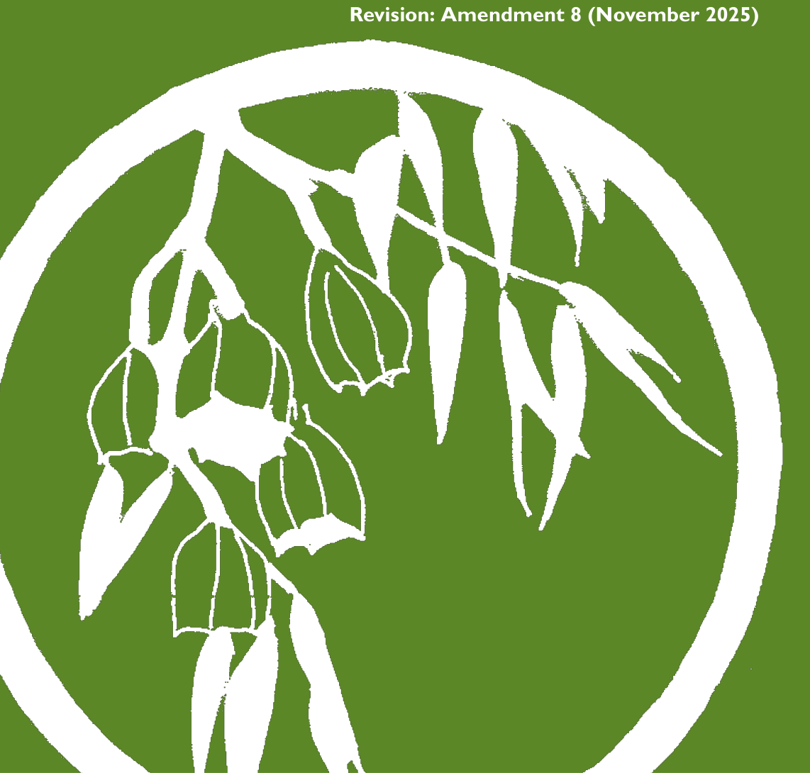
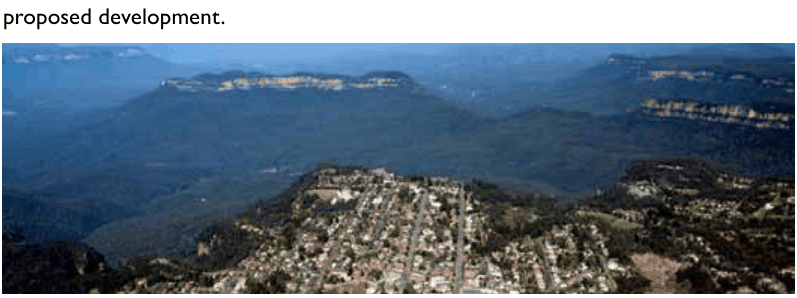

# Blue Mountains Development Control Plan 2015 - Part C Environmental Management

> This chapter is split into 66 section file(s), one per numbered heading, in the order they appear in the PDF.

Source PDF: [DCP 2015_Amendment 8_Part C.pdf](DCP%202015_Amendment%208_Part%20C.pdf)

### PART C

### ENVIRONMENTAL

### MANAGEMENT

### Balancing the protection of the natural environment and development

> [Picture on page 1: a picture, saved as a picture (images/part-c-environmental-management-page-1-5.gif, 150 dpi).]

#### Revision: Amendment 8 (November 2025)

#### PART C | PAGE 102

### Contents

| Part C1 | Biodiversity And Natural Resources | 107 |
|---|---|---|
| C1.1. | Biodiversity & Natural Resources | 110 |
| C1.2. | Threatened Species, Threatened Populations and Threatened Ecological Communities | 114 |
| C1.3. | Significant vegetation and rare flora species | 118 |
| C1.4. | Fauna corridors | 120 |
| C1.5. | Ecological buffer areas | 122 |
| C1.6. | Riparian land and watercourses | 125 |
| C1.7. | Escarpment areas and geological features | 131 |
| C1.8. | National Park and World Heritage Areas | 133 |
| C1.9. | Light Pollution | 135 |
| Part C2 | Bushland And Weed Management | 137 |
| C2.1. | Bushland management C2.1.1. Environmentally Sensitive Land C2.1.2. Land containing high quality remnant bushland C2.1.3. Land containing poor quality or weed affected native vegetation C2.1.4. Land containing highly degraded native vegetation, or mainly cleared areas C2.1.5. Environmental zones: C3 Environmental Management and C4 Environmental Living | 140 144 146 146 148 148 |
| C2.2. | Weed Management C2.2.1. Environmentally sensitive land C2.2.2. Use of listed weed species in landscaped areas. | 149 152 153 |
| C2.3. | Weeds of the Blue Mountains C2.3.1. Categories of weeds listed | 155 156 |

#### PART C | PAGE 103

| Part C3 | Landscaping | 171 |
|---|---|---|
| C3.1. | Landscaping Objectives | 174 |
| C3.2. | Demonstration of landscaping objectives | 175 |
| C3.3. | Retention and protection of trees and other vegetation | 176 |
| C3.4. | Landscape design, scale and amenity | 178 |
| C3.5. | Plant Material Selection | 182 |
| C3.6. | Soil management | 184 |
| C3.7. | Plant material establishment and maintenance | 185 |
| C3.8. | Additional Zone Specific Controls | 186 |
| Part C4 | Bushfire | 193 |
| C4.1. | Legislative requirements for bush fire prone land | 196 |
| C4.2. | Bush Fire Prone Land Map and Vegetation Categories | 198 |
| C4.3. | Development on Bush Fire Prone Land | 199 |
| C4.4. | Asset Protection Zones | 200 |
| C4.5. | Plant species selection and landscape design in Bush Fire Prone Areas 204 |  |
|  | C4.5.1. Location and Maintenance of Vegetation | 205 |
|  | C4.5.2. Principles for suitable plant material selection | 206 |
|  | C4.5.3. Landscape Maintenance | 207 |
| Part C5 | Tree And Vegetation Preservation | 213 |
| C5.1. | Tree and vegetation preservation objectives | 216 |
| C5.2. | Prescribed trees | 217 |
| C5.3. | Trees which are not prescribed (exempt) | 218 |
| C5.4. | Prescribed vegetation | 219 |
| C5.5. | Vegetation which is not prescribed (exempt) | 220 |
| C5.6. | Tree and vegetation preservation on heritage items and heritage conservation areas 222 |  |
| C5.7. | Requirements for tree removal | 223 |
| C5.8. | Pruning | 225 |

#### PART C | PAGE 104

| Part C6 | Water Management |  | 227 |
|---|---|---|---|
| C6.1. | Water Sensitive Urban Design and Stormwater Management |  | 230 |
|  | C6.1.1. | Key principles and design outcome objectives for all development 230 |  |
|  | C6.1.2. | Application of requirements for Water Sensitive Urban Design | 231 |
|  | C6.1.3. | Water Sensitive Urban Design for Small Scale Development | 232 |
|  | C6.1.4. | Water Sensitive Urban Design for Large Scale Development | 241 |
| C6.2. | On-site stormwater detention |  | 251 |
| C6.3. | Groundwater |  | 253 |
| C6.4. | Flooding |  | 256 |
|  | C6.4.1. | Flood Studies and Plans | 257 |
|  | C6.4.2. | Flood effects | 257 |
|  | C6.4.3. | Floor levels | 258 |
|  | C6.4.4. | Building components | 259 |
|  | C6.4.5. | Driveway access and car parking | 259 |
| C6.5. | Stormwater infrastructure |  | 261 |

#### PART C | PAGE 105

#### PART C | PAGE 106

### Part C1

### BIODIVERSITY AND

### NATURAL RESOURCES

### Introduction

Biodiversity (biological diversity) is the variety of life: the different species of plants, animals and microorganisms, the genes they contain and the various populations, communities and ecosystems of which they form a part. Biodiversity, and the natural functions that occur in healthy ecosystems, provide essential processes including nutrient, carbon and energy cycling, atmospheric oxygen production, pollination, seed dispersal and climate regulation. These processes are referred to as ecosystem services and provide us with fresh water, clean air, soil fertility and biological pest control.

Conservation of biodiversity and ecological integrity is a fundamental principle of ecologically sustainable development. The Blue Mountains contains rich biodiversity values and natural resources due to its unique setting within the Greater Blue Mountains World Heritage Area, and the network of bushland connecting the towns and villages.  The natural areas are comprised of unique landscape and geological features, environmentally sensitive areas including escarpments, caves, rock outcrops, watercourses, wetlands, swamps, groundwater seepage zones, heath and scrub, woodland and forest vegetation. Flora and fauna species, vegetation communities and ecosystem composition vary according to aspect, slope, underlying geology, soil type and depth, groundwater and surface water conditions.

Part C1: Biodiversity and Natural Resources

There are many threats to biodiversity including vegetation and habitat loss and fragmentation, nutrient enrichment, water pollution, altered microclimate and drainage patterns, soil disturbance, introduced and invasive species, altered fire regimes, climate change and the unsustainable use of natural resources. This part details requirements for the protection of biodiversity, environmentally sensitive or significant natural features and natural resources occurring on or adjacent to sites proposed for development and provides controls for the protection of: threatened species and populations, threatened ecological communities or their habitat; significant native vegetation communities and rare or threatened Australian plants; fauna corridors; ecological buffer areas;  watercourses, wetlands and riparian land; escarpment areas and sandstone geological features; and the National Park and the World Heritage Areas. In assessing a development proposal, Council will consider all likely environmental impacts, including those which may be caused by future vegetation clearing to the full entitlement permissible under the NSW Rural Fire Service 10/50 Vegetation Clearing Code of Practice (where this entitlement is applicable).

The term site is used within this Part to describe a property and/or area affected by the proposed development.

> [Picture on page 8: a picture, saved as a picture (images/part-c-environmental-management-page-8-35.gif, 150 dpi).]

Part C1 - Figure 1: Aerial of Katoomba - ‘City within a World Heritage Area’

#### PART C1 | PAGE 108

#### Read in conjunction with:

#### Part B - Context, Site

#### Analysis and Design

#### All

#### Part C - Environmental

#### Management

#### All

#### Part E - Site Development

and Management

#### All

#### Submission requirements:

Part C1: Biodiversity and Natural Resources

One or more of the following types of reports may need to accompany a development application:

• Site Analysis Plan

• Flora and Fauna Assessment

• Vegetation Survey and Species Inventory

• Vegetation Management Plan

#### PART C1 | PAGE 109

<!-- sections -->
## Sections

1. [C1.1 Biodiversity & Natural Resources](01-c1-1-biodiversity-and-natural-resources.md)
2. [C1.3 Significant vegetation and rare flora species](02-c1-3-significant-vegetation-and-rare-flora.md)
3. [C1.4 Fauna corridors](03-c1-4-fauna-corridors.md)
4. [C1.5 Ecological buffer areas](04-c1-5-ecological-buffer-areas.md)
5. [C1.6 Riparian land and watercourses](05-c1-6-riparian-land-and-watercourses.md)
6. [C1.7 Escarpment areas and geological features](06-c1-7-escarpment-areas-and-geological-features.md)
7. [C1.8 National Park and World Heritage Areas](07-c1-8-national-park-and-world-heritage-areas.md)
8. [C1.9 Light Pollution](08-c1-9-light-pollution.md)
9. [C2.1 Bushland management](09-c2-1-bushland-management.md)
10. [C2 Environmental Conservation.](10-c2-environmental-conservation.md)
11. [C2.1.1 Environmentally Sensitive Land](11-c2-1-1-environmentally-sensitive-land.md)
12. [C2.1.2 Land containing high quality remnant bushland](12-c2-1-2-land-containing-high-quality-remnant.md)
13. [C2.1.3 Land containing poor quality or weed affected native](13-c2-1-3-land-containing-poor-quality-or-weed.md)
14. [C2.1.5 Environmental zones: C3 Environmental Management](14-c2-1-5-environmental-zones-c3-environmental.md)
15. [C2.2 Weed Management](15-c2-2-weed-management.md)
16. [C2.2.1 Environmentally sensitive land](16-c2-2-1-environmentally-sensitive-land.md)
17. [C2.2.2 Use of listed weed species in landscaped areas.](17-c2-2-2-use-of-listed-weed-species-in-landscaped.md)
18. [C2.3 Weeds of the Blue Mountains](18-c2-3-weeds-of-the-blue-mountains.md)
19. [C2.3.1 Categories of weeds listed](19-c2-3-1-categories-of-weeds-listed.md)
20. [C3.1 Landscaping Objectives](20-c3-1-landscaping-objectives.md)
21. [C3.2 Demonstration of landscaping objectives](21-c3-2-demonstration-of-landscaping-objectives.md)
22. [C3.3 Retention and protection of trees and other](22-c3-3-retention-and-protection-of-trees-and.md)
23. [C3.4 Landscape design, scale and amenity](23-c3-4-landscape-design-scale-and-amenity.md)
24. [C3.5 Plant Material Selection](24-c3-5-plant-material-selection.md)
25. [C3.6 Soil management](25-c3-6-soil-management.md)
26. [C3.7 Plant material establishment and maintenance](26-c3-7-plant-material-establishment-and.md)
27. [C3.8 Additional Zone Specific Controls](27-c3-8-additional-zone-specific-controls.md)
28. [E3 Productivity Support and E4 General Industrial](28-e3-productivity-support-and-e4-general.md)
29. [W1 Natural Waterways](29-w1-natural-waterways.md)
30. [SP3 Tourist](30-sp3-tourist.md)
31. [C4.1 Legislative requirements for bush fire prone land](31-c4-1-legislative-requirements-for-bush-fire.md)
32. [C4.2 Bush Fire Prone Land Map and Vegetation](32-c4-2-bush-fire-prone-land-map-and-vegetation.md)
33. [C4.3 Development on Bush Fire Prone Land](33-c4-3-development-on-bush-fire-prone-land.md)
34. [C4.4 Asset Protection Zones](34-c4-4-asset-protection-zones.md)
35. [C4.5.1 Location and Maintenance of Vegetation](35-c4-5-1-location-and-maintenance-of-vegetation.md)
36. [C4.5.2 Principles for suitable plant material selection](36-c4-5-2-principles-for-suitable-plant-material.md)
37. [P1 Relatively high moisture content of leaves](37-p1-relatively-high-moisture-content-of.md)
38. [P2 Low levels of volatile oils, waxes and resins in leaves](38-p2-low-levels-of-volatile-oils-waxes-and.md)
39. [P3 Large or hard leaves with simple margins](39-p3-large-or-hard-leaves-with-simple-margins.md)
40. [P4 Plants that do not accumulate dead leaf and stem material](40-p4-plants-that-do-not-accumulate-dead-leaf.md)
41. [P5 Smooth, hard, or persistent bark, rather than flaky, papery](41-p5-smooth-hard-or-persistent-bark-rather.md)
42. [P7 Plants which may be periodically heavily pruned to reduce](42-p7-plants-which-may-be-periodically-heavily.md)
43. [P8 Avoid the use of vines](43-p8-avoid-the-use-of-vines.md)
44. [P9 Trees with low leaf-litter production over summer](44-p9-trees-with-low-leaf-litter-production.md)
45. [C4.5.3 Landscape Maintenance](45-c4-5-3-landscape-maintenance.md)
46. [C5.1 Tree and vegetation preservation objectives](46-c5-1-tree-and-vegetation-preservation.md)
47. [C5.2 Prescribed trees](47-c5-2-prescribed-trees.md)
48. [C5.3 Trees which are not prescribed (exempt)](48-c5-3-trees-which-are-not-prescribed-exempt.md)
49. [C5.4 Prescribed vegetation](49-c5-4-prescribed-vegetation.md)
50. [C5.5 Vegetation which is not prescribed (exempt)](50-c5-5-vegetation-which-is-not-prescribed.md)
51. [C5.6 Tree and vegetation preservation on heritage](51-c5-6-tree-and-vegetation-preservation-on.md)
52. [C5.7 Requirements for tree removal](52-c5-7-requirements-for-tree-removal.md)
53. [C5.8 Pruning](53-c5-8-pruning.md)
54. [C6.1.1 Key principles and design outcome objectives for all](54-c6-1-1-key-principles-and-design-outcome.md)
55. [C6.1.2 Application of requirements for Water Sensitive Urban](55-c6-1-2-application-of-requirements-for-water.md)
56. [C6.1.3 Water Sensitive Urban Design for Small Scale](56-c6-1-3-water-sensitive-urban-design-for-small.md)
57. [C6.1.4 Water Sensitive Urban Design for Large Scale](57-c6-1-4-water-sensitive-urban-design-for-large.md)
58. [C6.2 On-site stormwater detention](58-c6-2-on-site-stormwater-detention.md)
59. [C6.3 Groundwater](59-c6-3-groundwater.md)
60. [C6.4 Flooding](60-c6-4-flooding.md)
61. [C6.4.1 Flood Studies and Plans](61-c6-4-1-flood-studies-and-plans.md)
62. [C6.4.2 Flood effects](62-c6-4-2-flood-effects.md)
63. [C6.4.3 Floor levels](63-c6-4-3-floor-levels.md)
64. [C6.4.4 Building components](64-c6-4-4-building-components.md)
65. [C6.4.5 Driveway access and car parking](65-c6-4-5-driveway-access-and-car-parking.md)
66. [C6.5 Stormwater infrastructure](66-c6-5-stormwater-infrastructure.md)
