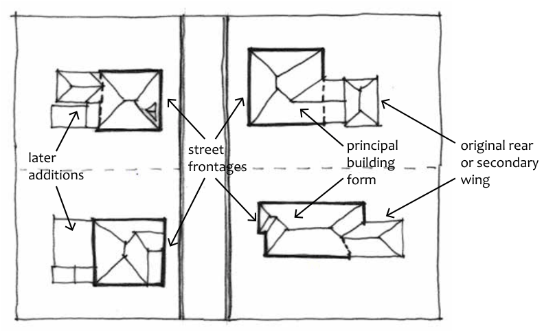

### D9.2 Original fabric

#### Explanation

The original materials and finishes of heritage properties, which together are sometimes referred to as the building’s fabric, are usually of primary heritage significance and contribute greatly to the style and character of individual buildings and items, and also to the character and significance of a conservation area. The primary part of the building can be referred to as the principal building form, and its integrity should be retained. Refer to Part D - Figure 1.

original rear or secondary wing

> [Picture on page 31: a picture, saved as a picture (images/part-d-heritage-management-page-31-4.gif, 150 dpi).]
> Words printed on the picture (copied from the PDF):
> street
> frontages
> later
> additions
> principal
> building
> form

Part D - Figure 1: Examples of principal building form.

Part D: Heritage

The materials and trades associated with historic buildings are becoming increasingly rare and difficult to source, and preservation and repair of original fabric keeps alive historic crafts, trades and materials. Examples of historic materials and trades still considered highly useful are lime and lime washes, solid timber, terracotta, stone and stonemasonry, dry-pressed bricks, leadlight glass and render.

#### Objectives

O1. To conserve the significant original fabric of historic buildings and the traditional trades, crafts and construction methods associated with that fabric.

O2. To encourage the removal of inappropriate or uncharacteristic structures or elements.

O3. To retain the distinctive shared characteristics of groups of similar buildings.

#### Controls

C1. Original facades are to be retained and conserved without significant alteration, including the scale, proportions, materials and detailing.

C2. Original materials and building fabric are to be retained, unless it can be demonstrated that significant deterioration has occurred and repair is not practical. Any repair and replacement should be with matching, or where not possible to match, similar materials.

C3. Appropriate traditional building techniques and construction methods are to be used as part of repair and replacement wherever possible.

C4. Council encourages and may require the reconstruction of missing elements including but not limited to original balconies and verandahs, fences, chimneys, joinery and shopfront detailing.

C5. Hidden fabric that comes to light during maintenance or development work or other means should be retained wherever possible for its ability to potentially provide additional historic information.
