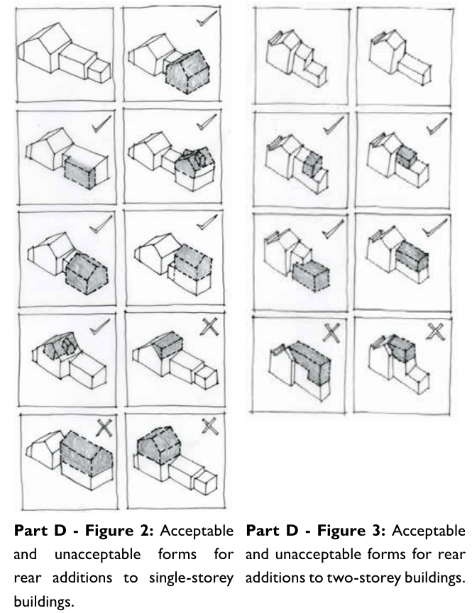

### D9.3 Alterations and additions

#### Explanation

Alterations and additions to heritage properties should be guided by the principle ‘do as much as necessary and as little as possible’. Alterations and additions to heritage properties may sometimes be desirable to meet contemporary expectations. Sometimes a degree of restoration is desirable, to remove unwanted or intrusive later elements.

Part D: Heritage

Changes should not overwhelm or detract from the significance of the property and the contribution the building makes to the streetscape. New additions should be in keeping with the forms and materials of heritage items but not imitate decorative details.  Alterations and additions to heritage properties should be simply constructed, without forms or details that draw attention away from the original heritage building. Additions are to be subservient to any existing style, to allow the historic fabric to be ‘read’ clearly.

#### Objectives

O1. To retain the original built form characteristics of significant items as the predominant elements when viewed from all angles.

O2. To ensure alterations and additions to a significant item are designed:

(a) to respect the heritage significance of streetscapes and group views, and

(b) to respect the individual significance of heritage items and the group values of heritage conservation areas, and

(c) to be consistent with the original architectural style, form, massing, materials and finishes of the item, and

(d) to be subservient in detailing to the original architectural style; and

(e) not to have an adverse impact on the curtilage and setting of the item.

O3. To ensure that the various heights and setbacks of significant buildings within the streetscape are retained, in order to retain streetscape and setting values.

#### Controls

C1. Alterations and additions are not to significantly alter the appearance of principal and significant facades, except to remove detracting elements.

C2. The removal of intrusive elements is encouraged.

C3. Reconstruction is to be based on known earlier features. Documentation to support reconstruction proposals may be required. Missing elements should be reinstated from evidence such as old photographs, remnants or evidence on site. If historical evidence is not available, it may be appropriate for similar buildings of the same style in the local area to be used as a guide.

C4. Additions are generally to be sited to the rear, and to be visually recessive.

Part D: Heritage

C5. The height of an alteration or addition to the rear of a building is to generally be below the ridgeline of the main roof of the existing building. An exception may be where a separate pavilion to the rear is not visible from the street.

C6. Where possible the use of pavilion forms that are separate from the principal building form are encouraged.

C7. Alterations and additions in heritage conservation areas are to respond to and respect the setbacks of surrounding properties.

C8. New building forms, roof forms and layouts are to be sympathetic and visually subservient in scale, form and detailing to the existing building where visible from the public domain.

C9. New work that impacts upon original fabric or elements should be reversible where possible.

C10. New work to the rear, particularly where visible, is to follow the traditional hierarchy of diminishing scale and detail in forms, roofs, windows etc.

C11. New work is to respect the pattern, style and dimensions of original windows and doors.

C12. New materials must respect and respond to the original and early materials of the building, and of the group if part of a larger group.

C13. New work is to use traditional building materials and techniques wherever appropriate and possible.

C14. ‘Upstyling’ (adding additional decoration for visual interest) of exteriors is discouraged.

> [Picture on page 34: a picture, saved as a picture (images/part-d-heritage-management-page-34-7.gif, 150 dpi).]

Part D: Heritage

Part D - Figure 3: Acceptable and unacceptable forms for rear additions to two-storey buildings.

Part D - Figure 2: Acceptable and unacceptable forms for rear additions to single-storey buildings.
