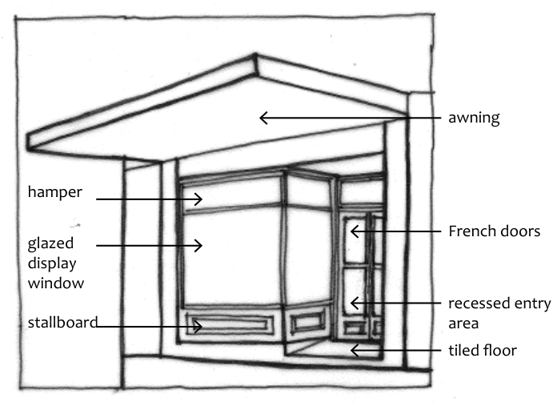
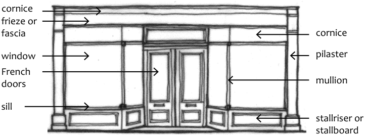

### D9.6 Commercial, industrial and public buildings

#### Explanation

Part D: Heritage

Commercial, industrial and public buildings have always been an important feature of Blue Mountains towns. Many town centres have significant buildings with architectural styles that include the Victorian, Federation and the Inter- War periods and date from the 1860s to the 1940s. Public building types include shops, hotels, hospitals, churches, schools, post office buildings, police stations, courthouses and railway stations. Building materials include stone, brick, stucco, render and timber. Early industrial buildings are also spread throughout the LGA with a variety of forms, materials and intactness and may include garages, workshops, service stations and light industry factories. These buildings sometimes have a monumental but simple ‘shed’ aesthetic of brick and corrugated iron. Some industrial buildings are not conventionally considered ‘attractive’ due to their basic functionality but have an important aesthetic significance and sometimes technical significance associated with industrial practices. Traditional shopfront buildings are dealt with in the following part D9.7 Traditional shopfront buildings.

#### Objectives

O1. To retain forms, significant elevations, details and finishes of commercial, industrial and public buildings.

O2. To retain good representative examples of significant architectural styles in the historic development of commercial, industrial and public buildings.

#### Controls

C1. Principal building forms are to be retained.

C2. Significant architectural elevations and significant finishes and details are to be retained.

C3. New work for the adaptive re-use of a building is to be consistent with the overall character of the building type, its architectural style and its context.

D9.7 Traditional shopfront buildings (Late Victorian, Federation,

### Edwardian and Inter-War c.1890-c.1945)

Part D: Heritage

Most of the Blue Mountains village centres have historic shopfronts which are remnants of the growing tourist industries and town development of the late 19th and early 20th centuries. There are substantial numbers of traditional shopfront buildings, particularly in Blackheath, Katoomba and Leura. These retail precincts are notable for their intact historic character and compact form and the older retail buildings are representative of early twentieth century forms, being narrow two- or three-storey masonry buildings with parapets to the street, an iron skillion roof behind, and with shopfronts opening to the footpath and a small residence or commercial space on the level above. Many are heritage-listed. The cohesiveness of these retail areas is derived from the continuous planes of the upper level parapet forms and over-footpath awnings. Traditional shopfront detailing is diverse, which adds appeal and visual interest to the overall streetscape. This section applies to traditional shopfront buildings dating from the Late Victorian, Federation, Edwardian and Inter-War periods (c.1890 – c.1945). This includes buildings listed as heritage items or within heritage conservation areas but is also relevant to those shopfront buildings within specific town centre precincts identified in Part G of this DCP. Specific precinct controls are identified in Part G Locality Management. Characteristics of original shopfronts include:

• decorative facades and parapets

• bronze alloy or timber shopfront framing with large display windows

• recessed and tiled entries or ‘in-gos’

• steel awnings suspended from the first floor facade

• decorative joinery

• patterned terrazzo floor tiling

• glazed enamel wall tiling

• leadlight glass

• roofs generally simple skillion forms falling to the rear of the property from behind the parapet in a single long slope

> [Picture on page 39: a picture, saved as a picture (images/part-d-heritage-management-page-39-8.gif, 150 dpi).]
> Words printed on the picture (copied from the PDF):
> hamper
> glazed
> display
> window
> stallboard

awning

French doors

recessed entry area

Part D: Heritage

tiled floor

Part D - Figure 4: Traditional shopfront elements. A single frontage is the most common type of shopfront in the Blue Mountains.

> [Picture on page 39: a picture, saved as a picture (images/part-d-heritage-management-page-39-17.gif, 150 dpi).]

cornice

cornice

frieze or fascia

pilaster

window

mullion

French doors

sill

stallriser or stallboard

Part D - Figure 5: Double-fronted shopfront type

#### Objectives

O1. To preserve the original and early fabric of traditional shopfront buildings.

O2. To ensure restoration, reconstruction and infill development involving traditional shopfronts is in accordance with, or sympathetic to, traditional shopfront design and detailing, and that adverse impacts and loss of fabric is minimised. Refer to Figures 4 and 5 above.

O3. To ensure new development near or adjacent to traditional shopfront buildings is sympathetic to the historic character, and where relevant, the heritage significance, of shopfronts and streetscapes.

#### Controls

Original fabric and restoration

C1. Development applications relating to significant shopfront buildings must demonstrate an understanding of the style and period of the shopfront, particularly where the site is part of a group.

C2. All original or early shopfronts and any associated fabric are to be retained and conserved where significant, including tiled and terrazzo flooring to shop entrances.

Note: Where accessibility requirements conflict with the original fabric of shop entry areas, a solution is to be reached that appropriately balances conflicting requirements.

Part D: Heritage

C3. The internal layout and structural walls of residential shop-top housing that forms part of a traditional shopfront building is generally to be retained.

C4. Where original shopfronts or facades have been altered, significant contributory detailing and other characteristic elements are to be reinstated where there is evidence of the original style or detailing on the building or within the row or group.

C5. Repairs or replacement of traditional shopfront fabric must retain the ‘in-go’ (recessed entry) form of the shopfront where existing.

C6. Where there is evidence of early suspended streetfront awnings, such as original suspension points and suspension devices, these are to be retained or reinstated where possible.

New shopfronts and infill

C7. New work must respect the traditional patterns of the shopfronts in the wider streetscape.

C8. New work must respect the differing street frontage conditions of other building types such as former post offices, churches, hotels and early office buildings. Conversion of these building types to shopfronts is not generally supported.

C9. New forms, materials and details should match or be sympathetic to the (predominant) style and period of the wider streetscape.

C10. New shopfronts may be contemporary in style, but respond to the characteristic elements of traditional and significant shopfronts in the surrounding area, including coursing lines, window arrangements, surface treatments, and awning details.

C11. The whole of the frontage at ground floor should be glazed within an appropriate framing structure, except where there is a side entry to an upper level.

C12. A recessed entry should be provided.

C13. Detailing is to use Part D - Figure 4 and 5 as a guide to new development.

Part D: Heritage

C14. New street verandahs or balconies of infill development are not to imitate or replicate traditional verandah or balcony detailing, but are to reference traditional forms using contemporary design and traditional materials where possible.

C15. Blanking out of glazed areas with signage or opaque film is not supported.

C16. Roller shutters are not acceptable for shopfront windows. Traditional black scissor-grilles should be used for security if required.
