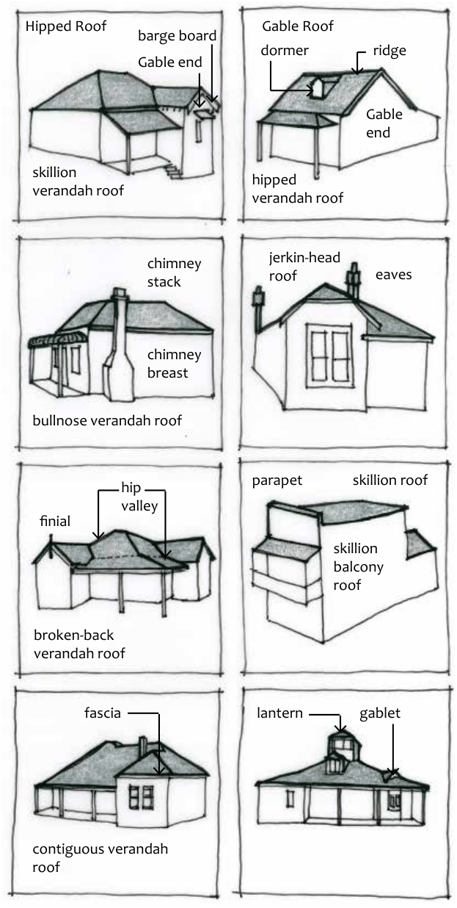

### D10.2	 Roof forms

#### Explanation

Traditional roof forms vary with the layout of the building. Most roofs will begin with a main roof form of a rectangular hipped form or gable over the principal building, which is then modified with the addition of gables or further hipped forms over front, rear or side projections. The layout of the building interior and external walls determine the ultimate form of the roof; the interior, walls and roof must function harmoniously to create the most functional and pleasing internal and external forms. Refer to Part D - Figure 6 for roof forms and terms. The angle of roof pitch is an important indicator of roof form. Traditional roof pitches are around 35 degrees. The pitch of roof should remain constant throughout the primary building, as differing degrees of pitch usually create problems. Roofs became more gently pitched in the Inter-War and Post-War periods. Commercial buildings usually have a brick parapet wall to the streetfront, with a simple and long skillion form concealed behind the parapet over the shop itself to the rear. Detailing of ridges, eaves, gutters and downpipes, gable ends all affect the appearance and character of the roof.

Part D: Heritage

#### Objectives

O1. To retain and conserve the original forms of roofs and their associated detailing and components.

O2. To ensure that new roofs are compatible in design, form and construction with traditional roofs.

#### Controls

C1. The original roof form is to remain the dominant built element.

C2. The roof forms of alterations and additions are to be consistent and or compatible with the forms, pitch and detailing of the primary roof.

C3. The ridgeline of any new roof is to match or be lower than that of the primary roof. An exception may be alterations and additions to the rear where a separate pavilion roof is not visible from the street.

C4. Existing roofs are not to be re-pitched to accommodate attic development.

C5. Dormer windows to front roof planes are not likely to be supported unless there is evidence of their previous existence.

C6. If an attic development is proposed, dormers and/or skylights are only to be constructed in the rear roof planes, or side planes if not visible from the public domain. Support for dormers will generally be a merit-based assessment dependant on individual circumstances.

> [Picture on page 50: a map, saved as a picture (images/part-d-heritage-management-page-50-5.gif, 150 dpi); the street names and other small labels are on the picture.]
> Labels printed on the map (copied from the PDF, in no particular order):
> Gable Roof · Hipped Roof · barge board · ridge · dormer · Gable end · Gable · end · skillion · verandah roof · hipped · verandah roof · eaves · jerkin-head · roof · chimney · stack · chimney · breast · bullnose verandah roof · parapet skillion roof · hip · valley · finial · skillion · balcony · roof · broken-back · verandah roof · fascia · lantern gablet · contiguous verandah · roof

Part D: Heritage

Part D - Figure 6: Traditional roof forms and roof elements.
