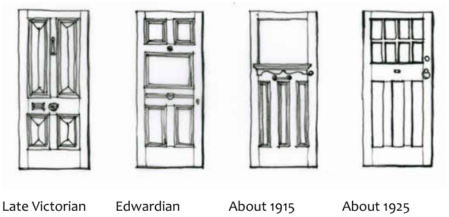

### D10.4	 Windows and doors

#### Explanation

The majority of window types available in the late nineteenth and early twentieth century were double-hung timber-framed sash windows. Windows are commonly rectangular in shape and vertically-proportioned. Where a larger opening was desired, windows were set in groups. Casement windows became popular in the Federation period. Often these were grouped in threes. The number of panes reflected stylistic fashions and advances in the manufacture of the size of sheets of glass. In the Federation period both casements and double-hung windows were sometimes embellished with additional glazing bars, panes and coloured and patterned glass. Decoration was focussed on the street elevation where it could be shown off to advantage. Windows to the rear of properties remained plain.

Part D: Heritage

Bay windows to front gables and side windows often have a protective window hood or awning supported on decorative timber brackets. The front door was the most elaborate door of the house, commonly featuring moulded and recessed timber panels, with glass panels textured, patterned, etched and or coloured. Around 1910 the front door was commonly ‘high-waisted’, with the central cross beam of the door structure raised above the centre of the door. Doors to verandahs were usually timber French doors. More elaborate doors had fanlights above the door and/or sidelight windows to either side of the front door.

#### Objectives

O1. To retain original doors and windows and their associated detailing and joinery components.

O2. To reinstate traditional windows and doors consistent with the architectural style of the building on significant elevations facing streets.

O3. To retain the visual prominence of windows and doors visible from the public domain.

#### Controls

C1. Door and window style is to be appropriate to building style and period. Refer to Part D - Figures 7 and 8.

C2. Vertical proportions of existing openings are to be retained, and new windows and doors are to be of vertical proportions.

C3. The installation of double glazing to original windows must not be apparent from the external face of the window.

C4. Security bars, mesh or roller shutters are not likely to be supported, particularly where visible from the public domain.

> [Picture on page 53: a picture, saved as a picture (images/part-d-heritage-management-page-53-10.gif, 150 dpi).]

Late Victorian Edwardian About 1915 About 1925

Part D: Heritage

Part D - Figure 7: Door types of the Victorian, Federation and Inter- War periods. Source: “How to Restore the Old Aussie House”, Ian Stapleton, Flanner Flower Press, 1991

Early Victorian c.1830-1850

Mid Victorian c.1850-1870

Late Victorian c.1890-1910

Federation/ Edwardian c.1900-1910

Federation/ Edwardian c.1915

Art Noveau leadlight c.1900- 1915

Art Deco leadlight c.1915- 1940

Part D - Figure 8: Window types of the Victorian, Federation and Inter-War periods
