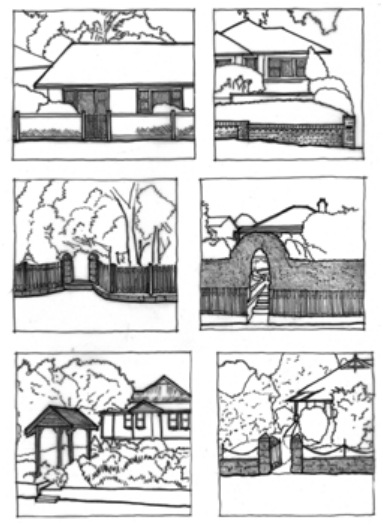

### D10.7	 Fences, walls and gates

#### Explanation

Front fences and gates are often the first thing that is seen when approaching a heritage property and can set the tone for the rest of the experience. Fences should be of an appropriate style to ensure they match the house and provide a harmonious setting. The most critical component of a fence is the material choice: the fencing material should always match the primary building material. Timber houses generally had timber fencing; brick houses had brick fencing. Fencing panels may match the balustrading on the front verandah. Fences can also dominate the streetscape, block neighbourhood surveillance, and reduce social interaction. Tall blank fences facing the street are particularly unsympathetic as they separate the house from the public domain.

#### Objectives

O1. To retain original walls, fences and gates. O2. To reinstate traditional fences and gates on street frontages in a style and manner consistent with the existing buildings.

O3. To maintain traditional heights of fences and their elements.

Part D: Heritage

#### Controls

C1. Original fences and gates are to be retained and repaired as necessary. Details and heights must match the existing where repairs occur.

C2. Fences forward of the building line are to be consistent in materials and detail with the period and/or style of the primary building, and to be semi-transparent to allow views through to the front setback.

C3. New fences are to be compatible with surrounding development.

C4. Fence heights forward of the building line are to be a maximum of 1.2m high.

C5. If a higher fence is supported by Council for particular circumstances, it should be screened with planting at the boundary line, which may require the fence to be set back within the existing property boundary.

C6. Colorbond or other sheet fencing is not appropriate for any boundary fence and is unlikely to be supported. Side and rear fencing should be unpainted timber palings.

C7. Gates are to extend to no higher than the top of the fence.

C8. Elaborate worked metal gates (including security gates) are not likely to be supported.

> [Picture on page 57: a picture, saved as a picture (images/part-d-heritage-management-page-57-3.gif, 150 dpi).]

Part D: Heritage

Part D - Figure 9: fencing is to match or be sympathetic to the character of the building. Edwardian and Federation timber buildings usually have timber picket fences and brick buildings of the Inter-War period usually have low brick fences.
