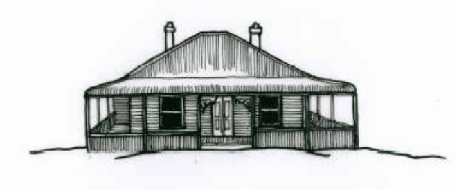
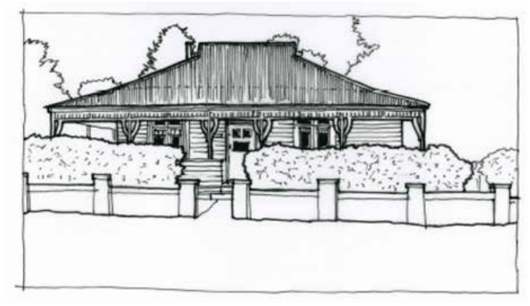
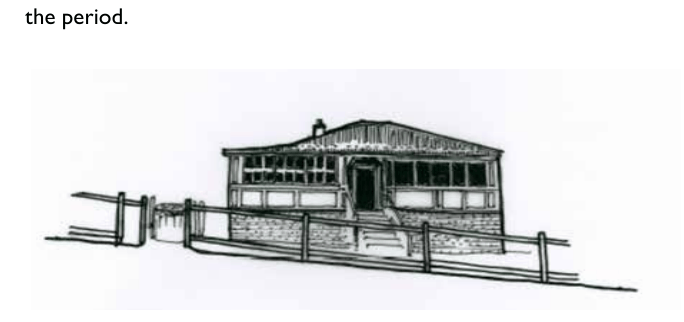
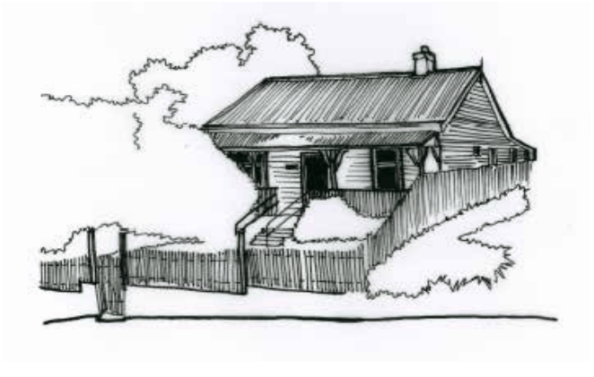
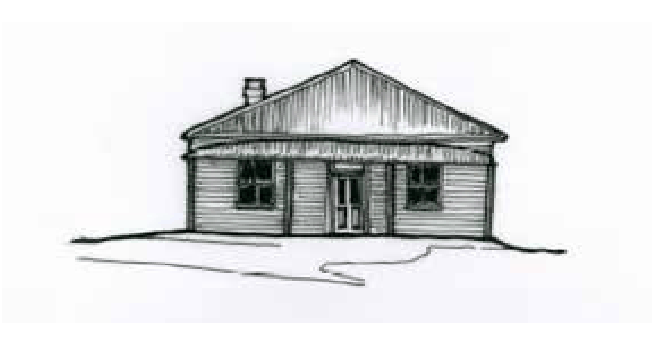
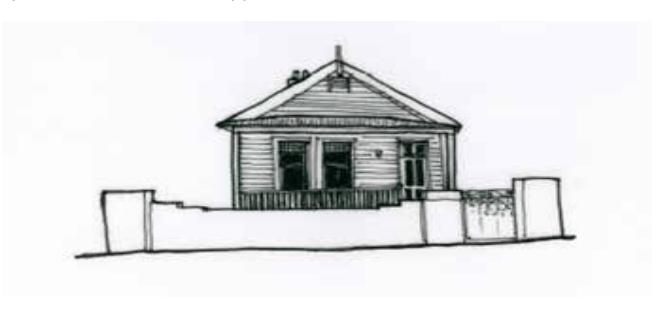
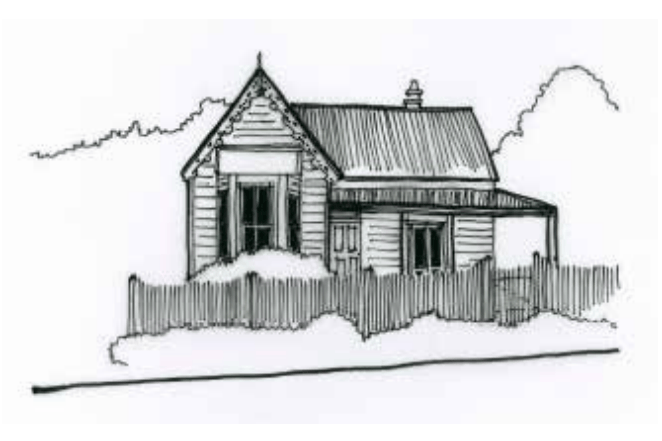
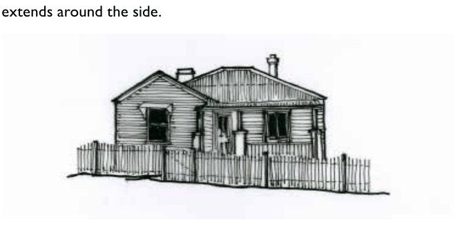
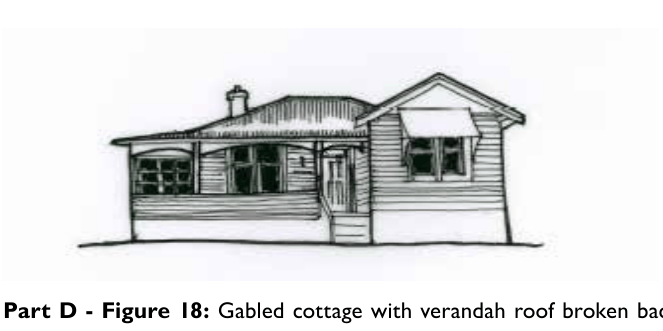
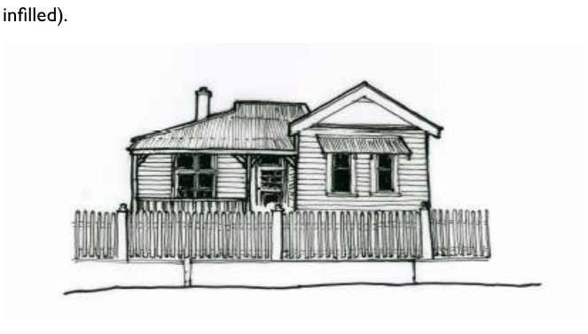

### D12.1	 Timber cottages (Late Victorian to Federation, c.1890 –

### c.1915)

#### Farmhouse cottages

Part D: Heritage

The farmhouse cottage form references the early verandahed buildings of the Colonial and Victorian periods, and is based on a simple and symmetrical layout of four rooms arranged around a central hallway, with a central front door. The cottage is usually centrally placed on a wide block and positioned to address the street. The early cottages are set close to the ground usually raised on stumps or brick piers where required by the site topography. Basic features of the farmhouse cottage include:

•	 Single-storey generous form, with verandahs creating a wider frontage.

•	 Garages, sheds and outbuildings were separate structures at the rear of the site.

•	 Corrugated iron roof with one or two chimneys.

•	 Simple timber double-hung sash windows with clear glass.

•	 Chimneys of brick with round terracotta pots.

•	 Prominent wide verandahs encircle three sides.

•	 Front fences and gates were simple in design, generally timber pickets or woven wire on timber frames.

•	 Utility rooms such as kitchens and bathrooms were provided under skillion roofs to the rear or in separate outbuildings.

•	 Vertically-proportioned windows symmetrical to the main façade.

•	 Larger lots had hedging or windbreak trees at the frontage.

•	 Timber weatherboards with rusticated weatherboards to the front elevation.

•	 Specimen tree plantings were popular, along with fruiting trees in back gardens.

•	 Timber-framed doors.

> [Picture on page 73: a picture, saved as a picture (images/part-d-heritage-management-page-73-1.gif, 150 dpi).]

Part D - Figure 10: Simple symmetrical farmhouse cottage c.1900 with wraparound verandah.

> [Picture on page 73: a picture, saved as a picture (images/part-d-heritage-management-page-73-4.gif, 150 dpi).]

Part D: Heritage

Part D - Figure 11: Farmhouse cottage c. 1910 with verandah roof ‘broken back’ to the main roof (change of roof pitch), and decorative verandah detailing including timber frieze with spindles and decorative posts and brackets. Brick fence is uncharacteristic; a timber picket fence would be more appropriate to the period.

> [Picture on page 73: a picture, saved as a picture (images/part-d-heritage-management-page-73-11.gif, 150 dpi).]

Part D - Figure 12:  Traditional variations on the farmhouse cottage include the enclosing or partial enclosure of front verandahs with lightweight fibro walls and banks of casement-style sliding or fixed windows.

#### Simple cottages

The simple cottage form had a similar room layout to the farmhouse cottage, with rooms arranged around a central hallway, although more modest variations were single-fronted, with only one room wide aside the hallway. Timber joinery appears throughout, with generally a fireplace to the front room/s and also the rear kitchen. Attic additions are rare due to the pitch of the roof, but occasionally symmetrically-placed vertically-proportioned dormers are an early addition. Rear additions are built either as a wing or across the width of the cottage. Typical features include:

•	 Single-storey modest form.

•	 Vertically-proportioned windows and doors.

•	 Verandah across the front only; simple skillion, hipped or bullnose shape.

•	 Utility rooms such as kitchens and bath-rooms were provided under skillion roofs to the rear or in separate outbuildings.

•	 Timber weatherboards and corrugated iron roofing.

•	 Front fences and gates were simple in design, generally timber pickets or woven wire on timber frames.

•	 Generally limited or basic decorative elements.

•	 Specimen tree plantings were popular, along with fruiting trees in back gardens.

Part D: Heritage

•	 Fences to back gardens were generally paling fences 1.8m high, or strung wire.

•	 Built on narrower or smaller lots closer to town centres with a long narrow building form.

•	 Symmetrical forms where double-fronted. •	 Garages, sheds and outbuildings were

separate structures at the rear of the site.

•	 Brick chimney to one side.

> [Picture on page 74: a picture, saved as a picture (images/part-d-heritage-management-page-74-37.gif, 150 dpi).]

Part D - Figure 13: Simple cottage c.1910s with skillion verandah roof and symmetrical window and door arrangement.

> [Picture on page 75: a picture, saved as a picture (images/part-d-heritage-management-page-75-1.gif, 150 dpi).]

Part D - Figure 14: Simple unadorned weatherboard cottage c.1905 with symmetrical form and hipped bullnose roof to verandah.

> [Picture on page 75: a picture, saved as a picture (images/part-d-heritage-management-page-75-4.gif, 150 dpi).]

Part D: Heritage

Part D - Figure 15: Simple single-fronted cottage of narrow form commonly found in groups of narrower subdivisions. Single room width plus hallway. Hipped verandah roof. Uncharacteristic brick wall and gate from a later period.

#### Gabled cottages

Gabled cottage forms are similar in materials and details to the earlier and more basic cottage forms, but the most noticeable change is the L-shaped plan that created a projecting room with a gable end that presents to the street.  The remainder of the front elevation usually contains a verandah to act as a porch and shelter the entry door. The asymmetrical presentation to the street became popular in the late Victorian period when free-standing buildings became more common and more diverse. This style of form and plan was increasingly used after 1850, and became typical after 1900. Many basic elements were retained from the farmhouse cottage style. Typical features of the form include:

•	 Single-storey modest form.

•	 Central entry door is now within an offset front-facing verandah.

•	 Roofs generally clad in corrugated iron. •	 Windows to side elevations and to the

front gable, where not protected by the verandah, were often protected by a simple fixed awning.

•	 Front fences matched the materials of the house; weatherboard houses had simple pickets.

•	 Timber joinery for verandah construction such as turned or plain posts, brackets, friezes and spindles. Simple or ornate detailing to timber work.

•	 Vertically-proportioned timber windows and doors.

•	 Traditional variations included the return verandah which extended along the side and terminated in a second gabled room that extended over the garden elevation.

•	 Windows becoming more decorative, with small panes of coloured or plain glass appearing in the Federation period.

•	 The timber gable sometimes had a timber finial or other relatively simple details such as decorative barge boards or tim-ber battening in a pattern layout.

•	 Solid brick chimney form.

> [Picture on page 76: a picture, saved as a picture (images/part-d-heritage-management-page-76-22.gif, 150 dpi).]

Part D: Heritage

Part D - Figure 16: High-pitched gabled cottage c.1905 with decorative timber barge board to gable. The pitch is reminiscent of the Victorian era. The verandah

> [Picture on page 76: a picture, saved as a picture (images/part-d-heritage-management-page-76-26.gif, 150 dpi).]

extends around the side.

Part D - Figure 17: Simple gable-front timber cottage c.1910, unusually with brick piers to verandah posts. No decoration to the front gable.

> [Picture on page 77: a picture, saved as a picture (images/part-d-heritage-management-page-77-1.gif, 150 dpi).]

Part D - Figure 18: Gabled cottage with verandah roof broken back to the main roof, timber arches to verandah instead of brackets, and verandah-end infilled sympathetically to create additional internal space. Front verandah infilled with weatherboards, and originally returned around the side elevation (now infilled).

> [Picture on page 77: a picture, saved as a picture (images/part-d-heritage-management-page-77-7.gif, 150 dpi).]

Part D: Heritage

Part D - Figure 19:  Gabled cottage with Federation detailing including coloured glass panes to windows and fanlight, two separate gable windows and plastered gable end.
