### D12.2	 Bungalows (Federation and Inter-War periods c.1910 –

### c.1945)

#### Federation bungalows (including Arts & Crafts & Queen Anne styles)

The Federation Bungalow style was the Australian response to the bungalow style that was developing in America. It can be seen as a transition phase between the Federation Queen Anne style and the later Californian Bungalow style that brought American Craftsman style to the world. Stylistically, it exploited the qualities of the bungalow while frequently retaining the flair and idiosyncrasies of the Queen Anne style, although usually in simplified form.

Queen Anne style influences include:

•	 Terracotta detailing

•	 White painted ornate timber joinery to verandahs

Arts and Crafts influences include:

•	 Leadlight glass in windows and front door panes

•	 Increasing heaviness of timber joinery and simplification of detailing

•	 Shingles to verandahs, awning roofs and gables

•	 Increasing emphasis on presentation of a solid front verandah, often with heavy brick piers

•	 Increasing horizontality of building form

•	 The new terracotta Marseille tiles which arrived in Australia around 1890

•	 High-waisted front doors

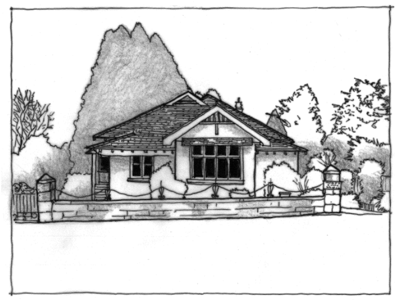

> [Picture on page 78: a picture, saved as a picture (images/part-d-heritage-management-page-78-21.gif, 150 dpi).]

Part D: Heritage

Part D - Figure 20: Expressed roof structure through visible beam ends, low stone wall, slate roof and strong details give this Federation Bungalow a solid rustic appearance

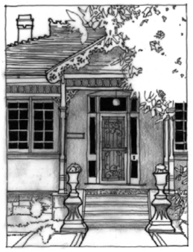

> [Picture on page 79: a picture, saved as a picture (images/part-d-heritage-management-page-79-1.gif, 150 dpi).]

Part D - Figure 21: Intricate timber detailing to gable ends, verandah posts, brackets and frieze are contrasted with fine tuckpointed brickwork giving this Federation bungalow a high level of technical expertise of construction

#### Californian and Inter-War weatherboard bungalows

Part D: Heritage

Bungalows in the Blue Mountains continued the preference for timber weatherboards over brickwork, although examples of both brick and timber can be seen. The new stylistic influences of the American Craftsman style were coming more into play, in particular the following:

•	 Timber battened gables

•	 Heavy verandah forms across the front-age with solid brick piers

•	 Shingles to gables and verandah roofs •	 Gables might have roughcast render

•	 Roof forms often became a double-gable form, and verandahs were often in the front gable, which could be enhanced with large masonry piers supporting the roof gable

•	 Infill of front verandahs is common in the upper Mountains to form a front porch area insulated from the main house. Many are highly sympathetic and do not detract from the significance or appearance of the building

•	 Increasing horizontality through lower roof pitch, horizontal window sets, longer verandahs and wider forms

•	 Honest expression of structure by the addition timber brackets and rafters at eaves, under window sills and at gable barge boards

•	 Fences were low or transparent to show off the garden

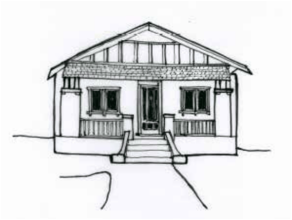

> [Picture on page 80: a picture, saved as a picture (images/part-d-heritage-management-page-80-1.gif, 150 dpi).]

Part D - Figure 22: Weatherboard bungalow c.1920 with symmetrical layout, heavy verandah posts and shingled verandah roof, showing influences from the Californian Bungalow style.

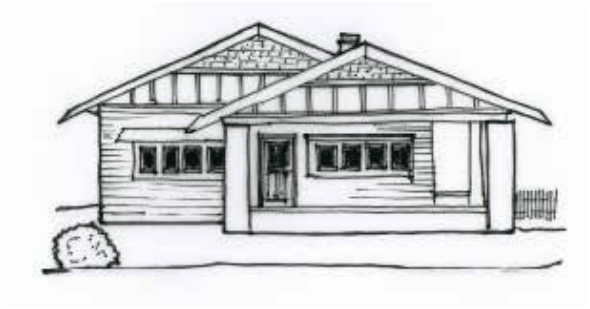

> [Picture on page 80: a picture, saved as a picture (images/part-d-heritage-management-page-80-5.gif, 150 dpi).]

Part D: Heritage

Part D - Figure 23: Weatherboard bungalow c.1920 with double frontage, heavy verandah posts and shingled and battened gables, with leadlight windows, showing influences from the Californian Bungalow style.

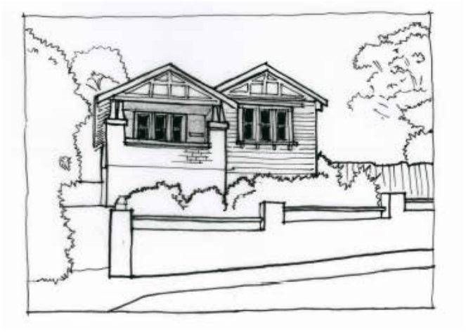

> [Picture on page 81: a picture, saved as a picture (images/part-d-heritage-management-page-81-1.gif, 150 dpi).]

Part D - Figure 24: Weatherboard bungalow c.1920s with double frontage and heavy brick verandah showing influences from the Arts and Crafts and Californian Bungalow style.

#### Inter-War Old English brick bungalows

Part D: Heritage

Brick houses became highly desirable following World War One, and bungalow styles diversified into a variety of types. The Old English style of bungalow or cottage involved a certain sentimental attachment to the English vernacular style, which had originally referenced Tudor buildings. Typical Old English bungalows in the Blue Mountains were highly simplified, but used features such as dark face brickwork and Marseille tiles with leadlight windows to create a house of solid and comfortable appearance. In the Inter-War period leadlight glass became popular, and gable-front windows became projecting bays.

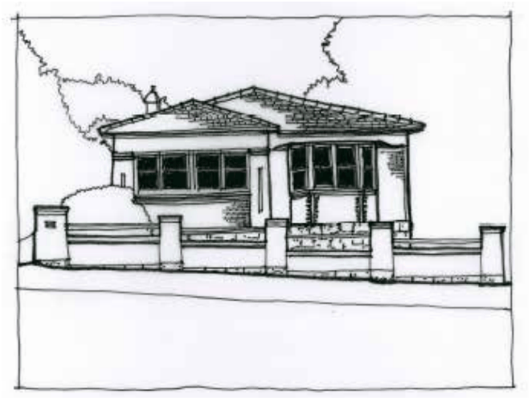

> [Picture on page 82: a picture, saved as a picture (images/part-d-heritage-management-page-82-1.gif, 150 dpi).]

Part D - Figure 25: Solid and well-constructed Old English style of bungalow c.1930s with brick and tile appearance, but enhanced by two-tone brickwork in quoins to bay window structure and leadlight windows. Frontage formed from bay window and verandah (now sympathetically infilled with matching windows), with roof form hipped over verandah (note lack of gable form). Roof pitch has decreased from previous styles.

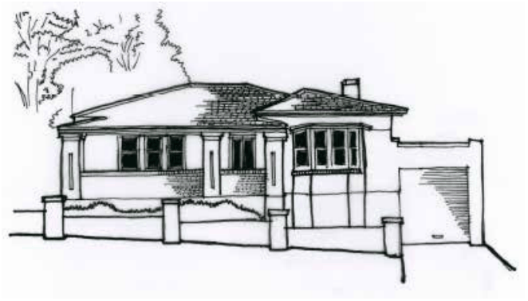

> [Picture on page 82: a picture, saved as a picture (images/part-d-heritage-management-page-82-8.gif, 150 dpi).]

Part D: Heritage

Part D - Figure 26: Solid and comfortable Old English style of bungalow c.1930s with garage structure attached at side. Similar to previous figure but note variation on roof form with roof hipped over bay window and verandah roof incorporated into main roof. Roof pitch has decreased from previous styles.

#### Inter-War Arts and Crafts brick bungalows

As the bungalow style developed, an infinite variety of forms and features proliferated. As the bungalow style gained popularity during the Inter-War years, the style become more solid, horizontal and rustic, with brick, stone and roughcast render more common than weatherboard as a wall material.

Verandahs become deeper and more enclosed, and the heavier construction of the house gave a more solid and cosy appearance. The range of detailing employed by builders working in a vernacular of cottage and bungalow styles is part of the charm of the Blue Mountains town character, and where consistent streetscapes exist, a major contributor to cultural heritage significance.

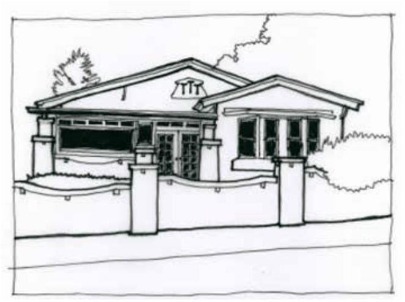

> [Picture on page 83: a picture, saved as a picture (images/part-d-heritage-management-page-83-7.gif, 150 dpi).]

Part D: Heritage

Part D - Figure 27: Arts and Crafts detailing is a feature of this gable-end bungalow, which displays a heavy verandah structure (now sympathetically infilled), roughcast render, and expression of structure through small corbels to the post caps, fence cap, window sills and brackets to the eaves.

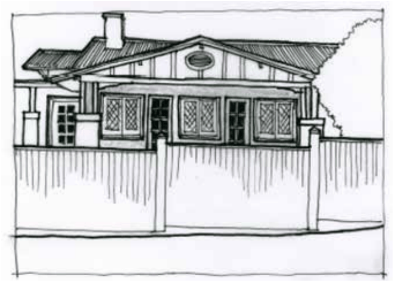

> [Picture on page 83: a picture, saved as a picture (images/part-d-heritage-management-page-83-13.gif, 150 dpi).]

Part D - Figure 28: Although partially hidden behind a high fence, this c.1930s bungalow demonstrates the heavy horizontal form of an American Craftsman gable end across the frontage, with double posts over brick piers, fine joinery,

battened gabling and leadlight windows. A mixture of Arts and Crafts and Old English details.

#### Inter-War Art Deco and Mediterranean brick bungalows

During the Inter-War period, Modernism and other international styles became known and popularised worldwide. This allowed a freer rein in style, producing detailing that often blended diverse aesthetics and mixed stylistic references.

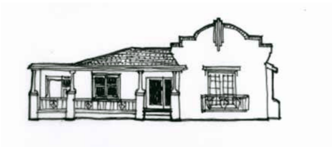

> [Picture on page 84: a picture, saved as a picture (images/part-d-heritage-management-page-84-7.gif, 150 dpi).]

Part D - Figure 29: Inter-War face brick cottage c.1930s with decorative gable showing an amalgam of international influences including Art Deco and Mediterranean.

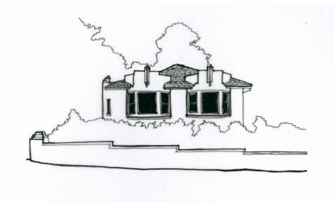

> [Picture on page 84: a picture, saved as a picture (images/part-d-heritage-management-page-84-11.gif, 150 dpi).]

Part D: Heritage

Part D - Figure 30: Pure Art Deco brick cottage, with matching strong faceted Art Deco forms of bay windows topped by Art Deco parapets and geometric central brick feature elements.

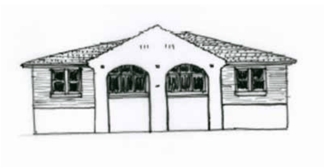

> [Picture on page 85: a picture, saved as a picture (images/part-d-heritage-management-page-85-1.gif, 150 dpi).]

Part D - Figure 31: Simple brick semi-detached cottages c.1930a with Mediterranean style influences of Marseille tiles and rendered classical arched verandahs (now infilled). Small tiles are embedded in the rendered façade. Leadlight windows.
